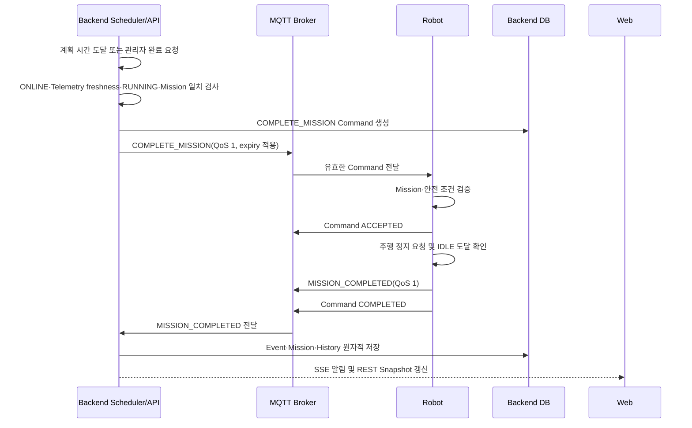

# 미션 완료 및 서버·로봇 동기화 계약

> 상태: 로컬 1차 구현·자동 검증 완료, 배포 전(Outbox 기능 미제공)  
> 대상: Backend, Web Frontend, AGS1/Jetson Robot  
> 기준 계약: MQTT v2  
> 최종 수정일: 2026-08-06

## 1. 목적

시간 기반 미션의 완료 시점은 서버가 결정하고, 실제 주행 종료 여부는 로봇이
확인한다. 서버는 로봇의 완료 이벤트를 DB에 저장한 뒤에만 미션을 최종 완료로
확정한다.

이 문서는 다음 문제를 방지하기 위한 공통 계약이다.

- 오프라인 로봇에 만료될 완료 명령을 반복 발행하는 문제
- 서버는 `RUNNING`이지만 로봇에는 활성 미션이 없는 상태 불일치
- 명령 결과만 성공하고 `MISSION_COMPLETED` 이벤트가 유실되는 문제
- 자동 완료와 관리자 수동 완료를 구분할 수 없는 문제
- 로봇 재부팅 또는 통신 단절 후 완료 이벤트 유실 범위와 운영 대응

## 2. 책임과 최종 성공 기준

### 2.1 책임 분리

| 주체 | 책임 |
| --- | --- |
| 서버 | 계획 시간 도달 판단, 완료 명령 생성, 이벤트 저장, 최종 업무 상태 확정 |
| 로봇 | 명령 검증, 실제 정지, `IDLE` 도달 확인, 완료 이벤트 발행 |
| MQTT Broker | QoS 1 전달과 유효 기간 내 세션 메시지 보관 |
| Web | 서버가 확정한 미션 상태 표시, 불일치와 확인 필요 상태 안내 |

`progress_percent`는 완료 명령의 조건이 아니다. 실행 중 진행률은 서버가 로봇의
`mission.elapsed_sec`로 계산하며 최대 `99.99`로 제한한다. `100`은
`MISSION_COMPLETED` 이벤트를 DB에 저장한 결과다.

따라서 관리자의 완료 버튼은 진행률이 `100%`가 아니어도 사용할 수 있다. 버튼은
Mission을 즉시 완료 처리하지 않고 `COMPLETE_MISSION` 명령을 생성하며, Robot이
정지 후 보낸 `MISSION_COMPLETED`가 저장되어야 화면과 DB가 `COMPLETED·100%`가 된다.

### 2.2 최종 성공 기준

다음 조건을 모두 만족해야 미션 완료 성공으로 판정한다.

```text
MISSION_COMPLETED 이벤트 DB 저장 완료
AND robot.mission.status = COMPLETED
AND robot.mission.progress_percent = 100
AND COMPLETED 상태 이력 저장 완료
```

`SENT`, `ACCEPTED`, Command Result의 `COMPLETED`는 명령 처리 상태일 뿐 미션의
최종 성공 조건이 아니다.

## 3. 정상 완료 흐름



`ACCEPTED`는 명령의 검증 및 정지 요청 접수를 의미한다. 실제 정지와 미션 완료는
`MISSION_COMPLETED` 이벤트로 확인한다. 로봇 구현이 기존의
`STOP_BEFORE_REPORTING` 의미를 유지한다면 `ACCEPTED`가 `IDLE` 도달 후에 발행된다는
사실을 Backend timeout 정책과 운영 문서에 명시해야 한다. 권장안은 검증 직후
`ACCEPTED`를 발행하고 최종 성공은 이벤트로 분리하는 것이다.

## 4. 자동 완료 전제조건

서버는 5초 주기 검사 또는 로봇 재연결 알림을 받았을 때 아래 조건을 모두 만족하는
미션에만 새로운 `COMPLETE_MISSION`을 생성한다.

```text
mission.deleted_at IS NULL
AND mission.status = RUNNING
AND mission.started_at IS NOT NULL
AND started_at + planned_duration_sec <= now
AND robot.operational_status = ACTIVE
AND robot_current_state.connectivity_status = ONLINE
AND 최신 telemetry 수신 시각 >= now - completion_telemetry_max_age
AND robot_current_state.mission_id = 대상 mission_id
AND robot_current_state.mission_status = RUNNING
AND 직전 동일 COMPLETE_MISSION이 없거나 EXPIRED 상태임
```

권장 기본값은 `completion_telemetry_max_age = 15s`이며 운영 설정으로 변경할 수 있게
한다. Presence가 `ONLINE`이어도 최신 Telemetry가 없으면 실제 상태를 신뢰하지 않고
완료 명령을 보류한다.

오프라인 또는 Telemetry stale 상태에서는 Command 행을 생성하지 않는다. 미션은
`RUNNING`으로 유지하되 Web에는 파생 상태인 `완료 대기(로봇 연결 필요)`를 표시한다.

직전 완료 명령이 `CREATED`·`SENT`·`ACCEPTED` 상태이면 새 명령을 만들지 않는다.
명령이 `EXPIRED`로 확정된 뒤에만 최신 State·Telemetry를 다시 검증해 재시도한다.
이 순서를 지키지 않으면 재연결 직후 새 명령이 로봇의 pending 명령과 충돌해
`ALREADY_IN_STATE`로 거절될 수 있다.

다만 terminal result 이후 동작은 결과별로 다르다. `EXPIRED`는 최신 상태를 재검증해
새 명령을 만들 수 있다. `COMPLETED`인데 Mission Event가 없으면 이벤트 불일치로
대기하며 명령을 반복하지 않는다. `FAILED`·`REJECTED`는 확인 필요 상태로 두고 자동
재시도하지 않는다. 관리자가 원인을 해소한 뒤 수동 완료를 다시 요청할 수 있다.

계획 시간을 넘긴 `PAUSED` 미션은 자동 완료하지 않는다. 관리자가 재개하면 로봇의
`RUNNING` State·Telemetry를 확인한 다음, 이미 계획 시간이 지났다면 다음 5초 검사에서
즉시 완료 명령을 생성한다. 장기 PAUSED 종결은 자동 완료가 아니라 관리자 취소 정책으로
처리한다.

## 5. MQTT Payload 목표 계약

### 5.1 서버에서 로봇으로 보내는 완료 명령

Topic:

```text
tbs/v2/robots/{mqtt_id}/commands/request
```

자동 완료 예시:

```json
{
  "schema_version": "2.0",
  "command_id": "7b53b753-bd52-4bd2-9909-e347d13df916",
  "command_type": "COMPLETE_MISSION",
  "issued_at": "2026-08-05T05:30:00Z",
  "expires_at": "2026-08-05T05:30:30Z",
  "requested_by": {
    "actor_type": "SYSTEM",
    "actor_id": "MISSION-SCHEDULER"
  },
  "parameters": {
    "mission_id": "MIS-001",
    "completion_reason": "PLANNED_DURATION_REACHED"
  }
}
```

관리자 수동 완료에서는 다음 값을 사용한다.

```json
{
  "mission_id": "MIS-001",
  "completion_reason": "OPERATOR_COMPLETED"
}
```

허용 완료 사유:

| 값 | 의미 |
| --- | --- |
| `PLANNED_DURATION_REACHED` | 서버가 계획 시간 도달을 판단한 자동 완료 |
| `OPERATOR_COMPLETED` | 관리자가 화면 또는 API에서 요청한 수동 완료 |

`mission_id`는 DB UUID가 아니라 기존 MQTT 계약과 동일한 Mission 업무 코드다.

### 5.2 로봇에서 서버로 보내는 완료 이벤트

Topic:

```text
tbs/v2/robots/{mqtt_id}/events/mission
```

```json
{
  "schema_version": "2.0",
  "event_id": "354040e8-629e-4d01-85bb-ad5120f15e26",
  "event_type": "MISSION_COMPLETED",
  "mqtt_id": "RBT-001",
  "boot_id": "d71972f1-8a6d-47c5-8789-121450f3ae83",
  "seq": 182,
  "source_component": "mission",
  "occurred_at": "2026-08-05T05:30:07Z",
  "sent_at": "2026-08-05T05:30:07Z",
  "ttl_sec": 300,
  "mission_id": "MIS-001",
  "causation_command_id": "7b53b753-bd52-4bd2-9909-e347d13df916",
  "result": {
    "completion_reason": "PLANNED_DURATION_REACHED",
    "duration_sec": 600,
    "incident_count": 0,
    "normal_detection_count": 0
  }
}
```

Command로 발생한 `MISSION_COMPLETED`에는 `causation_command_id`가 필수다. 로봇이
경로 완료를 자체 판단하여 Event를 생성하는 정책을 추가할 경우에는 이 필드를
`null`로 허용하고 `completion_reason = ROUTE_COMPLETED` 같은 별도 사유를 계약에
추가한다.

### 5.3 Outbox 미제공과 Best-effort Receipt

Topic:

```text
tbs/v2/robots/{mqtt_id}/ingest/receipt
```

```json
{
  "schema_version": "2.0",
  "event_id": "354040e8-629e-4d01-85bb-ad5120f15e26",
  "ingest_status": "STORED",
  "incident_id": null,
  "received_at": "2026-08-05T05:30:08Z"
}
```

제품에서는 Robot과 Backend 모두 Application Outbox 기능을 제공하지 않는다. Robot은
단절 중 Event를 저장하지 않고 재연결 후 과거 Event 여러 건을 일괄 재전송하지 않는다.
`receipt_required: false`를 유지하며 다시 켜는 제품 설정도 제공하지 않는다.

Backend Receipt를 유지하는 경우 DB Transaction commit 후 한 번 발행하는
Best-effort 진단 정보로만 사용한다. Robot은 Receipt Timeout을 이유로 Event를
재전송하지 않는다. 단절 중이거나 발행에 실패한 Mission 완료 Event는 유실될 수 있으며,
이 경우 Backend는 Mission을 임의 완료하지 않고 확인 필요 상태로 유지한다.

## 6. 로봇 Command 처리 규칙

로봇은 `COMPLETE_MISSION` 수신 시 다음 순서로 검사한다.

1. `expires_at`이 지나지 않았는지 확인한다.
2. `parameters.mission_id`가 로컬 활성 Mission과 같은지 확인한다.
3. 로컬 `mission_state == RUNNING`인지 확인한다.
4. Drive FSM과 로봇 Mode가 `ESTOP` 또는 `SAFE_STOP`이 아닌지 확인한다.
5. 같은 `command_id`가 처리 중이거나 처리 완료됐는지 확인한다.
6. 검증 성공 후 주행 정지를 요청한다.
7. Drive FSM이 `IDLE`에 도달한 경우에만 완료 Event를 생성한다.

권장 결과 코드는 다음과 같다.

| 조건 | Command Result | reason_code |
| --- | --- | --- |
| 활성 Mission 없음 | `REJECTED` | `NO_ACTIVE_MISSION` |
| Mission ID 불일치 | `REJECTED` | `MISSION_MISMATCH` |
| Mission이 `RUNNING`이 아님 | `REJECTED` | `ALREADY_IN_STATE` |
| `ESTOP` 또는 `SAFE_STOP` | `REJECTED` | `SAFETY_CONDITION_NOT_CLEARED` |
| 유효 기간 경과 | `EXPIRED` | `OK`(기존 계약 유지) |
| 상태 반영 예외 | `FAILED` | `INTERNAL_ERROR` |

## 7. 예외 및 재연결 처리

| 상황 | 서버 처리 | 로봇 처리 | 최종 상태 |
| --- | --- | --- | --- |
| 계획 시간 도달, 로봇 Offline | 명령을 만들지 않고 재연결 대기 | 없음 | `RUNNING`, 완료 대기 표시 |
| Online이지만 Telemetry stale | 명령 보류, 경고 | State·Telemetry 재발행 | 신선도 회복 후 재평가 |
| 재연결, 동일 Mission `RUNNING` | 직전 명령 terminal/TTL 확인 후 새 TTL·새 command_id로 생성 | 정상 종료 수행 | Event 저장 후 `COMPLETED` |
| 재연결, 로봇 Mission 없음 | 자동 완료 전송 금지, 불일치 경고 | 현재 State 보고 | 관리자 조정 또는 정책상 `FAILED` |
| 재연결, 다른 Mission 실행 중 | 자동 완료 전송 금지, 심각 불일치 경고 | 현재 Mission 유지 | 관리자 조정 |
| `SAFE_STOP` | 자동 완료 금지 | 안전 상태 유지 | 해제·재개 후 다시 평가 |
| Command `EXPIRED` | 미션 완료 금지, 조건 재검사 후 새 명령 | 만료 명령 실행 금지 | 새 명령 또는 대기 |
| `REJECTED`/`NO_ACTIVE_MISSION` | 무한 자동 재시도 금지 | 실제 상태 재보고 | 확인 필요 상태 |
| Command 완료, Event 미수신 | 완료 확정 금지, 불일치 경고 | 재연결 후 최신 State 보고 | 관리자 확인 또는 별도 Reconciliation |

오프라인 중 Broker에 쌓인 만료 Command를 실행해서는 안 된다. Backend는 MQTT 5
Message Expiry를 설정하고 Robot도 Payload의 `expires_at`을 다시 검사한다.

## 8. 재부팅과 최소 영속 상태

블랙박스 또는 영상 저장 기능을 제거해도 다음 상태 저장은 별도 기능으로 유지해야
한다.

- 현재 `mission_id`
- `mission_state`
- `zone_id`
- `elapsed_sec` 계산에 필요한 기준값
- 처리 중·처리 완료 `command_id` 중복 방지 기록

로봇 재부팅 후 로컬 Mission 복원에 성공하더라도 주행을 자동 재개하지 않는다. 기존
안전 정책을 유지해 로봇은 `MISSION_FAILED / PROCESS_RESTARTED`를 먼저 보고하고 로컬
Mission을 닫으며, Backend는 해당 Event를 저장해 서버 Mission도 `FAILED`로 맞춘다.
이를 자동 정상 완료로 바꾸지 않는다.

로컬 Mission 복원 자체에 실패하면 로봇은 `mission = null` State를 보고한다. Backend는
서버에 남은 `RUNNING` Mission을 임의 `COMPLETED`로 바꾸지 않고
`ROBOT_MISSION_STATE_LOST` 확인 필요 상태로 둔다. 이 경우에만 관리자가 `FAILED` 또는
`CANCELLED`로 조정한다.

## 9. Backend 구현 체크리스트

- [x] 자동 완료 SQL에 Robot `ACTIVE`·`ONLINE` 조건 추가
- [x] 최신 Telemetry 신선도 조건 추가
- [x] 서버 Mission과 Robot Current State의 Mission ID·상태 일치 검사
- [x] Offline·stale·불일치 시 Command 생성 금지
- [ ] 보류·불일치 Metric/Audit 기록
- [x] `COMPLETE_MISSION.parameters`에 `mission_id`, `completion_reason` 추가
- [x] 자동/수동 완료 사유 분리
- [x] Mission Event에 `causation_command_id` 저장
- [x] Event 중복 처리를 `event_id` 기준으로 멱등하게 유지
- [x] Event·Mission·History를 하나의 Transaction으로 commit
- [ ] Command 완료 후 Event 미수신 감시 및 확인 필요 상태 제공
- [x] Web 최종 성공 조건을 `mission.status == COMPLETED`로 유지

## 10. Robot 구현 체크리스트

- [x] 새 COMPLETE 파라미터를 파싱하되 전환 기간에는 기존 빈 객체도 허용
- [x] 대상 `mission_id`와 로컬 활성 Mission 일치 검사
- [x] 완료 사유를 `MISSION_COMPLETED.result`에 그대로 전달
- [x] `causation_command_id`를 Mission Event에 포함
- [x] `IDLE` 도달 전 `MISSION_COMPLETED` 발행 금지
- [x] 재부팅 후 Mission 복원 성공 시 `MISSION_FAILED / PROCESS_RESTARTED`로 안전 종결
- [ ] 재연결 직후 Presence → 구독 완료 → State → Telemetry만 발행하고 과거 Event를 재전송하지 않음
- [x] 만료 Command와 중복 command_id 실행 금지

## 11. 계약·테스트 체크리스트

- [x] `command-request.schema.json`의 COMPLETE 계약 변경
- [x] `mission-event.schema.json`에 `causation_command_id` 추가
- [x] Java/Python Payload 모델과 Validation 동기화
- [ ] 정상 자동 완료 Broker E2E
- [ ] 정상 수동 완료 Broker E2E
- [x] Offline 도달 후 Command 미생성 검증
- [x] 재연결 후 신선한 Command 생성·완료 검증
- [x] stale Telemetry 완료 보류 검증
- [x] `SAFE_STOP` 완료 보류 검증
- [x] Mission 없음·불일치 자동 재시도 차단 검증
- [ ] Command 완료·Event 미수신 불일치 경고 검증

## 12. 무중단 호환 배포 순서

기존 배포본의 COMPLETE 명령은 빈 `parameters` 객체이며 Mission Event에는
`causation_command_id`가 없다. 다음 순서를 지키지 않으면 기존 Robot 또는 Backend가
새 Payload를 Validation 오류로 거절할 수 있다.

1. Backend 계약과 Schema가 신규 `reason_code`인 `MISSION_MISMATCH`를 먼저 허용한다.
2. Backend가 기존·신규 Mission Event를 모두 수신하도록
   `causation_command_id` 선택 필드를 먼저 허용한다.
3. Robot이 기존 빈 COMPLETE 파라미터와 신규 파라미터를 모두 허용하고 신규 Event
   필드를 발행하도록 배포한다.
4. Backend가 신규 COMPLETE 파라미터 발행과 Online·Telemetry·직전 명령 가드를
   활성화한다.
5. 모든 Robot 전환 완료 후 신규 필드를 필수로 강화하고 구형 계약 지원을 제거한다.

Outbox 기능은 위 순서와 향후 제품 범위에 포함하지 않는다. 상대 Robot 팀에도 Event
Outbox를 제거하고 `receipt_required: false`를 고정하며, 재연결 후에는 최신 Snapshot만
발행한다고 공유한다.

## 13. 이번 구현의 적용·제외 범위

이번 변경으로 다음 항목을 적용했다.

- 자동 완료의 Online·Telemetry freshness·Mission 일치·안전 상태 검사
- 직전 pending 명령 TTL 검사와 결과별 재시도 차단
- 자동·수동 완료 사유 분리
- COMPLETE 대상 Mission 코드 전달 및 Robot 대조
- Mission Event의 `causation_command_id` 저장
- Online일 때만 진행률 갱신하고 `COMPLETED` 전 Web 100% 표시 방지

Backend Receipt Outbox와 Robot Event Outbox는 제공하지 않는다. Robot 설정은
`receipt_required: false`로 고정한다. Robot의 COMPLETE `ACCEPTED`도 기존처럼 `IDLE`
적용 후 발행하며, 이 지연 의미와 완료 Event 유실 가능성을 Backend timeout과 운영에서
고려한다.

## 14. 구현 반영 파일

### 14.1 Robot 운영 코드(기기 배포 필요)

| 파일 | 반영 내용 |
| --- | --- |
| `embedded/jetson_main/communication/commands.py` | 신규 COMPLETE 파라미터 검증, Mission 일치 검사, 신규 reason code, 완료 사유·원인 command ID 전달 |
| `embedded/jetson_main/communication/events.py` | `MISSION_COMPLETED`에 `causation_command_id` 전달 |
| `embedded/jetson_main/comms/factory.py` | Mission Event Payload에 선택적 `causation_command_id` 직렬화 |

위 세 파일은 테스트 전용이 아니라 Jetson에서 실행되는 운영 코드다. Backend만 먼저
신규 reason code와 Event 필드를 허용한 뒤 Robot에 배포해야 한다. 현재 Event 발행
경로에 연결된 SQLite Outbox는 제품 정책에 맞게 제거하고
`receipt_required: false`는 고정한다.

### 14.2 Robot 검증 코드

| 파일 | 검증 내용 |
| --- | --- |
| `embedded/jetson_main/tests/test_communication_integration.py` | 신규 완료 명령, Mission 불일치 거절, 완료 Event의 사유·원인 ID 검증 |
| `embedded/jetson_main/tests/test_factory.py` | Mission Event 직렬화 계약 검증 |

### 14.3 Backend 운영 코드

| 파일·클래스 | 반영 내용 |
| --- | --- |
| `MissionCompletionCommandCreationService` | Online·Telemetry·Mission·안전 상태·직전 명령 검증 후 자동 완료 명령 생성 |
| `MissionCompletionCommandDispatcher` | 자동 완료 Payload에 Mission 코드와 `PLANNED_DURATION_REACHED` 포함 |
| `RobotCommandCreationService` | 수동 완료의 Online·Telemetry·Mission·안전 상태 검증과 `OPERATOR_COMPLETED` 지정 |
| `RobotCommandService` | 저장된 신규 파라미터를 MQTT Payload로 전달 |
| `CommandRequestPayload` | COMPLETE용 `missionId`, `completionReason` 계약 추가 |
| `RobotCommandCreateRequest` | REST 요청은 빈 COMPLETE 파라미터를 유지하되 서버 내부 확장 필드를 수용 |
| `MissionEventPayload` | 선택적 `causationCommandId` 수신 허용 |
| `RobotEventIngestionService` | 원인 명령의 Robot·Mission 일치 검증 및 Event 저장 |
| `RobotStatusIngestionService` | State의 Mission 코드를 내부 Mission ID로 현재 상태에 저장 |
| `TelemetryIngestionService` | Telemetry의 내부 Mission ID를 현재 상태에 저장 |
| `MissionProgressService` | Robot Online일 때만 진행률 갱신 |

DB 변경은
`V43__synchronize_mission_completion_state.sql`에 모았다. 현재 상태의 `mission_id`,
Mission Event의 `causation_command_id`, 완료 재시도용 인덱스 정책을 포함한다.

### 14.4 계약·Web·검증 파일

- MQTT Schema: `command-request.schema.json`, `mission-event.schema.json`,
  `common.schema.json`
- 계약 문서: `final-mqtt-topic-schema-v2.md`, `openapi-v1.yaml`
- Web: `commandTypes.ts` 및 완료 명령을 호출하는 기존 Mission 관리 화면
- Backend 검증: `RobotCommandLifecycleIntegrationTest`,
  `RobotEventMissionDefectIntegrationTest`

## 15. 패킷 유실과 상용 서비스의 완료 보장

패킷을 받지 못했을 때 서버와 로봇의 상태가 일시적으로 어긋날 수 있는 것은 구현이
비정상이라서가 아니라 분산 시스템에서 피할 수 없는 통신 실패 조건이다. 중요한 것은
패킷 유실 자체를 완전히 없애는 것이 아니라, 연결이 회복된 뒤 양쪽 상태가 최종적으로
같아지도록 복구 경로를 제공하는 것이다.

### 15.1 정상 조건에서의 보장

다음 조건이 모두 성립하면 좀비 Mission이 남지 않는다.

1. Robot이 활성 Mission과 처리한 `command_id`를 보존한다.
2. Robot이 대상 Mission을 검증하고 실제 `IDLE` 도달 후
   `MISSION_COMPLETED`를 발행한다.
3. Backend가 Event의 Robot·Mission·원인 Command를 검증한다.
4. Backend가 Event·Mission·History를 하나의 Transaction으로 저장한다.
5. Web은 Backend에 저장된 `COMPLETED`만 최종 완료로 표시한다.

여기서 “패킷을 받았다”는 MQTT Broker의 PUBACK만을 의미해서는 안 된다. 최종 성공은
Backend가 `MISSION_COMPLETED`를 DB에 commit한 상태를 뜻한다. Payload 검증 실패,
DB 저장 실패 또는 소비자 장애가 발생했다면 Broker 전달에 성공했더라도 Mission은
완료된 것이 아니다.

### 15.2 이번 구현이 보장하는 범위

현재 구현은 다음 유실·불일치 경로를 줄인다.

- Offline 상태에서는 완료 Command를 만들지 않고 재연결을 기다린다.
- Online이어도 Telemetry가 오래됐거나 대상 Mission이 다르면 Command를 만들지 않는다.
- 실행 중 진행률은 Online일 때만 갱신하고 Event 저장 전에는 100%로 확정하지 않는다.
- 만료·중복 Command를 구분하고 Mission 불일치 시 자동 완료하지 않는다.
- 완료 Event가 정상적으로 수신·검증·저장되면 Mission과 이력을 원자적으로 완료한다.

제품 정책상 Outbox와 내구성 있는 Backend 저장 Receipt를 제공하지 않으며
`receipt_required: false`를 고정한다. 따라서 Robot이 확인할 수 있는 성공 범위는
Broker가 QoS 1 메시지를 인수했다는 PUBACK까지이고, Backend DB commit까지는 알 수
없다. Broker 인수 후 Backend가 Event를 저장하지 못하는 장애가 발생하면 서버
Mission이 `RUNNING`에 남을 수 있다. 이는 현재 결정에 따른 알려진 신뢰성 공백이다.

### 15.3 Outbox 없는 재연결 처리

재연결 시 Robot은 과거 Event를 재전송하지 않고 Presence·State·Telemetry의 최신
Snapshot만 보낸다. Backend는 Server Mission과 Snapshot을 대조한다.

1. 같은 Mission이 `RUNNING`이면 정상 수행을 계속한다.
2. Server는 `RUNNING`인데 Robot Mission이 없으면 상태 소실로 표시한다.
3. 서로 다른 Mission이면 자동 명령을 중단하고 심각 불일치로 표시한다.
4. Command Result는 완료됐지만 Mission Event가 없으면 Mission을 자동 완료하지 않는다.
5. 관리자가 로그와 실제 기기 상태를 확인해 완료·실패·취소를 조정한다.

Outbox 없이 자동 완료 복구가 필요해지면 Command Result를 최종 근거로 승격하거나 State
Snapshot에 마지막 Terminal Mission 결과를 추가하는 별도 계약이 필요하다.

### 15.4 현재 단계에 대한 판단

현재 설계는 Online·최신 Telemetry·Mission 일치 확인과 Event 기준 완료 확정을
유지한다. 다만 Outbox 기능을 제공하지 않으므로 “Backend DB 저장까지 반드시 최종
수렴한다”는 보장은 제공하지 않는다. 이는 향후 Outbox 도입 예정이 아니라 확정된 제품
제약이다. 해당 수준의 보장이 새로 필요해지면 Outbox 추가가 아니라 완료 판정 계약
자체를 별도 안건으로 다시 결정해야 한다.
