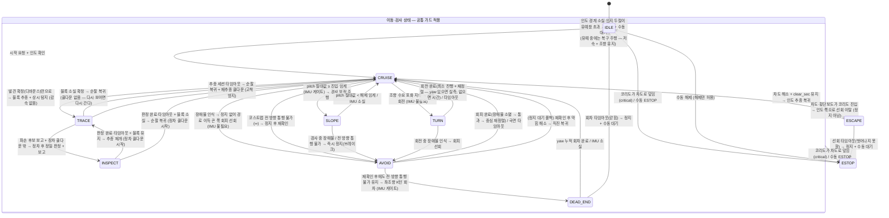

# jetson_final — 점자블록 순찰 로봇

Jetson Orin Nano 단독, 카메라 세그멘테이션 단독 입력, 보행 속도 저속 주행.
**두 카메라·두 모델·한 프로세스**로 도는 통합 저장소다: 주행 카메라의 세그멘테이션이
인도를 따라 달리며(7클래스 우선순위) 점자블록을 찾고, 하향 탐지 카메라의 탐지 모델이
**주행하며** 블록의 파손을 판정한다 (아래 'TRACE + INSPECT' 절).

동작 시나리오(명세):

1. 인도 자율주행 → 2. 각종 장애물 **좌/우 회피**하며 주행 → 3. 점자블록 탐지·상태 판정
→ 4. 이상 시 **사진 촬영 + GPS 태깅** → 5. 횡단보도 발견 시 횡단보도–인도 사이 점자블록
유무 판단(없으면 **미설치 구역** 태깅) → 6. 웹 지도에 핀 표시

이 저장소의 책임은 1~5단계다. 6단계(서버 전송·지도 핀)는 젯슨에 있는 통신 코드가
담당하고 보드에서 합친다 — 여기서는 그 코드가 그대로 집어갈 형식으로 로컬에 남긴다
(`reports/events.jsonl` + JPEG, 이음새는 `reporting.write_report()` 한 함수).

FSM 핸들러는 전부 본구현이다. **IMU 게이트가 남은 것은 SLOPE(pitch가 있어야 경사를
안다)와 DEAD_END(yaw 누적으로 회차를 잰다)뿐이다** — 장애물 회피·회전·차도 이탈은
IMU 없이도 돈다(근거는 아래 '0804 명세 반영' 절). 남은 TODO는 알고리즘이 아니라
필드 튜닝이다.

## 저장소 통합 내역 (2026-08-03)

주행 프로젝트(`robot/`)와 보드 작업 폴더(`SSAFY/`)가 따로 있었고 **같은 파일이 여러 벌**
존재했다. 이 저장소는 그 둘을 합쳐 하나로 만든 결과다. **로직은 옮기지 않았다** —
주행·세그·탐지 통합은 이미 `robot/` 안에서 끝나 있었고, 정리된 것은 파일 배치다.

| 통합 전 | 통합 후 | 근거 |
|---|---|---|
| `robot/*` | 저장소 루트 | 중간 폴더 하나 제거 |
| `robot/Deploy/` + `robot/models/vendor/` | `tools/braille_detect/` | 같은 배포 번들 두 벌. 완전본(Deploy)을 남기고, 부분본에만 있던 `DEPLOY.md`는 완전본 `README.md`의 **부분집합**이라 버렸다 (diff 삭제 줄 0) |
| `best.pt` 3벌 (`robot/Deploy/`, `robot/models/`, `SSAFY/Deploy/`) | `models/braille_defect.pt` 1벌 | MD5 전부 동일. 번들 스크립트가 이 경로를 찾아 쓰도록 고쳤다 |
| `segv2.pt` 2벌 (`robot/models/`, `SSAFY/models/`) | `models/segv2.pt` 1벌 | MD5 동일 |
| `SSAFY/DataRecorder`·`GPStest`·`ledTest` | `tools/` | 주행 프로세스와 무관한 도구 — 런타임과 분리 |
| `SSAFY/test.jpg` | `tools/braille_detect/sample_output.jpg` | 탐지 판정 결과 예시 |
| `__pycache__`, `.pytest_cache` | (삭제) | |

## 0804 명세 반영 — 무엇이 왜 바뀌었나

명세 전문과 0803 실외 주행 관찰을 받아 **주행 로직을 재검토했다.** 관찰된 문제 3개는
전부 튜닝이 아니라 설계 결정에서 나온 것이었고, 그 결정을 바꿨다.

| 0803 실외 증상 | 진짜 원인 | 바꾼 것 |
|---|---|---|
| **① 차도를 인도로 보는 경우가 있었다** | `sidewalk` 마스크를 전역 합집합으로 썼다 — 길 건너 차도가 오분류되면 그 픽셀이 무게중심·중심선에 섞여 조향을 차도 쪽으로 끌어당긴다 | **자차 연결(ego-connected) 주행가능**: 내 발밑에서 열이 끊기지 않고 이어진 영역만 내 주행면이다. 길 건너 영역은 사이에 차도가 있어 열이 끊긴다 (`_ego_run_mask`, `tests/test_ego_connectivity.py`) |
| **② 자율주행 속도가 너무 느렸다** | 한국 인도는 유도선이 길게 깔려 순찰 대부분이 TRACE 체류인데, TRACE가 상시 35%(0.112 m/s)였다 — 20m 구역에 3분 | **추종 감속 폐지** (35 → 100%). 감속 근거였던 모션 블러는 0.32 m/s·노출 1/60초에서 이동량 5mm이고, 추론 주기도 타일당 2회 이상 확보된다. 정지 화면은 INSPECT가 따로 잡는다 |
| **③ 회피하지 않고 자꾸 정지만 했다. 장애물도 크게 인식하지 못했다** | (ㄱ) 회피·회전 종료 판정이 전부 yaw 기반 = IMU 게이트 뒤였고 **IMU 배선이 해제된 상태**였다 → 모든 장애물이 정지 대기로 떨어졌다. (ㄴ) 차도 침범 위험이 곧 ESTOP(수동 해제만)이었다. (ㄷ) 경계 소실 유예 중 명령이 브레이크였다. (ㄹ) 노치 비용(1.2×0.13=0.156)이 목표 이탈 페널티(0.27)보다 작아 **비껴가는 쪽이 항상 비쌌다** | (ㄱ) 회피·회전 종료를 **시각(장애물 소멸·중심 재정렬) + 시간**으로 바꿔 IMU 게이트 제거. (ㄴ) 차도 → **ESCAPE 선회 이탈** 신규 상태, ESTOP은 코리도가 차도로 덮인 경우만. (ㄷ) 유예 중 **복구 주행**(저속 + 조향 유지). (ㄹ) `notch_cost` 1.2→1.8, `blocking_reach_ratio` 0.30→0.42(≈1.5m), `obstacle_blocking_proximity` 0.55→0.40 |

명세에서 새로 구현한 것:

| 명세 항목 | 구현 |
|---|---|
| 7개 클래스 각각 우선순위 배정 | `config.yaml`의 **`perception.segmentation.classes` 표 하나**로 통합 (drivable/cost/roadway 3열). 종전에는 같은 정보가 `drivable_classes`·`roadway_classes`·`costmap.class_costs` 세 곳에 흩어져 실제로 어긋나 있었다 |
| 7개 클래스 **제외** 장애물(사람·킥보드·볼라드) | 장애물 = **미분류 픽셀만**으로 재정의. 종전 정의('주행가능도 차도도 아닌')는 `bike_lane`·`caution_zone`·`alley`를 장애물로 잡아 자전거도로 옆을 지나는 것만으로 회피가 걸렸다 |
| 차도를 만나면 좌 or 우로 방향 전환 후 인도로 주행 | `ESCAPE` 상태 (`_handle_escape`) — 방향은 코스트맵의 열린 절반 = 인도가 있는 쪽 |
| 이상 시 사진 촬영 + GPS 태깅 | `reporting.py` + `main.build_gps()`. `reports/events.jsonl`에 한 줄, JPEG 1장 |
| 횡단보도–인도 사이 점자블록 유무 판단 | `_crosswalk_seam_braille_fraction` — 횡단보도 최근접 행 **바로 아래 띠**만 본다. 화면 전체에서 찾으면 지나온 유도선이 늘 잡혀 미설치를 영원히 못 잡는다 |
| 탐지 카메라는 상태 판정에만 | 그대로 — 주행 판단은 전방 세그 단독 |
| 터치 시 주행 탐지 시작 | `hardware/jetson/touch.py` — GPIO 폴링 + **누름 엣지** 1회 소비. 엣지인 이유: 누르고 있는 내내 시작 요청이 반복되면 IDLE의 '수동 재시작만이 출구' 안전 설계가 무력해진다(손을 얹어 두면 자동 재출발이 된다). 배선: VCC pin1(3.3V) / SIG pin16 / GND pin14 — `docs/HARDWARE.md` §1 |

## 7클래스 주행 설정 최종 확인 (명세 요청)

`config.yaml` → `perception.segmentation.classes`. 우선순위 = `cost` 오름차순.
정합성은 `tests/test_costmap.py::TestClassPriorityTable`(10개)과 `scripts/preflight.sh`가
기동 전에 고정한다 — 표가 어긋나면 판정이 **로그에도 동작에도 안 보이게** 약해지기 때문이다.

| 클래스 | drivable | cost | roadway | 정면에 있으면 | 옆에 있으면 |
|---|---|---|---|---|---|
| `braille_guide_blocks` | ✅ | 0.0 | | 밟고 지나간다 + TRACE로 추종하며 탐지 | 근접도 비례로 그쪽으로 조향 혼합 |
| `sidewalk` | ✅ | 0.0 | | 주행 기본면 | 중심선 추종 대상 |
| `caution_zone` | ❌ | 0.8 | | 자유거리가 끊겨 **회피 대상**(의도 — 위험·공사 구역) | 코스트맵이 그 방향을 회피 |
| `alley` | ❌ | 1.5 | | 회피 대상 — 차량이 드나드는 노면이다 | 코스트맵이 강하게 회피 |
| `bike_lane` | ❌ | 2.0 | | 회피 대상 — 자전거 속도가 인도보다 위험 | 코스트맵이 강하게 회피 |
| `crosswalk` | ❌ | ∞ | ✅ | **ESCAPE 선회 이탈** + 미설치 판정 트리거 | 그 방향 슬롯은 애초에 선택 불가 |
| `roadway` | ❌ | ∞ | ✅ | **ESCAPE 선회 이탈**, 코리도를 덮으면 ESTOP | 그 방향 슬롯은 애초에 선택 불가 |

확인한 것과 그 결과:

- **주행가능 = 2개뿐**(인도·점자블록). 종전에는 `alley`가 여기 들어 있었고
  `cost: 0.2`였다 — 실내 테스트에서 바닥이 `alley`로 분류되던 것을 통과시키려던
  설정이다. **실외에서는 골목으로 나가는 설정**이므로 뺐다.
  ⚠️ 실내에서 돌릴 때는 `alley.drivable`을 `true`로 되돌릴 것(config에 주석으로 명시).
- **주행가능 클래스의 비용은 전부 0**이어야 한다(`test_drivable_classes_are_free`).
  0이 아니면 '갈 수 있지만 가기 싫은 곳'이라는 뜻이고, 그런 클래스는 `drivable: false`가 맞다.
- **차도 계열은 ∞ 하나뿐이 아니다.** ∞는 '그 방향으로 조향하지 않는다'(1차 방어선)이고,
  코리도 진입 판정이 ESCAPE(2차), `critical`이 ESTOP(3차)이다. 종전에는 2차가 없어
  1차를 넘긴 순간 곧바로 미션이 끝났다.
- **주행불가 ≠ 장애물.** 장애물은 미분류 픽셀만이다. 종전 정의에서는 `bike_lane`·
  `caution_zone`이 장애물로 잡혀 자전거도로 옆을 지나는 것만으로 회피가 걸렸다
  (`test_undrivable_classes_are_not_obstacles`가 이 구분을 고정한다).
- **`crosswalk`가 `roadway`에서 빠지면** 횡단보도 앞 방어가 조용히 사라진다
  (`test_crosswalk_is_roadway`). segv2에서 신설된 클래스라 구모델 config를 그대로 쓰면
  실제로 이 사고가 난다.

지운 것: `models/sidewalk_seg.pt`(6클래스 구버전 — 어느 코드도 참조하지 않았다),
`tools/led_test/`(종료된 브링업 실험 + 핀덤프), `tools/braille_detect/best.onnx`
(`.pt`에서 엔진을 빌드하므로 소비처가 없었다), 녹화 샘플. 28.7MB → 13MB.

## 명세서 덩어리 ↔ 폴더 매핑

| 명세서 덩어리 | 위치 | 설명 |
|---|---|---|
| 인지 | `perception/` | 세그멘테이션 프레임 계약 + 시나리오 mock + 실추론 Provider (`segmentation`/`braille`/`camera`) |
| 추론 모델 | `models/` | 학습 완료 가중치 (세그 `segv2.pt` + 탐지 `braille_defect.pt`). 스펙·성능·한계는 `models/README.md` |
| 주행 | `driving/` | FSM 상태 정의·전이 테이블·순수 `step()`. 이 프로젝트의 본체 |
| 하드웨어 제어 | `hardware/` | 구동/조향/IMU 추상 + mock, 실물 구현은 `hardware/jetson/` |
| 하드웨어 인벤토리 (Phase 0) | `scripts/hardware_inventory.py` → `docs/HARDWARE.md` | 젯슨 실측·기존 코드 추출 결과 |
| 튜닝값·경로 | `config.yaml` | 숫자의 단일 출처 — 코드에 튜닝 숫자 하드코딩 금지 |
| 진입점 | `main.py` | 단일 스레드 루프 (인지 → step → 하드웨어), dry-run 기본 |
| 검증 | `tests/` | pytest 9개 파일 (공통 픽스처·파라미터 조립은 `tests/conftest.py`, 수집 설정은 `pytest.ini`) |
| 점자블록 탐지·판정 어댑터 | `perception/braille.py` + `main.capture_verdict()` (TRACE 상시 탐지 / INSPECT 정밀 판정 공용), 스케줄은 `main.detection_due()` | 구현됨 |
| 보고 (사진 + GPS 태깅) | `reporting.py` + `main.build_gps()` | 구현됨 — `reports/events.jsonl` + JPEG |
| 통신 (서버 전송·웹 지도 핀) | (이 저장소에 없음) | **젯슨에 있는 통신 코드가 담당하고 보드에서 합친다.** 이음새는 `reporting.write_report()`가 남기는 `events.jsonl`과 `state_machine`의 `on_event` 훅 |
| 조작자 입력 | `main.build_operator()` + `scripts/xbox_controller.py` | IDLE·ESTOP의 출구 (A=출발·해제, B=비상 정지) |
| 터치 센서 (시작 트리거) | `hardware/jetson/touch.py` | **구현됨·활성** (0804 배선: VCC pin1 / SIG pin16 / GND pin14). 누름 엣지 = 시작 + ESTOP 해제 (Xbox A와 같은 역할) |
| GPS | `scripts/gps_reader.py` | 구현됨 — 보고 경로(`main`)와 웹 대시보드 양쪽에 배선 |
| 배포 | `scripts/deploy.sh` + `scripts/preflight.sh` | 보드로 전송 후 배포 점검까지 (아래 '젯슨 배포' 절) |
| 부속 도구 | `tools/` | 주행 프로세스와 **무관하게** 도는 것들: 탐지 모델 단독 실행 번들, 영상 녹화, GPS 점검 (`tools/README.md`) |

## 폴더 한 줄 지도

- `config.yaml` — 모든 튜닝값·경로 (숫자는 여기에만). **7클래스 우선순위 표**는 `perception.segmentation.classes`
- `models/segv2.pt` — 인도 세그멘테이션 (YOLO11n-seg, 7클래스, imgsz 640) — 상시 구동
- `models/braille_defect.pt` — 점자블록 탐지·파손 판정 (YOLO26n 탐지, 3클래스, imgsz 960) — TRACE 상시 탐지 + INSPECT 정밀 판정
- `models/README.md` — 두 모델의 스펙·성능·한계·판정 규칙 (`band_argmax` 근거 포함)
- `tools/braille_detect/` — 위 탐지 모델의 **원본 배포 번들** (단독 실행: `jetson_infer.py`, 현장 헬퍼 `field_run.sh`, 배포 문서). 주행과 별개로 탐지만 확인할 때 쓴다
- `tools/data_recorder/` — 컨트롤러 수동 조작 + 카메라 2대 녹화 (임계값 재보정용 실사 영상 확보)
- `tools/gps_test/` — u-blox NMEA 진단 3종 (fix를 못 잡을 때)
- `main.py` — 진입점: 단일 스레드 루프, 장치 명령 쓰기의 유일한 지점(single writer)
- `reporting.py` — 이상 보고: 사진 저장 + GPS 좌표 태깅 (`ReportGate`는 순수 — 연속 프레임 확정 + 쿨다운)
- `scripts/drive.sh` — 보드 실주행 런처 (LD_LIBRARY_PATH 처리 후 `main.py --perception real`)
- `scripts/deploy.sh` — 개발 PC → 젯슨 전송 + 배포 점검 (`tar | ssh` — rsync 불필요)
- `scripts/preflight.sh` — 보드 배포 점검: 의존성·클래스 표·가중치·테스트·시나리오·장치
- `scripts/webtest.sh` + `web_test.py`/`web_test.html` — 야외 테스트 웹 관제 (오버레이·수동 조작·검사 판정)
- `scripts/gps_reader.py` — u-blox 7 NMEA 리더 (보고 좌표 태깅 + 웹 대시보드 표시)
- `scripts/xbox_controller.py` — 수동 조작 입력 (웹 테스트 전용)
- `scripts/hardware_inventory.py` — Phase 0 젯슨 인벤토리 (재실행 가능)
- `docs/HARDWARE.md` — Phase 0 결과: 실측값, 예상값 대조표, config 반영 내역
- `docs/ALGORITHMS.md` — 세그멘테이션 이후 얹을 알고리즘 조사 (조사 문서 — 결정 아님)
- `hardware/interfaces.py` — DriveMotor / SteeringServo / Imu 추상 (조향 클램프 강제 지점)
- `hardware/mocks.py` — 실물 없이 도는 가짜 장치 (dry-run·테스트용)
- `hardware/jetson/` — 실물 구현: drive_motor(0x40 B채널), steering_servo(0x60 ch0), imu(MPU6050 상보필터), touch(GPIO 시작 트리거 — 핀 미지정 시 비활성)
- `perception/interfaces.py` — SegmentationFrame 데이터 타입 + Provider 추상 (get_latest 풀 방식)
- `perception/mocks.py` — config의 시나리오를 재생하는 가짜 세그멘테이션
- `perception/segmentation.py` — 실추론 Provider: 세그 마스크 → 프레임 요약 + 중심선 RANSAC 적합 + 코스트맵 비용 프로파일 (numpy 계층/순수 계층 분리)
- `perception/braille.py` — 점자블록 탐지·파손 판정: `band_argmax` 순수 이식 + 검사기 어댑터 (TRACE·INSPECT 공용)
- `perception/camera.py` — cv2 캡처 래퍼 (실추론 전용, 지연 import)
- `driving/states.py` — 상태 열거형, DriveCommand, 전이 테이블(코드판)
- `driving/state_machine.py` — 순수 step() + 공통 가드 + on_event 훅
- `driving/steering_costmap.py` — 코스트맵 방향 선택(슬롯 점수 최소화, 순수 함수)
- `tests/` — FSM 전이·가드·차도 이탈·IMU 게이트, 인지 요약·중심선 적합, 코스트맵 비용·7클래스 표 정합, 자유공간 프로파일, **자차 연결**, **횡단보도 미설치 판정**, **보고 게이트**, 점자블록 판정, 탐지·검사 실행 순서 (9개 파일 / 289 테스트)

## 실행

```bash
python3 main.py                             # dry-run + obstacle_avoid 시나리오
python3 main.py --scenario braille_trace    # 발견 → 추종(감속 없음) → 소실 복귀
python3 main.py --scenario boundary_lost    # 경계 소실 → 복구 주행 → IDLE
python3 main.py --scenario roadway_escape   # 차도 진입 → 선회 이탈 → 인도 복귀
python3 main.py --scenario roadway_estop    # 코리도가 차도로 덮임 → ESTOP (최후 방어선)
python3 main.py --scenario crosswalk_missing # 횡단보도 점자블록 미설치 → 보고 (reports/)
python3 main.py --scenario costmap_steer    # 코스트맵: 전방 중앙 비용 상승 → 상태 전이 없이 비껴감
python3 main.py --live                      # 실구동 (주의: 모의 인지로 실제 모터가 돈다)
scripts/drive.sh --live                     # 보드 실주행 (실추론 + 실구동, cusparseLt 경로 처리 포함)
scripts/webtest.sh                          # 웹 관제 대시보드 (http://<젯슨IP>:8200)
python3 -m pytest                           # 전체 테스트 (루트에서 실행 — pytest.ini가 tests/만 수집)
scripts/preflight.sh                        # 보드 배포 점검 (주행 전 필수)
python3 scripts/hardware_inventory.py       # Phase 0 재실행
tools/braille_detect/field_run.sh           # 탐지 모델만 단독 실행 (주행 없음)
```

## 젯슨 배포

**어디서 실행하나** — 이걸 먼저 못 박는다. 카메라·모터·GPS·터치 센서가 전부 젯슨에
붙어 있으므로 **주행하는 것은 전부 젯슨에서** 돈다. 개발 PC에서 도는 것은 배포 명령과
순수 계층 테스트뿐이다.

인자의 계정명은 **젯슨의 리눅스 계정**이다(개발 PC의 Windows 사용자명이 아니다).
이 저장소에 남은 보드 경로가 전부 `/home/ubuntu/*`이므로 기본은 `ubuntu`이고,
확실히 하려면 젯슨에서 `whoami`를 찍어 본다.

| 명령 | 실행 위치 | 왜 |
|---|---|---|
| `scripts/deploy.sh ubuntu@<젯슨IP>` | **개발 PC** | 이 PC의 파일을 젯슨으로 밀어넣는 명령이다. 유일하게 PC에서 도는 것 |
| `scripts/preflight.sh` | 젯슨 | 장치·모델·의존성을 본다. `deploy.sh`가 ssh로 자동 실행하므로 따로 칠 일은 재점검할 때뿐 |
| `scripts/webtest.sh` | 젯슨 | 카메라를 열고 추론을 돌린다 |
| `scripts/drive.sh` | 젯슨 | 같은 이유 |
| `python3 -m pytest` | 둘 다 | 순수 계층이라 어디서든 돈다 (PC에서 개발 중 확인, 젯슨에서 배포 점검) |
| 브라우저 `http://<젯슨IP>:8200` | 폰·노트북 | 대시보드는 **보는 쪽**이 클라이언트다 |

```bash
# [개발 PC] 전송 + 배포 점검까지 한 번에
scripts/deploy.sh ubuntu@<젯슨IP>

# [젯슨] ssh로 들어가서 주행
ssh ubuntu@<젯슨IP>
cd jetson_final
scripts/webtest.sh            # 또는 --live
```

실외에는 공유기가 없으므로 **폰 핫스팟에 젯슨을 붙이고** 젯슨 IP(`hostname -I`)를
나가기 전에 적어 둘 것 — 현장에서 IP를 찾는 데 시간을 쓰지 않게.

`tar | ssh`로 밀어넣으므로 개발 PC가 Windows(Git Bash)여도 rsync 없이 돈다.
전송 제외: `__pycache__`, `.pytest_cache`, `reports/`, 녹화 영상. **모델 가중치는
전송한다** — 그것이 배포의 본체다(11MB).

전송 후 `scripts/preflight.sh`가 보드에서 자동 실행되고, 하나라도 실패하면 종료 코드가
0이 아니다. 점검 항목과 그 이유:

| 점검 | 실패하면 |
|---|---|
| python3 3.10 · `yaml`/`numpy`/`cv2`/`ultralytics` | 실추론이 기동하지 못한다 |
| 7클래스 표 정합 (7개 · 블록 주행가능 · 차도 존재 · 차도 임계 순서 · 확정 순서) | 판정이 **조용히** 약해진다 — 로그에도 동작에도 안 보인다 |
| 두 모델 가중치 존재 | 기동 시 예외 |
| pytest 전체 | 주행 판단이 깨진 상태로 나간다 |
| dry-run 시나리오 4종 | FSM 흐름이 깨진 상태로 나간다 |
| 장치 존재 (카메라·GPS·조이스틱·IMU) | 경고만 — 배선을 뽑고 주행 로직만 보는 운용이 있다 |

점검 통과 후 순서:

```bash
scripts/drive.sh --duration 20     # 실추론 + 모터 로그만 (모델·카메라 확인)
scripts/webtest.sh                 # 웹 관제로 오버레이 확인 (임계값 현장 재보정)
scripts/drive.sh --live            # 야외 실구동
```

보드에서는 `main.py`를 직접 부르지 말고 `scripts/drive.sh`를 쓴다 — pip torch가 시스템에
없는 `libcusparseLt.so.0`을 찾는 젯슨 특유의 문제 때문에 `LD_LIBRARY_PATH`가 필요하다.

`--perception real`은 보드 전용이다(ultralytics·cv2 필요 — 개발 PC에는 없다).
mock 경로와 실추론 경로는 `SegmentationProvider` 계약으로만 만나므로 FSM·테스트는
어느 쪽이든 동일하게 동작한다. 실추론 구현: `perception/segmentation.py`(세그 →
프레임 요약), `perception/braille.py`(파손 판정 — `band_argmax` 이식),
`perception/camera.py`(캡처).

dry-run이 기본값이다: 모터/서보 명령은 로그로만 나가고, `--live`를 명시해야 실물이
움직인다. 조향 한계(좌 45° / 우 30° 오프셋 — 넘기면 조향은 들어가도 전·후진이 안
된다)는 hardware 계층(`SteeringServo.set_offset_deg` 템플릿 메서드)에서 강제되므로
상위 로직 버그가 서보를 그 밖으로 보낼 수 없다. 모든 상태 전이는 타임스탬프와 함께 로깅된다.

## FSM — 상태와 전이

상태: IDLE(대기) · CRUISE(인도 중심선 추종 순찰) · TRACE(점자블록 추종 + 상시 탐지) ·
INSPECT(파손 후보 정차 정밀 판정) · TURN(회전 — 감속 + 깊은 조향) ·
AVOID(장애물 좌/우 회피 선회) · **ESCAPE(차도 이탈 선회)** · SLOPE(경사 보정 주행) ·
DEAD_END(좌조향 K턴 회차) · ESTOP(비상 정지).

**IMU 게이트는 SLOPE와 DEAD_END에만 남았다.** 앞은 pitch가 있어야 경사를 알고, 뒤는
yaw 누적으로 회차 진행을 재므로 대체 수단이 없다. 회피·회전·차도 이탈은 종료 판정이
**시각 + 시간**이라 `imu.read()`가 `None`이어도 전부 돈다 — 종전에는 이 셋이 모두
IMU 게이트 뒤여서, IMU 배선이 해제된 상태에서 장애물·코너·차도 전부가 정지로
떨어졌다(0803 실외 '자꾸 정지만 함'의 직접 원인).

코드판 전이 테이블은 `driving/states.py`의 `TRANSITION_TABLE` — 아래 다이어그램과
항상 함께 수정할 것.



**차도 — 두 단계로 나눈다** (명세: '차도는 절대 접근 금지, 차도를 만나면 좌 or 우로
방향 전환 후 인도로 주행'). 인도 옆이 차도인 것은 **정상 상황**이므로 그 판정 하나로
미션을 끝내면 오탐 한 번에 순찰이 끝난다 — 종전이 그랬다.

| 판정 | 임계 (코리도 내 차도 비율) | 대응 |
|---|---|---|
| `roadway_encroachment_risk` | ≥ `roadway_risk_fraction` (0.20) | **ESCAPE** — 감속(55%) + 인도가 있는 쪽으로 깊은 선회(좌 30°/우 22°). 차도가 코리도에서 빠지고 `clear_sec` 유지되면 CRUISE 복귀 |
| `roadway_critical` | ≥ `roadway_critical_fraction` (0.55) | **ESTOP** (수동 해제만). 선회로 되돌릴 단계를 지났다 = 로봇이 사실상 차도 위다 |
| ESCAPE `timeout_sec` 초과 | 4초간 선회해도 안 빠진다 | **ESTOP** — 선회로 못 벗어나는 상황에서 '절대 접근 금지'를 지킬 방법은 정지뿐이다 |

선회 방향은 코스트맵 좌/우 절반 중 **열린 쪽 = 인도가 남아 있는 쪽**이다(차도 슬롯은
비용 ∞라 통행 불가 개수로 세어져 절반 점수에서 진다). 방향은 진입 시 한 번 확정하고
유지한다 — 매 틱 다시 고르면 차도 마스크가 화면에서 이동할 때 좌우 판정이 뒤집혀
제자리에서 떠는 기동이 된다. ESCAPE는 `GUARDED_STATES`에 **없다**: 차도를 벗어나는
중에는 인도 경계가 실제로 안 보이는 것이 정상이므로(그래서 벗어나는 것이다) 경계 소실
IDLE 폴백을 걸면 선회가 시작하자마자 끊긴다. 실패 출구는 자신의 타임아웃 → ESTOP이다.

**CRUISE 조향**: **어디로 가고 싶은가(목표)와 어느 방향이 통행 가능한가(선택)를
분리한다.** 목표는 인도 중심선(RANSAC 적합의 `lookahead` 지점)이다(점자블록 추종 혼합은
CRUISE가 아니라 TRACE 담당 — 아래). 그 목표를 그대로 조향각으로 바꾸는 대신, 인지가
화면 하단 밴드를 x축 슬롯으로 쪼개 클래스별 통행 비용을 얹어 준 `cost_profile`에서
**점수(통행 비용 + 목표 이탈 + 직전 선택 이탈) 최소 슬롯**을 고른다
(`driving/steering_costmap.py` — `docs/ALGORITHMS.md` N7). 차도는 비용 ∞라 애초에
후보에서 빠지고(ESTOP은 최후 방어선이지 1차 방어선이 아니다), 인도 마스크에 뚫린
구멍(사람·볼라드 등 미학습 물체)은 `unknown_cost`가 붙어 **상태 전이 없이 옆으로
비껴가는** 동작이 된다. 그것으로 부족해 `blocking` 판정이 나면 **정지하지 않고**
AVOID 회피 기동(좌/우 벗어나기→통과→yaw 원방위 복귀)으로 넘어간다 — 인도에서
`blocking`의 대부분은 지나가지 않는 고정물이라 3초씩 서서 기다리는 값이 통행 자체보다
작았다. 전 방향이 ∞면(비껴갈 방향 자체가 없다) AVOID로 정지해
재확인 주기마다 다시 평가한다. `cost_profile`이 없는 프레임(mock 기본)은 종전
비례 조향 그대로다 — 코스트맵은 폴백을 지운 적이 없다. 클래스별 비용은
`config.yaml`의 `perception.segmentation.costmap`, 조향 가중치는 `driving.cruise.costmap`.

**TRACE + INSPECT (미션 본체) — 카메라 2대 역할 분담**

| 카메라 | 모델 | 언제 | 무엇 |
|---|---|---|---|
| 전방 주행 (Web Camera) | `models/segv2.pt` 세그 7클래스 | 상시 | 주행 판단 + 점자블록 **발견** |
| 하향 탐지 (Brio 100, 하향 30~45°) | `models/braille_defect.pt` 탐지 3클래스<br>(단독 실행 번들: `tools/braille_detect/`) | TRACE 중 블록에 붙은 뒤 `detect_period_sec`마다 | 점자블록 **탐지·판정** (상태 판정 전용 — 주행 판단에 쓰지 않는다) |

세그가 블록을 확정하면(발견 디바운스 `inspect.confirm_sec`만 통과하면 된다 — 근접도
하한도, 중앙 정렬 조건도 없다) CRUISE는 **TRACE**로 넘긴다. 유도선은 인도 방향으로
깔려 있으므로 블록을 따라가는 것이 곧 인도를 따라가는 것이고, 하향 카메라 화각에 블록이
들어오게 유지하는 것이 추종의 목적이다.

| 근접도 | 조향 목표 (`_approach_weight`) | 스로틀 | 탐지 추론 (`main.detection_due`) |
|---|---|---|---|
| 0 (막 발견) | 인도 중심 100% | `trace.throttle_pct` (100%) | 돌지 않는다 |
| 중간 | 인도 중심 ↔ 블록 중심 선형 혼합 | 동일 | 돌지 않는다 |
| ≥ `inspect.enter_proximity` | 블록 중심 100% | 동일 | `detect_period_sec`마다 |

- **추종은 감속하지 않는다.** 명세가 '주행하며 탐지'이고, 실제로 감속할 근거가 없다:
  0.32 m/s·노출 1/60초에서 모션 블러 이동량은 5mm이고, 0.32 m/s × 0.4초 = 0.128m라
  타일(0.30m) 하나당 추론이 2회 이상 돈다. 종전 35% 상시 저속이 **0803 실외 '속도가
  너무 느림'의 지배적 원인**이었다 — 한국 인도는 유도선이 길어 순찰 대부분이 이 상태
  체류다. 정밀 판정용 정지 화면은 INSPECT가 따로 잡는다.
- **목표는 전환이 아니라 혼합**이다. 통째로 갈아끼우면 화면 가장자리에 걸린 블록 하나에
  조향이 꺾여 인도를 벗어난다. 조향은 그 위에 코스트맵(차도 ∞)·좌우 비대칭 클램프·
  슬루율 제한을 더 지나므로, 유도선이 횡단보도로 이어져도 차도로는 꺾지 않는다.
- **블록에 붙기 전에는 탐지를 돌리지 않는다.** 하향 카메라는 로봇 바로 앞 노면을 보므로
  멀리 있는 블록은 그 화면에 없고, imgsz 960 추론은 Orin Nano에서 수백 ms급이라 그 시간
  동안 단일 스레드 루프 전체가 멈춘다(인지·조향 갱신 포함) — 없는 것을 찾느라 눈을
  감는 셈이다.

탐지가 파손 후보를 보면 `notify_defect_found()`로 통지하고 FSM이 **INSPECT**로 정차한다.
정차 비용을 내는 이유는 모션 블러다 — `defect_partial`(≈55px)부터 먼저 무너지므로
주행 중 판정은 '멈춰 볼 가치가 있는가'의 1차 스크리닝으로만 쓰고, 확정은 정차 후
`settle_sec` 뒤의 캡처로 한다. 둘 다 같은 모델·같은 판정 함수(`band_argmax`)를 쓴다
(`main.capture_verdict` 한 곳) — 판정이 두 벌로 갈라지지 않게. **판정을 마치면 순찰이
아니라 TRACE로 돌아간다** — 유도선 하나에 파손이 여러 곳일 수 있고, 한 번 판정했다고
그 선을 놓으면 나머지를 놓친다.

**왜 '정차해서 검사'가 아니라 '따라가며 탐지'인가**: 점자블록은 낱개 물체가 아니라
**연속된 유도선**이라, 전방 카메라의 근접도 proxy로는 '이 유도선을 다 봤다'가 관측되지
않는다 — 유도선을 따라 달리는 동안 블록 마스크가 항상 화면 최하단까지 이어져
`braille_proximity`가 상시 포화(≈1)이고 중심 오차도 ≈0이다. 그래서 관측 가능한 것
(블록이 화면에 있는가)만 트리거로 쓰고 판정은 주행 중 계속한다.

**두 개의 쿨다운 — 둘 다 고착 방지이고, 어느 쪽도 '최우선'을 막지 않는다.**
`inspect.cooldown_sec` 하나의 값을 두 타이머가 공유한다.

| 타이머 | 언제 걸리나 | 무엇을 막나 |
|---|---|---|
| 정차 쿨다운 (`_inspect_cooldown_over`) | INSPECT 종료 시 (가드 이탈 포함) | **재정차**. 복귀 직후 로봇은 아직 같은 파손 위라 다음 탐지 주기에 같은 후보가 또 나온다 — 없으면 그 자리에서 정차가 무한 반복된다. 이 창 안에서도 추종·탐지는 계속 돈다 |
| 재추종 쿨다운 (`_trace_cooldown_over`) | 추종 세션 **타임아웃** 시에만 | **재진입**. 유도선은 끝없이 이어질 수 있어 `trace.timeout_sec`을 두는데, 이 창이 없으면 나온 그 틱에 같은 선을 다시 물어 상한이 아무 일도 하지 않는다 |

**블록 소실로 추종이 끝난 경우에는 어느 창도 걸지 않는다** — 다시 보이면 다시 간다.
세션 타임아웃의 기준(`trace_started_at`)은 INSPECT를 다녀와도 리셋되지 않는다: 정차마다
리셋되면 파손이 잦은 구간에서 상한이 사실상 사라진다.

**두 값은 실측 속도에서 계산된다.** `docs/HARDWARE.md` §4의 구동계 캘리브레이션
(0.0032 m/s per 1% 스로틀)에서 추종 속도 100% = **0.32 m/s**이고, 점자블록 타일은
0.30m이므로 **타일 1개 통과 = 0.94초**다.

| 값 | 설정 | 환산 | 왜 그 값인가 |
|---|---|---|---|
| `inspect.cooldown_sec` | 2.0s | 0.64m = 타일 2.1개 | 정차 쿨다운의 목적이 '그 파손을 지나갈 시간'이므로 하한이 타일 통과 시간(0.94초)이다. **0.94초 미만으로 내리면 같은 타일에서 재정차한다** |
| `trace.timeout_sec` | 120.0s | 38.4m | 추종이 100%가 된 뒤로는 사실상 걸리지 않는다. 남겨 두는 이유는 하나 — 블록 오탐이 상시 켜진 채 굳으면(젖은 노면 반사 등) 순찰이 영구히 TRACE에 갇힌다. **속도 예산이 아니라 그 고착의 상한이다** |

> 쿨다운은 `trace.throttle_pct`에 **반비례**한다 — 추종 속도를 바꾸면 함께 재계산할 것
> (추종 35%였을 때 이 값은 5.0초였다). 거리 기준으로 바꾸면 이 연동이 사라지지만
> 오도메트리가 필요하다 — `docs/ALGORITHMS.md` N1.

> **파손 보고는 정차(INSPECT)에만 걸려 있다.** `main.run_detection()`이 0.4초마다
> 완전한 `BrailleVerdict`(불량 띠 수·국소 파손 수·사유)를 계산하는데 '멈춰 볼 가치가
> 있는가'만 쓰고 버린다 — 주행 중 판정은 모션 블러로 `defect_partial`(≈55px)부터
> 무너지므로 그것을 그대로 보고하지 않는 것은 의도다. 다만 쿨다운을 다시 올리면
> '발견하고도 정차 못 하는' 격차가 생기고 그만큼 보고가 조용히 누락된다 — 올릴 때는
> TRACE 쪽 verdict도 보고 경로에 태울 것.

> `inspect.confirm_sec < turn.confirm_sec`은 **순서 제약**이다. 뒤집히면 유도선이 꺾이는
> 코너에서 블록 확정보다 회전 확정이 먼저 나서 TRACE 대신 TURN(80% + 깊은 조향)으로
> 코너를 돈다 — 블록을 따라가야 하는 바로 그 구간이다. `tests/test_costmap.py`가
> 이 순서를 고정한다.

> **블록 추종은 순찰보다 우선이고, 안전보다 우선은 아니다.** CRUISE·TRACE 안의
> 판정 순서는 경사(SLOPE) → 장애물(AVOID) → 블록(TRACE)이고, 그 위에 공통 가드(차도
> critical ESTOP · 차도 risk ESCAPE · 경계 소실 IDLE)가 있다. 블록을 향해 가다가
> 장애물을 만나면 회피가 먼저다 —
> `tests/test_state_machine.py::test_obstacle_beats_braille_gate`가 고정한다.

하드 제약 반영: ① 차도 → **선회 이탈(ESCAPE)**, 코리도가 차도로 덮이면(critical) 또는
선회로 못 벗어나면 즉시 ESTOP(래치, 수동 해제만), ② 경계 소실·인지 두절 →
유예창(`perception_grace_sec`) 동안 **복구 주행**(저속 + 소실 시점 조향 유지 — 인도를
벗어나는 중이라면 그 조향이 이미 되돌리는 방향이다), 유예를 넘기면 수동 대기(IDLE —
자동 재출발 없음). 단 프레임 자체가 없으면(카메라 장애) 복구하지 않고 브레이크다 —
그건 진짜 눈먼 주행이다. ③ 회피 후 원경로 복귀가 기본 방침(중심 재정렬까지 되돌리고,
남은 횡오차는 CRUISE 중심 추종이 시각 피드백으로 수렴시킨다).

IDLE·ESTOP은 **수동 개입만이 출구**인 흡수 상태다. 그 개입 경로는
`main.build_operator`가 붙이는 Xbox 컨트롤러다 — **A = 출발 요청 + ESTOP 해제,
B = 수동 비상 정지**. 장치가 없으면 경고만 남기고 주행은 진행하지만, 그 상태에서
IDLE·ESTOP에 들어가면 복구 수단은 프로세스 재시작뿐이다(`--no-operator`로 명시적으로
끌 수 있다). 리더는 js 이벤트를 래치만 하는 읽기 전용 데몬 스레드라 하드웨어
single writer 계약을 깨지 않는다.

## 원거리 장애물 — 자유공간 프로파일 (0803 실외 테스트 대응)

**증상**: 4~5m 앞의 사람 다리·신발이 화면에 뚜렷이 보이는데도 장애물로 전혀 인지되지
않았다. **원인은 튜닝이 아니라 판정 영역의 기하다.**

종전 장애물 판정은 코리도(`corridor_height_ratio`)에서 최하단 여백을 뺀 밴드 안에서만
돌았다. 640×480이면 y 288~432, 즉 화면 높이의 60~90%다. 카메라 0.30m·하향 10°로
환산하면 **지면 0.56~1.14m**뿐이고, 4.5m 지점은 y≈177에 찍혀 밴드에 **들어오지도
못한다**. 통과했다 해도 두 게이트가 더 막는다: `obstacle_blocking_proximity: 0.55`
(밴드 하단 45%에 들어와야 `blocking`, 그리고 `blocking`이 아닌 장애물은 FSM이 완전히
무시한다)와 `obstacle_min_fraction: 0.12`(4.5m 사람은 밴드 면적의 약 5%다).

밴드를 위로 넓히는 것만으로는 못 고친다 — 종전 정의('밴드 안 **미분류 픽셀** 비율')로는
화면 상단의 하늘·건물·원경이 전부 미분류라 화면 절반이 장애물이 된다. 그래서 **정의를
바꿨다**: '미분류를 센다' → **'주행가능이 어디까지 이어지나'**.

| | 종전 (근거리 밴드) | 추가 (자유공간 프로파일) |
|---|---|---|
| 무엇을 세나 | 밴드 안 미분류 픽셀 비율 | 열별로 **연속된** 주행가능 길이 |
| 유효 범위 | 지면 약 0.4~1.2m | 세그가 보는 만큼 (실측 기준 6~7m) |
| 하늘·건물 | 밴드를 넓히면 전부 장애물 | 주행가능 구간 **위쪽**이라 산식에 참여하지 않음 |
| 결과 | `ObstacleRegion` 1개 | 슬롯별 노치 → 코스트맵 비용 + `ObstacleRegion` |

각 열에서 판정 밴드 아래 경계부터 위로 훑어 주행가능이 끊기는 지점이 그 방향의
자유거리다. 지면에 선 물체는 자기 열의 자유거리를 이웃보다 짧게 끊는다(**노치**).
**연속**을 세는 것이 핵심이다 — 사람 머리 위로 보이는 원거리 인도를 함께 세면 그 열은
열린 것이 되어 노치가 사라진다(`tests/test_free_space.py::TestContiguousRunSemantics`가
이 의미론을 고정한다).

노치는 **상대** 기준이다(그 프레임에서 가장 멀리 보이는 슬롯 대비). 절대 행 위치를 쓰면
자유거리 상한이 장면마다 달라서 — 곧은 인도는 지평선까지, 코너·오르막은 훨씬 아래에서
끊긴다 — 코너마다 전 방향이 장애물이 된다. '옆이 더 열려 있는가'가 좌우 회피가 답해야
하는 질문이고 상대 기준이 정확히 그것이다.

두 곳에 얹힌다:

| 경로 | 임계 | 동작 |
|---|---|---|
| 코스트맵 슬롯 비용 (`notch_min_ratio`·`notch_cost`) | 상대 노치 | CRUISE가 **상태 전이 없이** 노치가 얕은 쪽으로 비껴간다 (1차, 부드럽다) |
| `obstacles` 목록 (`blocking_reach_ratio` + 경로 관련성) | **절대** 자유거리 **이고** 진행 경로와 겹칠 때 | `blocking` → AVOID 회피 선회 (2차) |

상대 노치만으로 회피 기동에 들어가지 않는 이유: 노치는 '옆이 더 열렸다'는 뜻이고 그건
비껴가면 될 일이다. 기동까지 갈 근거는 내 길이 실제로 막혔을 때여야 한다.
전 슬롯이 균등하게 막힌 경우(가로 담장·벽)는 상대 노치가 0이 되는 구조적 한계가 있고,
그 경우는 절대 판정이 잡는다.

**`blocking`은 경로 관련성을 함께 요구한다** (`_overlaps_path` — 노치 구간이 진행
코리도 폭과 겹쳐야 한다). 이것이 없으면 인도 오른쪽 끝의 화단·담장이 **항상** 자유거리를
끊으므로 ① 평범한 인도 구간에서 상시 회피 기동이 돌고, ② 선회로 비켜난 뒤에도 그 화단이
계속 잡혀 **회피가 끝나지 않는다**(국면 상한이 유일한 출구가 된다). 경로 폭은 새 임계값을
만들지 않고 진행 코리도(`post.corridor_width_ratio`)를 그대로 쓴다 — '내 길의 폭'이 두
곳에서 다른 값이 되지 않게. 노치 **비용**에는 이 조건을 걸지 않는다: 경로 밖 노치도
부드럽게 비껴갈 이유는 있고, 그쪽은 상태 전이가 없어 대가가 작다.

**자차 연결(ego-connected)과 같은 산식을 쓴다.** 열별로 아래에서 위로 연속된 주행가능을
세는 계산(`_ego_run_mask`) 하나가 두 판정의 재료다 — 원거리 장애물(자기 열을 짧게 끊는
물체)과 '차도를 인도로 본다'의 방어(길 건너 영역은 사이에 차도가 있어 열이 끊긴다).
같은 물리를 보는 판정을 두 벌로 두지 않는다. 그림자·맨홀·타일 이음선이 한두 행을 끊는
것은 `post.ego_gap_rows`만큼의 세로 닫힘으로 메운다 — 그것이 없으면 한 행 끊김에 그 위
인도가 통째로 '내 것이 아닌' 영역이 된다.

**종전 근거리 판정을 대체하지 않고 더한다** — 유효 범위가 다르고, `enabled: false`로
끄면 종전 동작 그대로 돌아온다(폴백 보존).

현행 설정에서 합성 장면으로 계산한 응답:

| 거리 | 노치 깊이 | 판정 |
|---|---|---|
| 6.0m | 0.105 | 비용 가산 (비껴감) |
| 4.5m | 0.139 | 비용 가산 (비껴감) — **0803에 놓쳤던 그 대상** |
| 2.0m | 0.302 | 비용 가산, 슬롯 3개폭 |
| 1.0m | 0.583 | **blocking** → AVOID 회피 선회 |
| 없음(하늘 137행) | 0.000 | 보고 없음 |

0804에 두 값을 올렸다 — 0803 관찰 '장애물을 크게 인식하지 못한다'의 정량적 원인이
여기였다. 4.5m 사람의 노치 깊이가 0.139이므로 종전 `notch_cost: 1.2`의 가산 비용은
0.167뿐이고, 그 사람을 피해 슬롯 2칸(ratio 0.27)을 옆으로 가는 대가는 목표 이탈
`1.0 × 0.27 = 0.27`이다 — **비껴가는 쪽이 항상 비싸서 사람 쪽으로 계속 조향했다.**
`notch_cost: 1.8`이면 슬롯 1칸(0.133) 회피는 이기고, 근거리로 오면 노치가 깊어지며
회피 폭이 자동으로 커진다(깊이 0.4 → 가산 0.72). `blocking_reach_ratio`도
0.30(≈1m)에서 **0.42(≈1.5m)**로 올렸다: 회피가 정지에서 선회로 바뀐 뒤에는 1m가 너무
짧다 — 선회로 물체를 비껴가려면 물체 폭만큼의 횡이동 거리가 필요하고, 1m 앞에서
시작하면 조향 15°·0.32m/s로는 물체에 닿는다.

> **임계값은 전부 초기 추정값이다.** `notch_min_ratio: 0.08`은 위 기하 계산(4.5m에서
> 0.139)에 여유를 둔 값이고, 실제 세그 마스크의 상단 요동은 측정된 바 없다.
> `scripts/webtest.sh`의 오버레이가 슬롯별 자유거리를 수직 막대로 그리고
> (회색=열림 / 노란색=노치 / 빨간색=blocking) 최대 노치를 숫자로 띄운다 —
> 4~5m 사람 앞에 서서 그 값을 읽고 임계를 그 아래로 맞추는 것이 보정 절차다.

> **절대 거리는 여전히 없다.** 여기서 나오는 것은 전부 행 기반 유사-거리이고, 미터
> 공간이 필요해지면 IPM이 전제다 — `docs/ALGORITHMS.md` B3. 그때 이 프로파일은
> 그대로 가상 LaserScan(N8)이 된다.

## 인지 노이즈를 흡수하는 다섯 지점

세그 마스크는 프레임 단위로 깜빡인다. 그 노이즈가 조향·상태로 그대로 새어나가는
출구가 다섯 있었고, 각각 한 지점에서 막는다. **다섯 다 실패하면 종전 동작으로
강등된다** — 새 경로가 안 되는 장면에서 주행이 끊기지 않게 하는 것이 공통 설계다.

| 노브 | 막는 것 | 동작 |
|---|---|---|
| `driving.inspect.confirm_sec` | 블록 검출 깜빡임 → 주행 상태·추종 목표 진동 | 발견·소실을 양방향 디바운스해 확정된 뒤에만 접근한다. **이것이 TRACE 진입의 유일한 인지 조건**이므로(근접도·정렬 게이트를 없앴다) 오탐 방어가 전부 여기 걸린다. 접근은 전환이 아니라 **근접도 비례 혼합**이고, 위치는 캐시하지 않는다 — 측정이 없는 틱은 그 틱만 인도 중심을 따른다. 디바운스는 CRUISE 밖에서도 매 틱 갱신된다(INSPECT 체류 중 얼어붙으면 이미 지나친 블록을 추종하러 간다) |
| `perception.…post.centerline` | 인도 형상이 무게중심 스칼라 1개로 뭉개짐 | 하단 절반에서 행별 중심을 뽑아 2차 곡선으로 **RANSAC 적합**하고, `lookahead_ratio` 지점을 조향 목표로 읽는다(굽은 길 선반영). 인라이어 합의가 부족하면 **적합 실패로 처리해 무게중심으로 강등** — 억지로 선을 내놓는 것이 이 알고리즘의 최대 위험이다 |
| `driving.cruise.costmap.commit_weight` | 슬롯 비용이 엇비슷할 때 선택이 좌우로 튐 | 직전에 고른 방향에서 벗어나는 만큼 점수에 페널티를 얹는다(히스테리시스). 슬루율 제한과는 다른 층이다 — 이쪽은 '어느 슬롯을 고르는가', 슬루율은 '고른 각도에 얼마나 빨리 가는가'. 0이면 히스테리시스 없음(매 틱 독립 선택) |
| `driving.steer_rate_deg_per_s` | 목표 흔들림 → 조향 떨림 | 틱 간 조향 변화량을 `rate × dt`로 자른다. 모든 상태의 명령이 이 한 지점(`_limit_steer_rate`)을 지나므로 기준값이 항상 직전 실제 명령과 같다. **스로틀은 제한하지 않는다** — 정지·ESTOP은 항상 즉시 걸려야 한다 |
| `driving.perception_grace_sec` | 한 프레임 오탐 → 미션 종료 | 상태를 유지한 채 **복구 주행**(`recovery_throttle_pct` + 소실 시점 조향 유지)을 하고, 유예를 넘겨 지속될 때만 IDLE 폴백. 조향을 유지하는 것이 최선의 사전 정보다 — 인도를 벗어나는 중이라면 중심 오차가 커지며 조향이 이미 되돌리는 방향으로 커진 뒤에 소실된다. 프레임 자체가 없으면(카메라 장애) 복구하지 않고 브레이크다 |

`dt`는 `loop_hz` 상수가 아니라 직전 틱 시각과의 차이로 잰다: 보드에서 실주기는 세그
추론 시간만큼 늘어지고 흔들린다. 뒤 둘을 0으로 두면 종전 동작(제한 없음·즉시 폴백)이다.

중심선 적합은 **인지 계층 안에서 끝난다** — `SegmentationFrame` 계약도 FSM도 바뀌지
않았고, `sidewalk_center_offset_ratio`가 더 나은 값으로 채워질 뿐이다. 곡률을 계수로
꺼내는 것은 IPM(B3) 전에는 물리적 의미가 없어 미룬다 — `docs/ALGORITHMS.md` N6.

## IMU 게이트 — 무엇이 IMU를 실제로 요구하는가

`hardware/jetson/imu.py`(MPU6050 상보필터 — pitch는 출발 자세 대비 상대값,
yaw는 좌회전 양수 누적)가 구현되어 있고, 배선이 없으면 `read()`가 `None`을 돌려
게이트가 닫힌 채 유지된다.

**게이트는 두 상태에만 남았다.** 0803 실외 테스트에서 관찰된 '자꾸 정지만 함'의
직접 원인이 이 게이트의 과잉 적용이었다: 회피·회전·차도 이탈의 종료 판정을 전부
yaw로 짜 놓아, IMU 배선이 해제된 상태에서 장애물·코너·차도가 **전부** 정지로 떨어졌다.
종료 판정의 본질은 시각으로 관측 가능한 것('장애물이 경로에서 빠졌는가', '인도 중심으로
돌아왔는가')이었고 yaw는 편리한 대리 지표였을 뿐이다.

| 상태 | IMU 필요? | 근거 |
|---|---|---|
| SLOPE | **필요** | pitch 없이는 경사 자체를 알 수 없다 — 대체 수단이 없다 |
| DEAD_END | **필요** | K턴 진행을 yaw 누적으로 잰다. 시간으로는 헛바퀴와 회전을 구분할 수 없다 |
| AVOID | 불필요 | SWERVE 종료 = 장애물이 경로에서 빠짐(시각), PASS = 시간, RETURN 종료 = 중심 재정렬(시각) |
| TURN | 불필요 | 완료 = 최소 진행 + 중심 재정렬. 최소 진행만 yaw(있으면)/시간(없으면)으로 갈린다. 과회전 상한(`max_yaw_deg`)은 yaw가 있을 때만 |
| ESCAPE | 불필요 | 종료 = 차도가 코리도에서 빠짐(시각) + 유지창 |

IMU가 있으면 TURN의 진행 판정이 시간에서 실측으로 올라가고 과회전 상한이 살아난다 —
**있으면 더 정확해지고, 없어도 미션이 진행된다.** mock(`hardware/mocks.py`의 `MockImu`)을
꽂으면 SLOPE·DEAD_END가 즉시 열린다는 것을 테스트가 증명한다.

## 스레드 전환 시나리오 (지금은 단일 스레드, 구조는 분리 가능)

최종 단계에서 인지/제어/통신을 스레드로 분리할 때: **인지**의
`SegmentationProvider`가 생산자 스레드가 되고, `get_latest()`는 '최신 프레임 1장
버퍼(락 1개)' 읽기로 바뀐다 — 시그니처가 풀 방식이므로 호출부는 그대로다.
**통신**은 `on_event` 훅을 구독하는 소비자 스레드 + 이벤트 큐가 되며, 훅이 상태
전이 알림의 유일한 출구이므로 다른 코드는 손대지 않는다. **제어(main 루프)**는
지금처럼 메인 스레드에 남아 `step()`(순수 함수 — I/O·sleep·시계 접근 없음)을 돌리고,
하드웨어 명령은 계속 이 루프 한 곳에서만 쓴다(single writer). 모든 대기가
타임스탬프 비교라 루프는 어디서도 블로킹되지 않는다.

## 이후 통합 로드맵과 이음새

| 단계 | 들어오는 것 | 상태 |
|---|---|---|
| 2단계 | 세그멘테이션 실추론 (`models/segv2.pt`) | **구현됨** — `perception/segmentation.py`의 `YoloSegmentationProvider` + 중심선 RANSAC 적합(N6) + 시맨틱 코스트맵(N7). 임계값(`perception.segmentation`의 `post`·`costmap`)은 보드 실사 영상으로 재보정 필요 — 웹 테스트 도구가 표본·곡선·조향 목표를 오버레이로 그린다(코스트맵 슬롯 오버레이는 아직 없다) |
| 2.5단계 | 점자블록 검사 (`models/braille_defect.pt`) | **구현됨** — `perception/braille.py`(`band_argmax` 이식) + `INSPECT` 상태. 보드에서 레이턴시 실측·TensorRT 엔진 전환 남음 (`tools/braille_detect/README.md`) |
| 보고 (명세 4·5단계) | 사진 촬영 + GPS 태깅 | **구현됨** — `reporting.py` + `main.build_gps()`. 파손은 INSPECT 판정 시, 미설치는 연속 프레임 확정 시. 출력은 `reports/events.jsonl`(한 줄 = 한 건) + JPEG |
| 통신 (명세 6단계) | 서버 전송 · 웹 지도 핀 | **젯슨에 있는 통신 코드가 담당하고 보드에서 합친다.** 이 저장소가 내놓는 이음새는 두 개뿐이다 — `reports/events.jsonl`(좌표·판정·사진 파일명)과 `state_machine`의 `on_event` 훅(상태 전이 알림) |
| IMU 도착 | 자이로/가속도 센서 | **구현됨** — `hardware/jetson/imu.py`(MPU6050). 배선하면 SLOPE·DEAD_END가 열리고 TURN의 진행 판정이 시간에서 yaw 실측으로 올라간다. 회피·회전·차도 이탈은 배선 없이도 돈다 |
| 최종 | 스레드 분리 | 위 '스레드 전환 시나리오' 문단 |

## 남은 필드 튜닝 대상 (실사 재보정 필요)

전부 **초기 추정값**이다. `scripts/webtest.sh`의 오버레이가 판정 영역·중심선 표본·자유공간
막대·최대 노치를 그리므로, 그 화면을 보며 config를 고치는 것이 재보정 절차다.

| 대상 | 어디서 보나 | 주의 |
|---|---|---|
| `free_space.notch_min_ratio` / `notch_cost` / `blocking_reach_ratio` | 오버레이의 `free_space max_notch / min_reach` 숫자 | 4~5m 앞에 사람을 세우고 `max_notch`를 읽어 `notch_min_ratio`를 그 아래로 맞춘다 |
| `post.ego_gap_rows` | 오버레이에서 인도 마스크가 세로로 끊기는지 | 올리면 사람 다리 사이로 이어져 버린다 |
| `post.crosswalk_*` 3개 | 오버레이의 `crosswalk ok / MISSING-BLOCKS` | 미설치 보고는 되돌릴 수 없다 — 미탐 쪽으로 기울여 두었다 |
| `post.roadway_risk_fraction` / `roadway_critical_fraction` | 오버레이의 `roadway X / risk / CRITICAL` | 두 값이 뒤집히면 선회 구간이 사라진다 (`preflight.sh`가 막는다) |
| `escape.steer_*` / `clear_sec` / `timeout_sec` | 차도 옆 실주행에서 선회 반경 | 인도 폭보다 선회 반경이 크면 반대쪽으로 벗어난다 |
| `turn.min_progress_sec` | IMU 없이 코너 주행 | 코너를 덜 돌고 나오면 올리고, 지나치면 내린다. 축거 미실측이라 이 값이 곧 회전 반경의 근사다 |
| `avoid.pass_sec` / `return_center_abs` | 장애물 폭 실측 | `pass_sec`은 스로틀에 반비례한다 |

알려진 한계(설계상 남긴 것):
- 자유공간은 `drivable`만 세므로 **횡단보도·인도 끝·급한 오르막이 막힘으로 읽힐 수 있다.**
  차도는 그것이 맞는 판단이고(가면 안 된다), 오르막은 SLOPE가 따로 잡는다.
- 움직이는 보행자를 정지 물체로 취급한다 (속도 추정·N5 추적 미구현).
- 장애물 요약이 영역 1개(무게중심)라 '왼쪽에 사람 + 오른쪽에 벽'이 중앙으로 뭉개진다 —
  그래서 회피 방향은 장애물 치우침보다 **코스트맵 좌/우 절반 비교**를 먼저 본다.
- 장애물이 선회 중에도 계속 잡히면(인도를 가로막은 벽) SWERVE↔PASS를 반복하며 계속
  비껴가려 한다. 최종 출구는 경계 소실 → IDLE(사람 호출)이다.
