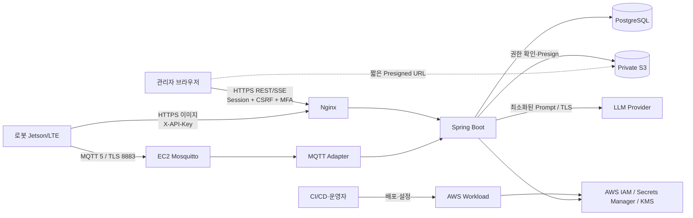

# 길봄 간단 위협 모델

- 문서 상태: 확정
- 적용 범위: 관리자 웹, Spring Boot API, 로봇 HTTPS/MQTT 연동, PostgreSQL, Private S3, LLM 연동, CI/CD·AWS 운영 경계
- 구현 시점: Day 3 인증·세션, Day 4 RBAC·CSRF·감사 로그 및 각 도메인 기능
- 관련 계약:
  - [`admin-authentication-security.md`](./admin-authentication-security.md)
  - [`authorization-matrix.md`](./authorization-matrix.md)
  - [`audit-and-sensitive-data-policy.md`](./audit-and-sensitive-data-policy.md)

## 1. 목적과 가정

이 문서는 길봄 서비스에서 우선 보호해야 할 자산, 외부 접근 지점, 관리자 권한 오용, AWS·LLM Secret 유출 가능성을 식별하고 구현 시 필수 통제를 정한다.

다음 전제를 사용한다.

- 인터넷, 관리자 브라우저, 로봇의 LTE 구간과 업로드 데이터는 신뢰하지 않는다.
- 프론트엔드는 보안 경계가 아니다. 최종 인증·인가·입력 검증은 서버가 수행한다.
- 관리자 웹·앱은 MQTT Broker에 직접 접속하지 않는다.
- 로봇의 0.5초 안전 정지는 로컬 프로세스가 담당하며 클라우드 MQTT 명령은 안전 제어의 유일한 수단이 아니다.
- S3 bucket은 Private이며 DB에는 `file_id`와 `object_key`만 저장한다.
- LLM 공급자는 특정하지 않지만 이 문서의 데이터 최소화·보존·권한 제한을 만족하는 공급자만 사용할 수 있다.
- 이 문서는 간단한 설계 위협 모델이며 침투 테스트나 AWS 계정 전체 보안 검토를 대체하지 않는다.

## 2. 보호할 데이터

| 등급 | 자산 | 주요 위협 | 필수 보호 |
|---|---|---|---|
| `S0 Secret` | 비밀번호 원문, 세션 ID, CSRF Token, TOTP secret·코드·복구 코드, 로봇 API Key·MQTT 비밀번호, TLS private key, DB 비밀번호, AWS·LLM credential | 계정 탈취, 로봇 위조, AWS 자원 장악, 데이터 유출 | 원문 저장·로그 금지, 전용 Secret 저장소, 최소 권한, 회전·폐기 |
| `S1 Privileged` | 역할·권한·사용자 배정, 관리자 명령, 운영 설정, 승인 정보, 감사 로그 | 권한 상승, 무단 명령, 증거 훼손 | MFA, RBAC·객체 범위, CSRF, 변경 감사, 분리 승인 |
| `S2 Restricted` | 관리자 이름·이메일·조직정보, 로봇 위치·이동 이력, 결함 위치·이미지, 보고서 본문·PDF, Presigned URL | 개인정보·운영정보 노출, 물리 위치 추적 | 전송·저장 암호화, 접근 범위, 짧은 URL 만료, LLM 전송 최소화 |
| `S3 Internal` | MQTT 기술 로그, 시스템 상태, 버전·배포 정보, 비민감 메트릭 | 내부 구조 노출, 공격 정찰 | 인증·운영자 제한, 공개 응답 최소화, 로그 redaction |
| `Public` | 최소 health 상태, 공개 정적 프론트엔드 | 상세 장애·구성 노출 | 상태값만 공개하고 구성·예외·credential은 미노출 |

추가 원칙은 다음과 같다.

- 비밀번호와 API Key·MQTT 비밀번호 원문은 영구 저장하지 않는다. 비밀번호는 adaptive hash, 고엔트로피 API Key는 검증용 hash만 저장한다.
- 세션 ID는 Spring Session 전용 저장소 외에 복제하지 않고 어떤 로그에도 남기지 않는다.
- TOTP secret은 검증에 필요하므로 KMS로 보호되는 키를 이용해 암호화하고 복구 코드는 hash만 저장한다.
- Presigned URL, Secret, 인증 헤더, 쿠키, SQL bind 값은 로그·감사·추적에 포함하지 않는다.
- 결함 이미지와 보고서는 업무상 필요한 사용자에게만 제공하고 브라우저에 영구 URL을 주지 않는다.

## 3. 시스템 흐름과 신뢰 경계

| 경계 | 신뢰 판단 | 규칙 |
|---|---|---|
| 인터넷 → Nginx | 비신뢰 | HTTPS만 허용, 요청 크기·속도 제한, 보안 헤더 |
| Nginx → Spring Boot | 내부 서비스 | 프록시 헤더 신뢰 대상을 Nginx로 제한, 백엔드 포트 외부 비공개 |
| 로봇/LTE → Mosquitto | 비신뢰 기기 네트워크 | MQTT TLS, 기기별 credential·ACL, schema·순번·만료 검증 |
| 로봇 → 이미지 API | 비신뢰 입력 | 기기별 API Key, robot ID 결합, JPEG 형식·500KB 상한 |
| Backend → PostgreSQL | 내부 데이터 경계 | 전용 DB 계정, parameter binding, 외부 포트 차단 |
| Backend/Browser → S3 | AWS 데이터 경계 | Private bucket, IAM 최소 권한, 짧은 Presigned URL |
| Backend → LLM | 제3자 처리 경계 | 전송 데이터 allowlist, Secret 미전송, 출력 불신, egress 제한 |
| CI/CD·운영자 → AWS | 관리면 | 개인 계정·MFA, 단기 credential, 배포·Secret 접근 감사 |

## 4. 외부 접근 지점

| 접근 지점 | 행위자·인증 | 노출 자산 | 주요 위협 | 필수 통제 |
|---|---|---|---|---|
| Nginx `443` 관리자 REST/SSE | 관리자 세션, TOTP MFA, CSRF | 로봇·결함·보고서·권한 | credential stuffing, 세션 탈취, CSRF, IDOR | 로그인 제한, 보안 쿠키, 세션 교체, RBAC·객체 범위, 입력 검증 |
| 공개 `/auth/csrf-token`, `/system/health`, `/system/info` | 미인증 | 최소 시스템 정보 | 정찰, 요청 폭주 | 최소 응답, rate limit, 상세 health 비공개 |
| `POST /api/v1/images` | 기기별 `X-API-Key` | 결함 이미지·로봇 ID | Key 탈취, 위장 업로드, 파일 폭탄 | Key hash·회전, 로봇 결합, JPEG 검증, 500KB, rate limit, 멀웨어 처리 격리 |
| MQTT `8883` | 로봇·백엔드 기기별 credential | 텔레메트리·사건·명령 | 로봇 위조, topic 침범, replay, retained 명령 | TLS, client별 topic ACL, schema·boot ID·seq·TTL, 명령 Retain 금지 |
| S3 Presigned URL | 권한 검증 후 소지자 | 이미지·프로필·PDF | URL 유출·재사용, 객체 덮어쓰기 | Private·Public Block, 짧은 만료, 단일 object/method, URL 로그 금지 |
| LLM API outbound | 백엔드 전용 LLM credential | 보고서용 최소 데이터 | prompt 유출, prompt injection, 비정상 비용, 부정확 결과 | allowlist prompt, no-training/최소 보존, schema 검증, rate·budget, 사람 승인 |
| AWS Console/API | 지정 운영자·workload role | S3·Secret·KMS·서버 | 과도한 IAM, 장기 Key 유출, 설정 변조 | 개인 계정 MFA, workload role, 최소 IAM, CloudTrail, 변경 분리 |
| Jenkins/CI/CD | 지정 배포 주체 | 빌드 산출물·배포 권한 | 공급망 변조, Secret 출력·이미지 포함 | 보호 브랜치, 승인, 단기 배포 credential, Secret masking, 이미지 scan |

PostgreSQL, Spring Boot 관리 포트, Actuator 상세 정보와 Mosquitto 관리 인터페이스는 인터넷에 공개하지 않는다. 외부 공개가 필요한 것은 Nginx HTTPS와 로봇 MQTT TLS뿐이다.

## 5. 관리자 권한 위협

역할별 최종 권한은 [`authorization-matrix.md`](./authorization-matrix.md)를 따른다.

| 역할 | 주요 권한 | 오용 시 영향 | 제한 |
|---|---|---|---|
| `ADMIN` | 사용자·역할·권한·설정, 로봇 credential, 전체 업무 | 전체 계정 탈취, 권한 상승, credential 재발급 | TOTP 필수, 단일 사용자 계정, 중요 변경 재인증, 마지막 ADMIN 보호, 전수 감사 |
| `MANAGER` | 임무·결함 병합·내보내기·보고서 승인·감사 조회 | 잘못된 임무, 정보 대량 반출, 부정 승인 | 로봇 객체 범위, 자기 보고서 승인 금지, export·승인 감사 |
| `OPERATOR` | 배정 로봇 조회·명령, 결함 수정, 보고서 작성 | 무단 명령, 상태 조작 | 배정 로봇 `OPERATOR/OWNER` 검사, 승인·관리 권한 미부여 |

관리자 통제는 다음과 같이 확정한다.

- 공유 관리자 계정을 금지하고 모든 행위를 개인 `user_id`로 추적한다.
- 모든 관리자 역할에 비밀번호와 TOTP MFA를 요구한다.
- 역할 권한에 사용자별 `ALLOW/DENY`를 적용하되 `DENY`가 우선한다.
- `ADMIN_SETTINGS_MANAGE`는 시스템 `ADMIN` 역할로만 부여한다.
- 시스템 `ADMIN` 외 사용자는 로봇 연계 리소스에 활성 객체 배정도 필요하다.
- 권한·역할·로봇 배정 변경 시 대상 사용자의 세션을 모두 폐기한다.
- 다른 사용자 MFA 초기화에는 작업자 자신의 비밀번호·TOTP 재검증과 사유를 요구한다.
- 최신 보고서 버전 작성자는 자신의 보고서를 승인할 수 없다.
- 관리자도 Secret 원문을 다시 조회할 수 없다. 로봇 credential·복구 코드는 발급 시 한 번만 표시한다.
- 권한 변경, 명령, export, 병합, 승인, Secret 발급·폐기는 성공·실패·거부를 감사한다.

## 6. AWS·LLM Secret 정책

### 6.1 Secret 목록과 저장 위치

| Secret | 운영 저장·주입 | 접근 주체 | 금지 |
|---|---|---|---|
| AWS API credential | 정적 Access Key 대신 EC2/ECS 등 workload IAM role의 단기 credential | 배포 workload | `.env`, Git, Docker image, 프론트 번들 |
| DB 비밀번호 | AWS Secrets Manager에서 런타임 주입 | Backend만 | compose 파일·명령행·로그 |
| LLM API Key | AWS Secrets Manager에서 런타임 주입 | 보고서 생성 Backend만 | DB, 프론트, prompt, 로그 |
| TOTP 암호화 master key | AWS KMS key로 encrypt/decrypt, DB에는 ciphertext와 key version | 인증 Backend만 | 원문 key 환경변수·DB |
| MQTT Backend credential·TLS private key | Secrets Manager 또는 제한된 인증서 저장소 | MQTT Adapter만 | Backend 일반 로그·이미지 |
| 로봇 API Key·MQTT 비밀번호 | 발급 원문 1회, DB에는 hash·Key ID | 해당 로봇과 검증 Backend | 원문 재조회·감사 로그 |

현재 `.env.example`은 로컬 개발용 placeholder에만 사용한다. 운영에서는 `.env` 파일로 Secret을 배포하지 않는다.

### 6.2 IAM과 런타임 주입

- Backend와 MQTT Adapter는 별도 workload role을 사용한다.
- Backend S3 권한은 지정 bucket·prefix의 필요한 `GetObject`, `PutObject`와 Presign에 필요한 작업으로 제한한다.
- MQTT Adapter는 S3·LLM·관리자 Secret에 접근할 수 없다.
- LLM을 호출하지 않는 서비스와 프론트엔드는 LLM Secret을 받을 수 없다.
- Secret ARN과 KMS key를 리소스 단위로 제한하고 wildcard 관리자 권한을 애플리케이션 role에 주지 않는다.
- CI/CD는 애플리케이션 Secret 값을 읽지 않고 배포 대상의 Secret 참조만 설정한다.
- Secret은 build arg, Docker layer, JVM option, 프로세스 명령행에 넣지 않는다.
- Secret 접근·KMS decrypt·IAM 변경은 CloudTrail로 추적하고 비정상 접근 경보를 만든다.

### 6.3 회전과 유출 대응

| 대상 | 정기 정책 | 유출 의심 시 |
|---|---|---|
| AWS workload credential | AWS가 단기 자동 회전 | role session 차단, 정책·CloudTrail 검토 |
| DB 비밀번호 | 90일 이내 또는 관리형 자동 회전 | 새 credential 발급, 기존 폐기, Backend 재시작 |
| LLM API Key | 90일 이내 | 즉시 폐기·재발급, 사용량·요청 이력 확인 |
| 로봇 API Key·MQTT 비밀번호 | 기기 교체·분실 또는 최대 180일 | 해당 기기 credential만 즉시 revoke·재발급 |
| TOTP KMS key | KMS 정기 회전 | 영향 factor 재암호화 또는 강제 재등록, 모든 세션 폐기 |

Secret 유출 사고에서는 값 자체를 감사 로그에 남기지 않고 Secret 식별자, 영향 사용자·로봇, 폐기·회전 시각과 작업자만 기록한다.

### 6.4 LLM 데이터와 출력

LLM은 보고서 초안을 만드는 보조자이며 신뢰하는 의사결정 주체가 아니다.

- LLM에는 통계 집계, 결함 유형·심각도, 비식별화된 설명처럼 보고서 작성에 필요한 allowlist 필드만 보낸다.
- 비밀번호, Token, API Key, 세션·쿠키, TOTP, AWS 정보, 내부 prompt, SQL·스택 트레이스, 관리자 이메일·이름을 보내지 않는다.
- 원본 이미지, 정밀 위치 좌표, 원본 시스템·감사 로그는 기본 전송 금지다. 필요하면 별도 개인정보·보안 검토를 먼저 수행한다.
- 사용자 입력과 결함 설명을 system instruction에 직접 이어붙이지 않고 명확한 데이터 영역으로 분리한다.
- LLM에 DB, S3, AWS, MQTT 도구 권한이나 임의 URL fetch 권한을 주지 않는다.
- 공급자 설정에서 학습 사용을 비활성화하고 요청·응답 보존을 비활성화하거나 제공 가능한 최소 기간으로 제한한다.
- 공급자의 보존·학습 정책을 만족하지 못하면 `generationMethod=LLM`을 비활성화하고 템플릿 방식만 사용한다.
- outbound 대상 host를 허용 목록으로 제한하고 TLS, timeout, 재시도 상한, 사용자·일별 rate limit과 비용 budget을 적용한다.
- LLM 출력은 길이와 JSON schema를 검증하고 HTML·SQL·명령으로 실행하지 않는다. 화면 출력은 escape한다.
- LLM 결과는 항상 `DRAFT`로 저장하며 사람이 검토하고 작성자와 다른 권한자가 승인해야 한다.
- 운영 로그에는 model ID, prompt version, token 수, 지연, 결과 코드, `requestId`만 남기고 prompt·응답 원문은 남기지 않는다.

## 7. 주요 위협과 대응

| ID | 위협 | 초기 위험 | 필수 통제 | 잔여 위험 |
|---|---|:---:|---|:---:|
| `TM-01` | 관리자 credential stuffing·계정 열거 | 높음 | TOTP, 공통 실패 응답, 계정·IP rate limit, 감사·경보 | 중간 |
| `TM-02` | 세션 탈취·고정·장기 재사용 | 높음 | Secure/HttpOnly/SameSite 쿠키, 인증 후 ID 교체, 유휴·절대 만료, 동시 1세션 | 중간 |
| `TM-03` | CSRF로 명령·권한·승인 수행 | 높음 | 세션 결합 CSRF, 모든 상태 변경과 로그인·로그아웃 검증 | 낮음 |
| `TM-04` | RBAC 우회·IDOR·과도한 관리자 권한 | 높음 | 기본 거부, 메서드 권한, 객체 배정, 컬렉션 필터, 매트릭스 테스트 | 중간 |
| `TM-05` | 내부 관리자의 명령·export·승인 오용 | 높음 | 최소 권한, 자기 승인 금지, 사유·재인증, 전수 감사 | 중간 |
| `TM-06` | 로봇 API Key 탈취와 위장 이미지 | 높음 | 기기별 Key hash·회전, robot ID 결합, 파일·rate 제한 | 중간 |
| `TM-07` | MQTT topic 위조·replay·과거 명령 재실행 | 매우 높음 | TLS, client ACL, boot ID·seq·TTL, command ID, Retain 금지 | 중간 |
| `TM-08` | 악성·대용량 이미지와 저장소 고갈 | 높음 | JPEG magic·크기·해상도 검증, 500KB, 격리 처리, quota | 낮음 |
| `TM-09` | S3 객체 또는 Presigned URL 유출 | 높음 | Private/Public Block, 최소 IAM, 단기 단일 객체 URL, query 로그 금지 | 중간 |
| `TM-10` | SQL Injection·예외를 통한 내부 구조 노출 | 높음 | parameter binding, 입력 검증, 고정 오류, SQL·bind 로그 금지 | 낮음 |
| `TM-11` | AWS·LLM Secret 유출과 과도한 IAM | 매우 높음 | workload role, Secrets Manager·KMS, 서비스별 role, 회전, CloudTrail | 중간 |
| `TM-12` | LLM prompt injection·데이터 유출·환각·비용 폭주 | 높음 | 데이터 allowlist, 도구 권한 없음, schema 검증, no-training, 사람 승인, budget | 중간 |
| `TM-13` | 감사 로그 변조·부인 방지 실패 | 높음 | 추가 전용, 중요 변경과 동일 트랜잭션, 별도 접근 권한, 백업 | 낮음 |
| `TM-14` | 공개 API·SSE·MQTT 요청 폭주 | 높음 | Nginx·애플리케이션 rate limit, 연결·payload 상한, timeout, backpressure | 중간 |

잔여 위험이 중간인 항목은 구현 테스트와 운영 모니터링을 모두 적용한 뒤 수용한다. 통제가 구현되지 않은 상태에서는 해당 기능을 운영에 공개하지 않는다.

## 8. 검증과 완료 조건

### Day 3

- 로그인 계정·IP 제한, 계정 열거 방지, MFA와 세션 수명 테스트
- 세션 ID·비밀번호·TOTP가 응답·로그·추적에 없는지 검사
- 인증 성공 시 세션·CSRF 교체 및 로그아웃·권한 변경 폐기 테스트

### Day 4

- 전체 API 역할 매트릭스와 다른 사용자 UUID를 이용한 IDOR 부정 테스트
- 모든 상태 변경 API의 CSRF 부정 테스트
- 권한·명령·export·승인·Secret 수명주기 감사 테스트

### 인프라·연동

- 인터넷에 Nginx 443과 MQTT TLS 8883 외 DB·Backend·Actuator 관리 포트가 열리지 않았는지 확인
- S3 Public Access Block, bucket policy, Presigned URL 만료·method·object 범위 확인
- 서비스별 IAM role과 Secret·KMS 리소스 제한 검토
- Git history, Docker image, 프론트 bundle, Jenkins log의 Secret scan
- MQTT client별 topic ACL, TLS, replay·TTL·Retain 금지 테스트
- LLM prompt allowlist, 금지값 redaction, 출력 schema·escape, rate·budget 테스트

위 항목과 `TM-01`~`TM-14`의 필수 통제가 테스트 또는 인프라 검증 항목으로 연결되면 이 위협 모델의 구현 반영이 완료된 것으로 본다.

