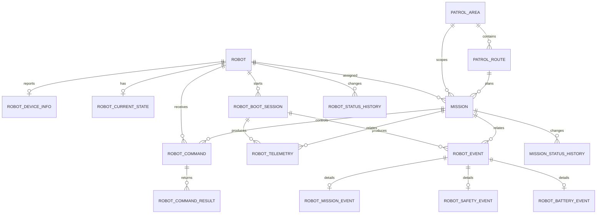

# 팀원 B DB 스키마 V1

> 문서 버전: V1  
> 작성 기준일: 2026-07-27  
> 담당: 팀원 B — 로봇 통신·임무·실시간 관제  
> 대상 DB: PostgreSQL 16 + PostGIS 3.5  
> MQTT 기준: `tbs/v2/robots/{robot_id}/...`, `schema_version = "2.0"`  
> Flyway 구현 예정 버전: 스키마 확정 후 `V5__create_robot_telemetry_schema.sql`

## 1. 문서 목적

이 문서는 팀원 B가 소유하는 로봇·텔레메트리·임무·명령 테이블의 V1 설계를
정의한다. 테이블 이름만 나열하지 않고 다음 구현 규칙까지 함께 고정한다.

- MQTT v2 Payload와 DB 칼럼의 원천 구분
- 로봇이 보고한 값과 서버가 관리·계산한 값의 분리
- 로봇 발급 `seq`와 서버 수신 시각의 처리
- 오래된 State·Telemetry가 최신 상태를 덮지 못하게 하는 규칙
- Flyway, DB Role, 최소 권한, Secret·감사 로그 정책
- 팀원 A·C 테이블과의 책임 경계

이 문서의 V1은 설계 문서 버전이다. 실제 Flyway의 V1과 혼동하지 않는다. 현재
프로젝트의 공통 Flyway V1~V4 다음에 팀원 B migration을 V5로 추가한다.

## 2. 적용 기준과 우선순위

충돌이 있을 때 다음 순서로 판단한다.

1. 현재 Java MQTT v2 DTO와 `final-mqtt-topic-schema-v2.md`
2. `database-migrations.md`와 기존 Flyway V1~V4
3. `authorization-matrix.md`, `audit-and-sensitive-data-policy.md`
4. `threat-model.md`, `environment-configuration-strategy.md`
5. `mqtt-device-db-mapping.md`와 `docs/길봄_DB_DDL.sql`

`mqtt-device-db-mapping.md`와 최종 DDL은 v1 Topic을 기준으로 작성된 부분이 있으므로
테이블 관계의 참고 자료로만 사용한다. Namespace, Payload 필드, enum, 명령 종류,
`schema_version`은 현재 구현된 MQTT v2 계약을 우선한다.

적용한 공통 규칙은 다음과 같다.

- DB 변경은 `backend/src/main/resources/db/migration`의 Flyway version migration만 사용한다.
- 적용된 `V*.sql`은 수정하지 않고 다음 version에서 `ALTER`한다.
- Hibernate `ddl-auto=none`, Spring Session 자동 DDL `never`,
  `flyway.clean-disabled=true`를 유지한다.
- 업무 시각은 `TIMESTAMPTZ`로 저장하고 DB·서버 표준 timezone은 UTC로 사용한다.
- Flyway owner와 Spring runtime 계정을 분리한다.
- Runtime 계정에는 테이블별 필요한 DML만 명시적으로 부여한다.
- MQTT 비밀번호, API Key, private key, 인증 헤더와 세션 값은 업무 테이블과
  `raw_payload`에 저장하지 않는다.
- 위치·이동 이력은 제한 데이터로 취급하고 로봇 객체 범위를 DB query 단계에서 적용한다.
- SQL, bind 값, constraint·table·column 이름은 외부 오류나 운영 로그에 노출하지 않는다.

## 3. 책임 경계

### 3.1 팀원 B가 생성·관리하는 Schema

```text
robot
telemetry
```

### 3.2 팀원 B 소유 테이블

| Schema | 테이블 | 역할 |
|---|---|---|
| `robot` | `robot` | 서버가 관리하는 로봇 등록 기준정보 |
| `robot` | `robot_device_info` | 계약 확정 전 보류한 장치정보 최신값 |
| `robot` | `patrol_area` | 순찰 구역 Polygon |
| `robot` | `patrol_route` | 계획 경로를 구현할 때 사용하는 선택 테이블 |
| `robot` | `mission` | 임무 현재 상태와 진행 집계 |
| `robot` | `mission_status_history` | 임무 상태 전이 이력 |
| `robot` | `robot_status_history` | 연결 상태·운행 모드 변경 이력 |
| `robot` | `robot_command` | 서버가 생성한 명령과 발행·만료 상태 |
| `robot` | `robot_command_result` | 로봇 ACK와 최종 실행 결과 |
| `telemetry` | `robot_boot_session` | Presence와 부팅·연결 이력 |
| `telemetry` | `robot_telemetry` | Telemetry 측정 이력 |
| `telemetry` | `robot_current_state` | 실시간 관제용 최신 상태 |
| `telemetry` | `robot_event` | Event 공통 Envelope |
| `telemetry` | `robot_battery_event` | Battery Event 상세 |
| `telemetry` | `robot_safety_event` | Safety Event 상세 |
| `telemetry` | `robot_mission_event` | Mission Event 상세 |

### 3.3 다른 팀 소유 테이블

| 대상 | 소유자 | 팀원 B의 사용 방식 |
|---|---|---|
| `auth.admin_user` | A | 등록자·임무 생성자·명령 요청자 FK 참조 |
| `auth.user_robot_assignment` | A | 로봇별 조회·명령·임무 객체 범위 검사 |
| `request_control.idempotency_request` | A | 명령 REST 요청의 중복 생성 방지 |
| `audit.audit_log` | A | 명령·임무·로봇 변경 감사 행 INSERT |
| `defect.*` | C | 전달받은 Incident Event의 저장·결함 처리 |
| `storage.*` | C/A | 이미지 object와 Incident 연결 |
| `report.*` | A | 임무 통계·보고서 근거 조회 |

팀원 B migration은 위 다른 팀 Schema에 새 테이블이나 칼럼을 만들지 않는다. 이미
생성된 PK를 FK로 참조하거나 서비스 트랜잭션에서 정해진 API·repository를 사용하는
것만 허용한다.

## 4. 핵심 설계 결정

### 4.1 로봇 등록과 로봇 보고정보를 분리한다

`robot.robot`은 서버가 신뢰하는 등록 기준정보다. MQTT 메시지를 처음 받았다는
이유만으로 미등록 로봇을 자동 생성하지 않는다. MVP에서는 별도 등록 화면 없이
운영 Seed 또는 제한된 프로비저닝 절차로 사전 등록한다.

`robot.robot_device_info`는 로봇이 직접 보고한 정보다. 로봇의 자기 보고값은 등록
권한을 부여하지 않으며 등록된 `robot_code`와 연결할 때만 저장한다.

### 4.2 펌웨어 버전은 저장하지 않는다

현재 `embedded`는 Jetson에서 실행되는 Python 애플리케이션이고 별도 MCU 펌웨어
프로젝트가 없다. 따라서 다음 칼럼은 만들지 않는다.

```text
firmware_version
```

MQTT `schema_version`과 AI `model.version`은 각각 Payload 계약과 AI 모델의
버전이므로 그대로 유지한다. 추후 실제 배포 버전 정책이 생기면
`software_version`을 새 계약과 새 Flyway version으로 추가한다.

### 4.3 MQTT username과 Client ID를 로봇 기준정보에 중복 저장하지 않는다

- 계약상 MQTT username은 `robot_code`와 동일하다.
- 현재 Backend 수신 객체에는 발행 로봇의 MQTT username과 Client ID가 없다.
- Mosquitto가 인증과 Topic ACL을 수행하며 Backend는 Topic의 `robot_id`와
  Payload의 `robot_id`를 교차 검증한다.
- 비밀번호와 private key 원문은 DB에 저장하지 않는다.

Credential Registry와 Mosquitto `passwd`·ACL의 동기화 프로비저닝은 별도 보안
작업이다. DB 행 하나를 추가하는 것만으로 Broker 계정이 생성된다고 가정하지 않는다.

### 4.4 `seq`는 로봇이 발급한다

`seq`는 서버 DB sequence가 아니다. 로봇이 새로운 `boot_id`를 만들 때 초기화하고
State·Telemetry·Event 전체에서 공유하는 증가 순번이다.

서버는 다음 원칙을 적용한다.

- 수신 순서대로 `seq + 1`을 새로 부여하지 않는다.
- `robot_boot_session.last_seen_seq`에는 수신한 최댓값만 기록한다.
- 업데이트는 `GREATEST(last_seen_seq, incoming_seq)`와 같은 원자적 연산을 사용한다.
- `message_id`, `event_id` 같은 자연 멱등 키를 중복 처리의 주 기준으로 사용한다.
- `seq` 역전과 누락은 진단 대상으로 기록하되 도착 순서만으로 실제 발생 순서를 바꾸지 않는다.

V1에서는 별도 전역 seq ledger를 만들지 않는다. Topic 전체의 모든 순번을 영구
감사해야 할 요구가 생기면 append-only ledger를 후속 version으로 추가한다.

### 4.5 로봇 시각과 서버 시각을 분리한다

| 의미 | 예시 |
|---|---|
| 로봇 발생 시각 | `sampled_at`, `updated_at`, `occurred_at`, `sent_at` |
| 서버 수신 시각 | `received_at`, `state_received_at`, `server_received_at` |

서로 다른 장치의 clock skew가 있으므로 DB CHECK로
`server_received_at >= robot_timestamp`를 강제하지 않는다. NTP 동기화와 허용 가능한
clock skew 검증은 애플리케이션 정책으로 처리한다.

### 4.6 원본과 서버 계산값을 구분한다

- `raw_payload`는 검증을 통과한 업무 JSON 원본이며 서버 보정값을 섞지 않는다.
- `overall_health_status`, 명령 Timeout, 임무 진행률은 서버 계산값이다.
- 배터리 추정값은 Payload의 `source=ESTIMATED`로 출처를 명시한다.
- 생성할 수 없는 센서 값은 임의 숫자 대신 `null` 또는 `valid=false`로 저장한다.

## 5. 관계 구조



Incident Event는 B가 MQTT 전달 경로만 지원하며 저장과 내용 처리는 C가 소유한다.
따라서 B의 `telemetry.robot_event`에는 Battery·Safety·Mission Event만 저장한다.
Incident 상세, 결함 생성·병합, AI 관측과 이미지 연결은 C 테이블로 이어진다.

## 6. 식별자 규칙

| 외부 값 | DB 조회·저장 | 규칙 |
|---|---|---|
| Topic·Payload `robot_id` | `robot.robot.robot_code` 조회 후 내부 `robot_id` UUID | Topic과 Payload 값 일치 |
| Payload `mission_id` | `robot.mission.mission_code` 조회 후 내부 `mission_id` UUID | 대상 로봇에 배정된 임무만 허용 |
| `requested_by.actor_id` | `auth.admin_user.user_code` 조회 후 `user_id` UUID | 인증 세션의 행위자와 일치 |
| `boot_id` | Payload UUID 그대로 | 로봇 프로세스 시작마다 새 값 |
| `message_id` | Payload UUID 그대로 PK | Telemetry 멱등 키 |
| `event_id` | Payload UUID 그대로 PK | QoS 1 Event 멱등 키 |
| `command_id` | 서버 생성 UUID | REST 멱등 처리 후 MQTT와 결과 연결 |
| `result_id` | Payload UUID 그대로 PK | Command Result 멱등 키 |

코드형 Wire ID와 내부 UUID를 같은 값으로 취급하지 않는다.

## 7. 컬럼 검토 기준

아래 명세는 Flyway SQL이 아니라 **V5 작성 전 검토안**이다. `필수`는 DB의
`NOT NULL` 후보를 뜻하며, `조건부`는 Payload나 업무 상태에 따라 `NULL`을 허용한다.

컬럼을 유지할지는 다음 기준으로 판단한다.

1. 현재 MQTT v2 Payload, 관리자 API 또는 서버 계산 로직이 실제로 값을 만드는가?
2. PK·FK, 멱등성, 최신 데이터 판정 또는 상태 전이에 필요한가?
3. 다른 테이블에서 안전하게 계산할 수 있는 값을 중복 저장하고 있지 않은가?
4. 팀원 A·C의 책임 데이터를 B 테이블에 복제하고 있지 않은가?
5. 비밀번호, API Key, 인증서 private key 같은 Secret이 들어갈 가능성이 없는가?

공통 원칙은 다음과 같다.

- 내부 PK와 FK는 `UUID`를 사용한다.
- 금액이 아닌 측정값은 필요한 정밀도에 맞춘 `NUMERIC` 또는 `DOUBLE PRECISION`을 사용한다.
- 로봇 시각과 서버 시각은 모두 `TIMESTAMPTZ`로 분리한다.
- 코드와 상태값은 `VARCHAR`와 `CHECK` 제약조건으로 허용값을 제한한다.
- `raw_payload`를 유지한다면 검증이 끝난 업무 JSON만 저장하고 Secret을 금지하며 보존기간을 정한다.
- 외부 API에는 DB 테이블·컬럼·제약조건 이름을 노출하지 않는다.

## 8. `robot` Schema 컬럼 검토안

### 8.1 `robot.robot`

관리자가 사용을 승인한 로봇의 기준정보다. MQTT 메시지를 처음 받았다는 이유만으로
이 테이블에 로봇을 자동 등록하지 않는다.

| 컬럼 | 타입 | 필수 | 출처 | 필요성·제약 |
|---|---|---|---|---|
| `robot_id` | `UUID` | O | 서버 생성 | PK, 내부 FK 전용 |
| `robot_code` | `VARCHAR(128)` | O | 서버 등록 | UNIQUE, MQTT Topic·Payload의 `robot_id` |
| `robot_name` | `VARCHAR(100)` | O | 관리자 | 화면 표시명 |
| `operational_status` | `VARCHAR(20)` | O | 관리자·서버 | `ACTIVE`, `INACTIVE`, `MAINTENANCE`, `DISABLED` |
| `created_by` | `UUID` | 조건부 | 인증 세션 | `auth.admin_user.user_id` FK, 초기 Seed는 `NULL` 허용 |
| `created_at` | `TIMESTAMPTZ` | O | 서버 | 등록 시각 |
| `updated_at` | `TIMESTAMPTZ` | O | 서버 | 최종 기준정보 변경 시각 |

검토 결과:

- `robot_code`와 MQTT username은 계약상 같은 값이므로 `mqtt_username`을 중복 저장하지 않는다.
- 현재 Backend 수신 메시지에는 publisher Client ID가 없으므로 `mqtt_client_id`를 만들지 않는다.
- `serial_number`, `hardware_model`은 현재 MQTT v2에 없으므로 이 테이블에 임의로 채우지 않는다.
- `registered_at`은 `created_at`과 의미가 같아 별도 컬럼으로 두지 않는다.
- 물리 삭제 대신 `operational_status`로 비활성화하고 변경은 `audit.audit_log`에 남긴다.

### 8.2 `robot.robot_device_info` — 계약 확정 전 보류

로봇이 직접 보고하는 하드웨어 정보를 저장할 후보 테이블이다. 현재 MQTT v2에는
`device-info` Topic이 없으므로 **현 상태의 V5 생성 대상에서는 제외**한다.

| 컬럼 | 타입 | 필수 | 출처 | 필요성·제약 |
|---|---|---|---|---|
| `robot_id` | `UUID` | O | Topic의 로봇 코드 조회 | PK이자 `robot.robot` FK |
| `serial_number` | `VARCHAR(100)` | 조건부 | 향후 로봇 보고 | 값이 실제로 제공될 때만 저장, UNIQUE 여부는 임베디드팀 확인 |
| `hardware_model` | `VARCHAR(100)` | 조건부 | 향후 로봇 보고 | 장치 모델 |
| `reported_at` | `TIMESTAMPTZ` | O | 향후 Payload | 로봇이 정보를 보고한 시각 |
| `received_at` | `TIMESTAMPTZ` | O | 서버 | 서버 수신 시각 |
| `updated_at` | `TIMESTAMPTZ` | O | 서버 | 최신 행 갱신 시각 |

`firmware_version`은 두지 않는다. 추후 실제 배포 소프트웨어 버전 관리 요구가 생기면
MQTT 계약을 먼저 변경한 뒤 새로운 Flyway migration에서 추가한다.

### 8.3 `robot.patrol_area`

관리자가 지도에서 지정한 하나의 순찰 구역이다.

| 컬럼 | 타입 | 필수 | 출처 | 필요성·제약 |
|---|---|---|---|---|
| `patrol_area_id` | `UUID` | O | 서버 생성 | PK |
| `zone_id` | `VARCHAR(50)` | O | 서버 생성·관리자 | UNIQUE, MQTT `zone_id`로 전달하는 공개 코드 |
| `area_name` | `VARCHAR(100)` | O | 관리자 | 화면 표시명 |
| `area_geometry` | `GEOMETRY(POLYGON, 4326)` | O | 관리자 지도 입력 | 비어 있지 않고 유효한 Polygon, GIST 인덱스 |
| `description` | `TEXT` | X | 관리자 | 구역 설명 |
| `is_active` | `BOOLEAN` | O | 관리자 | 과거 임무 보존을 위한 논리 비활성화 |
| `created_by` | `UUID` | O | 인증 세션 | `auth.admin_user.user_id` FK |
| `created_at` | `TIMESTAMPTZ` | O | 서버 | 생성 시각 |
| `updated_at` | `TIMESTAMPTZ` | O | 서버 | 수정 시각 |

구역 하나가 서로 떨어진 여러 면으로 구성되어야 한다면 구현 전에
`MULTIPOLYGON`으로 바꾼다. V1 기본안은 단일 `POLYGON`이다.

### 8.4 `robot.patrol_route`

순찰 구역 안에서 로봇이 따라갈 계획 경로다. 단순 구역 순찰만 구현하고 계획 경로를
사용하지 않는 MVP라면 이 테이블과 `mission.patrol_route_id`를 함께 제외할 수 있다.

| 컬럼 | 타입 | 필수 | 출처 | 필요성·제약 |
|---|---|---|---|---|
| `patrol_route_id` | `UUID` | O | 서버 생성 | PK |
| `patrol_area_id` | `UUID` | O | 관리자 선택 | `robot.patrol_area` FK |
| `route_code` | `VARCHAR(50)` | O | 서버 | UNIQUE, 외부 표시용 코드 |
| `route_name` | `VARCHAR(100)` | O | 관리자 | 화면 표시명 |
| `route_geometry` | `GEOMETRY(LINESTRING, 4326)` | O | 관리자 지도 입력 | 유효한 LineString, GIST 인덱스 |
| `planned_distance_m` | `NUMERIC(12,2)` | O | 서버 계산 | 0 이상, 진행률·ETA 계산 기준 |
| `is_active` | `BOOLEAN` | O | 관리자 | 논리 비활성화 |
| `created_by` | `UUID` | O | 인증 세션 | `auth.admin_user.user_id` FK |
| `created_at` | `TIMESTAMPTZ` | O | 서버 | 생성 시각 |
| `updated_at` | `TIMESTAMPTZ` | O | 서버 | 수정 시각 |

### 8.5 `robot.mission`

임무의 현재 상태와 서버 계산 집계를 보관한다. 상태 변경 이력은 별도
`mission_status_history`에 기록한다.

| 컬럼 | 타입 | 필수 | 출처 | 필요성·제약 |
|---|---|---|---|---|
| `mission_id` | `UUID` | O | 서버 생성 | PK |
| `mission_code` | `VARCHAR(50)` | O | 서버 생성 | UNIQUE, MQTT `mission_id` |
| `mission_name` | `VARCHAR(100)` | O | 관리자 | 화면 표시명 |
| `description` | `TEXT` | X | 관리자 | 임무 설명 |
| `robot_id` | `UUID` | O | 관리자 | 배정된 `robot.robot` FK |
| `patrol_area_id` | `UUID` | O | 관리자 | `robot.patrol_area` FK |
| `patrol_route_id` | `UUID` | X | 관리자 | 계획 경로를 사용할 때 `robot.patrol_route` FK |
| `mission_status` | `VARCHAR(20)` | O | 서버 상태머신 | `READY`, `RUNNING`, `PAUSED`, `COMPLETED`, `CANCELLED`, `FAILED` |
| `scheduled_start_at` | `TIMESTAMPTZ` | X | 관리자 | 예약 시작 시각 |
| `scheduled_end_at` | `TIMESTAMPTZ` | X | 관리자 | 예약 종료 시각, 시작보다 빠를 수 없음 |
| `started_at` | `TIMESTAMPTZ` | X | 서버 | 실제 시작 Event 또는 확정된 상태 전이 시각 |
| `ended_at` | `TIMESTAMPTZ` | X | 서버 | 완료·취소·실패 시각 |
| `progress_percent` | `NUMERIC(5,2)` | O | 서버 계산 | 0~100 |
| `estimated_completion_at` | `TIMESTAMPTZ` | X | 서버 계산 | 관제 화면 ETA |
| `traveled_distance_m` | `NUMERIC(12,2)` | X | 서버 계산 | 유효 GPS 궤적 기반, 0 이상 |
| `incident_count` | `INTEGER` | O | Mission Event | 로봇 보고 집계, 0 이상 |
| `normal_detection_count` | `INTEGER` | O | Mission Event | 로봇 보고 집계, 0 이상 |
| `completion_reason` | `VARCHAR(100)` | X | Mission Event·서버 | 종료 이유 코드 또는 제한된 문자열 |
| `created_by` | `UUID` | O | 인증 세션 | `auth.admin_user.user_id` FK |
| `created_at` | `TIMESTAMPTZ` | O | 서버 | 생성 시각 |
| `updated_at` | `TIMESTAMPTZ` | O | 서버 | 최종 갱신 시각 |

검토할 사항:

- 로봇을 정하지 않은 임무 초안이 필요하면 `robot_id`를 nullable로 하고 `DRAFT` 상태를 추가한다.
- `priority`는 현재 요구사항과 MQTT v2에 없으므로 기본안에서 제외한다.
- 진행률과 ETA는 로봇 Payload 원본이 아니라 서버 계산값이다.

### 8.6 `robot.mission_status_history`

임무 상태 전이를 append-only로 저장한다.

| 컬럼 | 타입 | 필수 | 출처 | 필요성·제약 |
|---|---|---|---|---|
| `mission_status_history_id` | `UUID` | O | 서버 생성 | PK |
| `mission_id` | `UUID` | O | 서버 | `robot.mission` FK |
| `from_status` | `VARCHAR(20)` | X | 서버 | 최초 생성 이력은 `NULL` |
| `to_status` | `VARCHAR(20)` | O | 서버·Mission Event | 허용된 임무 상태 |
| `transition_source` | `VARCHAR(20)` | O | 서버 | `ADMIN`, `ROBOT`, `SYSTEM` |
| `reason_code` | `VARCHAR(100)` | X | 명령·Event·서버 | 상태 변경 이유 |
| `related_command_id` | `UUID` | X | 서버 | 원인이 된 `robot_command` FK |
| `related_event_id` | `UUID` | X | MQTT | 원인이 된 Mission Event FK |
| `changed_by` | `UUID` | X | 인증 세션 | 관리자 변경일 때 `auth.admin_user` FK |
| `occurred_at` | `TIMESTAMPTZ` | X | 로봇 Event | 로봇에서 발생한 시각 |
| `recorded_at` | `TIMESTAMPTZ` | O | 서버 | 서버 기록 시각 |

이 테이블에는 `UPDATE`, `DELETE` 권한을 부여하지 않는다.

### 8.7 `robot.robot_status_history`

Presence와 State에서 확인한 연결 상태·운행 모드 변경을 append-only로 저장한다.
단순 반복 메시지는 저장하지 않고 실제 상태가 바뀐 경우에만 INSERT한다.

| 컬럼 | 타입 | 필수 | 출처 | 필요성·제약 |
|---|---|---|---|---|
| `robot_status_history_id` | `UUID` | O | 서버 생성 | PK |
| `robot_id` | `UUID` | O | Topic 조회 | `robot.robot` FK |
| `boot_id` | `UUID` | X | Presence·State | `robot_boot_session` FK |
| `connectivity_status` | `VARCHAR(10)` | X | Presence·Timeout | `ONLINE`, `OFFLINE` |
| `robot_mode` | `VARCHAR(20)` | X | State | `RobotMode` 값 |
| `reason_code` | `VARCHAR(50)` | X | Presence·State·서버 | Offline 또는 상태 변경 이유 |
| `mission_id` | `UUID` | X | State | 내부 Mission FK |
| `mission_status` | `VARCHAR(20)` | X | State | 활성 임무 상태 |
| `change_source` | `VARCHAR(20)` | O | 서버 | `PRESENCE`, `STATE`, `TIMEOUT`, `SYSTEM` |
| `observed_at` | `TIMESTAMPTZ` | X | 로봇 Payload | State의 `updated_at` 등 로봇 시각 |
| `received_at` | `TIMESTAMPTZ` | O | 서버 | 서버가 상태 변경을 확정한 시각 |

`connectivity_status`, `robot_mode`, `mission_status` 중 적어도 하나는 존재해야 한다.

### 8.8 `robot.mission_trajectory` — 기본안에서 제외

실제 궤적은 `telemetry.robot_telemetry`의 `mission_id`, 유효 위치, `sampled_at`을
순서대로 조회하면 재구성할 수 있다. 같은 좌표를 다시 저장하는
`mission_trajectory`는 V1 기본안에서 제외한다.

대량 데이터 조회 성능이 실제로 문제가 될 때만 후속 migration에서 단순화한
LineString read model 또는 집계 테이블을 추가한다.

### 8.9 `robot.robot_command`

REST에서 승인된 명령을 먼저 저장한 뒤 MQTT로 발행한다. Frontend가 Broker에 직접
명령을 발행하지 않는다.

| 컬럼 | 타입 | 필수 | 출처 | 필요성·제약 |
|---|---|---|---|---|
| `command_id` | `UUID` | O | 서버 생성 | PK, MQTT 멱등 키 |
| `schema_version` | `VARCHAR(10)` | O | 서버 | 현재 `2.0` |
| `robot_id` | `UUID` | O | API 대상 | `robot.robot` FK |
| `mission_id` | `UUID` | X | START 명령 | `robot.mission` FK |
| `patrol_area_id` | `UUID` | X | START 명령 | `zone_id`를 결정하는 Area FK |
| `command_type` | `VARCHAR(30)` | O | 관리자·서버 | MQTT v2 `CommandType` |
| `command_status` | `VARCHAR(20)` | O | 서버 상태머신 | `CREATED`, `SENT`, `ACCEPTED`, `COMPLETED`, `FAILED`, `REJECTED`, `EXPIRED`, `PUBLISH_FAILED` |
| `parameters` | `JSONB` | O | 서버 | 실제 발행한 `parameters` 스냅샷, Secret 금지 |
| `requested_by_type` | `VARCHAR(10)` | O | 인증·서버 | `ADMIN`, `SYSTEM` |
| `requested_by_user_id` | `UUID` | X | 인증 세션 | ADMIN이면 `auth.admin_user` FK, SYSTEM이면 `NULL` |
| `issued_at` | `TIMESTAMPTZ` | O | 서버 | 명령 생성 시각 |
| `expires_at` | `TIMESTAMPTZ` | O | 서버 | `issued_at`보다 늦어야 함 |
| `sent_at` | `TIMESTAMPTZ` | X | MQTT Publisher | 최초 발행 성공 시각 |
| `accepted_at` | `TIMESTAMPTZ` | X | Command Result | `ACCEPTED` 수신 시각 |
| `completed_at` | `TIMESTAMPTZ` | X | Command Result·Timeout | 최종 상태 확정 시각 |
| `publish_attempt_count` | `INTEGER` | O | 서버 | 0 이상 |
| `last_error_code` | `VARCHAR(100)` | X | 서버 | 내부 제한 코드만 저장, 예외·SQL 원문 금지 |
| `created_at` | `TIMESTAMPTZ` | O | 서버 | 생성 시각 |
| `updated_at` | `TIMESTAMPTZ` | O | 서버 | 상태 갱신 시각 |

`request_control.idempotency_request`가 REST 멱등성을 담당하므로 원문
`Idempotency-Key`를 이 테이블에 다시 저장하지 않는다.

### 8.10 `robot.robot_command_result`

하나의 명령에 `ACCEPTED`와 최종 결과가 각각 올 수 있으므로 `command_id`를 PK로
사용하지 않고 `result_id`를 PK로 사용한다.

| 컬럼 | 타입 | 필수 | 출처 | 필요성·제약 |
|---|---|---|---|---|
| `result_id` | `UUID` | O | MQTT Payload | PK, 결과 메시지 멱등 키 |
| `command_id` | `UUID` | O | MQTT Payload | `robot.robot_command` FK |
| `robot_id` | `UUID` | O | Topic·Payload | 명령 대상 로봇과 일치해야 함 |
| `schema_version` | `VARCHAR(10)` | O | MQTT Payload | 현재 `2.0` |
| `result_status` | `VARCHAR(20)` | O | MQTT Payload | `ACCEPTED`, `COMPLETED`, `FAILED`, `REJECTED`, `EXPIRED` |
| `robot_received_at` | `TIMESTAMPTZ` | O | Payload `received_at` | 로봇이 명령을 받은 시각 |
| `robot_completed_at` | `TIMESTAMPTZ` | X | Payload `completed_at` | ACCEPTED는 `NULL`, 최종 결과는 필수 |
| `reason_code` | `VARCHAR(100)` | O | MQTT Payload | 로봇 결과 이유 코드 |
| `resulting_mode` | `VARCHAR(20)` | O | Payload `state.mode` | 결과 시점 RobotMode |
| `resulting_reason_code` | `VARCHAR(50)` | O | Payload `state.reason_code` | 결과 시점 RobotStateReason |
| `server_received_at` | `TIMESTAMPTZ` | O | 서버 | 서버 수신 시각 |
| `raw_payload` | `JSONB` | O | 검증된 Payload | 원본 업무 JSON, Secret 금지 |

## 9. `telemetry` Schema 컬럼 검토안

### 9.1 `telemetry.robot_boot_session`

로봇 통신 프로세스 한 번의 실행을 `boot_id`로 식별한다.

| 컬럼 | 타입 | 필수 | 출처 | 필요성·제약 |
|---|---|---|---|---|
| `boot_id` | `UUID` | O | Presence | PK |
| `robot_id` | `UUID` | O | Topic 조회 | `robot.robot` FK |
| `session_status` | `VARCHAR(10)` | O | Presence·서버 | `ONLINE`, `OFFLINE` |
| `robot_connected_at` | `TIMESTAMPTZ` | X | ONLINE Presence | 로봇이 연결되었다고 보고한 시각 |
| `first_received_at` | `TIMESTAMPTZ` | O | 서버 | 해당 boot의 최초 메시지 수신 시각 |
| `last_received_at` | `TIMESTAMPTZ` | O | 서버 | 해당 boot의 최종 메시지 수신 시각 |
| `offline_received_at` | `TIMESTAMPTZ` | X | 서버 | OFFLINE 확정 시각 |
| `offline_reason` | `VARCHAR(50)` | X | Presence·Timeout | OfflineReason |
| `last_seen_seq` | `BIGINT` | X | State·Telemetry·Event | 받은 최댓값, 0 이상 |
| `created_at` | `TIMESTAMPTZ` | O | 서버 | 행 생성 시각 |
| `updated_at` | `TIMESTAMPTZ` | O | 서버 | 행 갱신 시각 |

`last_seen_seq`는 `GREATEST(기존값, 수신값)`으로만 갱신한다. Presence에는 `seq`가
없으므로 최초 ONLINE 시에는 `NULL`일 수 있다.

### 9.2 `telemetry.robot_telemetry`

Telemetry QoS 0 메시지의 측정 이력이다. MQTT Payload의 중첩 필드를 검색 가능한
컬럼으로 평탄화한다.

| 컬럼 | 타입 | 필수 | 출처 | 필요성·제약 |
|---|---|---|---|---|
| `message_id` | `UUID` | O | MQTT Payload | PK, 멱등 키 |
| `schema_version` | `VARCHAR(10)` | O | MQTT Payload | 현재 `2.0` |
| `robot_id` | `UUID` | O | Topic 조회 | `robot.robot` FK |
| `boot_id` | `UUID` | O | MQTT Payload | `robot_boot_session` FK |
| `seq` | `BIGINT` | O | MQTT Payload | 0 이상, `(robot_id, boot_id, seq)` UNIQUE |
| `mission_id` | `UUID` | X | Payload 코드 조회 | 관련 Mission FK |
| `sampled_at` | `TIMESTAMPTZ` | O | MQTT Payload | 로봇 측정 시각 |
| `received_at` | `TIMESTAMPTZ` | O | 서버 | 서버 수신 시각 |
| `position_valid` | `BOOLEAN` | O | `position.valid` | 위치 유효 여부 |
| `position` | `GEOMETRY(POINT, 4326)` | X | `lat`, `lon` | valid일 때 필수, GIST 인덱스 |
| `heading_deg` | `DOUBLE PRECISION` | X | `position.heading_deg` | 0 이상 360 미만 |
| `moving` | `BOOLEAN` | O | `motion.moving` | 이동 여부 |
| `speed_mps` | `DOUBLE PRECISION` | X | `motion.speed_mps` | 0 이상 |
| `battery_valid` | `BOOLEAN` | O | `battery.valid` | 배터리 값 유효 여부 |
| `battery_percent` | `NUMERIC(5,2)` | X | `battery.percent` | valid일 때 0~100 |
| `battery_state` | `VARCHAR(20)` | O | `battery.state` | `NORMAL`, `LOW`, `CRITICAL`, `UNKNOWN` |
| `battery_source` | `VARCHAR(20)` | X | `battery.source` | `MEASURED`, `ESTIMATED` |
| `battery_voltage_v` | `DOUBLE PRECISION` | X | MQTT Payload | 장착·계산 가능할 때 |
| `battery_current_a` | `DOUBLE PRECISION` | X | MQTT Payload | 충전은 부호 정책을 계약대로 유지 |
| `charging` | `BOOLEAN` | X | MQTT Payload | 값 제공 시 |
| `battery_temperature_c` | `DOUBLE PRECISION` | X | MQTT Payload | 값 제공 시 |
| `estimated_runtime_sec` | `INTEGER` | X | MQTT Payload | 0 이상 |
| `jetson_temp_c` | `DOUBLE PRECISION` | X | `system.jetson_temp_c` | 현재 v2의 유일한 시스템 온도 |
| `mission_state` | `VARCHAR(20)` | X | `mission.state` | Mission 객체가 있을 때 |
| `mission_elapsed_sec` | `INTEGER` | X | `mission.elapsed_sec` | 0 이상 |
| `mission_incident_count` | `INTEGER` | X | `mission.incident_count` | 0 이상 |
| `raw_payload` | `JSONB` | O | 검증된 Payload | 업무 JSON 원본, Secret 금지 |

로봇 시각과 서버 시각의 clock skew 때문에 `received_at >= sampled_at` CHECK는 만들지 않는다.

### 9.3 `telemetry.robot_current_state`

대시보드 조회를 위한 로봇별 1행 read model이다. State와 Telemetry가 서로 다른
주기로 도착하므로 원본별 순번과 시각을 분리한다.

| 컬럼 | 타입 | 필수 | 출처 | 필요성·제약 |
|---|---|---|---|---|
| `robot_id` | `UUID` | O | 등록 로봇 | PK이자 `robot.robot` FK |
| `current_boot_id` | `UUID` | X | Presence·State·Telemetry | 현재 boot session FK |
| `connectivity_status` | `VARCHAR(10)` | O | Presence·Timeout | `ONLINE`, `OFFLINE` |
| `connection_changed_at` | `TIMESTAMPTZ` | X | 서버 | 연결 상태 최종 변경 시각 |
| `last_received_at` | `TIMESTAMPTZ` | X | 서버 | 어떤 로봇 메시지든 마지막 수신 시각 |
| `last_seen_seq` | `BIGINT` | X | MQTT | 현재 boot에서 받은 최댓값 |
| `state_seq` | `BIGINT` | X | State | 오래된 State 덮어쓰기 방지 |
| `state_observed_at` | `TIMESTAMPTZ` | X | State `updated_at` | 로봇 상태 기준시각 |
| `state_received_at` | `TIMESTAMPTZ` | X | 서버 | State 수신 시각 |
| `robot_mode` | `VARCHAR(20)` | X | State | RobotMode |
| `state_reason_code` | `VARCHAR(50)` | X | State | RobotStateReason |
| `active_mission_id` | `UUID` | X | State·Telemetry | 내부 Mission FK |
| `mission_status` | `VARCHAR(20)` | X | State·Telemetry | 현재 임무 상태 |
| `battery_valid` | `BOOLEAN` | X | 최신 State·Telemetry | 배터리 유효 여부 |
| `battery_percent` | `NUMERIC(5,2)` | X | 최신 State·Telemetry | 0~100 |
| `battery_state` | `VARCHAR(20)` | X | 최신 State·Telemetry | BatteryState |
| `battery_observed_at` | `TIMESTAMPTZ` | X | State·Telemetry | 어떤 배터리 값이 최신인지 판정 |
| `camera_health` | `VARCHAR(20)` | X | State | HealthStatus |
| `lidar_health` | `VARCHAR(20)` | X | State | HealthStatus |
| `gps_health` | `VARCHAR(20)` | X | State | HealthStatus |
| `battery_health` | `VARCHAR(20)` | X | State | HealthStatus |
| `motor_health` | `VARCHAR(20)` | X | State | HealthStatus |
| `storage_health` | `VARCHAR(20)` | X | State | HealthStatus |
| `telemetry_seq` | `BIGINT` | X | Telemetry | 오래된 Telemetry 덮어쓰기 방지 |
| `telemetry_sampled_at` | `TIMESTAMPTZ` | X | Telemetry | 최신 측정 시각 |
| `telemetry_received_at` | `TIMESTAMPTZ` | X | 서버 | 최신 Telemetry 수신 시각 |
| `position_valid` | `BOOLEAN` | X | Telemetry | 최신 위치 유효 여부 |
| `position` | `GEOMETRY(POINT, 4326)` | X | Telemetry | 최신 위치, GIST 인덱스 |
| `heading_deg` | `DOUBLE PRECISION` | X | Telemetry | 이동 방향 |
| `moving` | `BOOLEAN` | X | Telemetry | 이동 여부 |
| `speed_mps` | `DOUBLE PRECISION` | X | Telemetry | 현재 속도 |
| `jetson_temp_c` | `DOUBLE PRECISION` | X | Telemetry | Jetson 온도 |
| `overall_health_status` | `VARCHAR(20)` | O | 서버 계산 | `OK`, `WARNING`, `CRITICAL`, `UNKNOWN` |
| `updated_at` | `TIMESTAMPTZ` | O | 서버 | read model 최종 갱신 시각 |

현재 상태 UPSERT는 같은 `boot_id` 안에서 해당 원본의 `seq`가 기존값보다 클 때만
측정 필드를 갱신한다. 새 `boot_id` 전환과 이전 boot의 지연 메시지 거부 규칙은
애플리케이션 트랜잭션에서 처리한다.

### 9.4 `telemetry.robot_event`

B가 처리하는 Battery·Safety·Mission Event의 공통 Envelope다. Incident Event는
C의 저장소로 전달하고 이 테이블에 저장하지 않는다.

| 컬럼 | 타입 | 필수 | 출처 | 필요성·제약 |
|---|---|---|---|---|
| `event_id` | `UUID` | O | MQTT Payload | PK, QoS 1 멱등 키 |
| `schema_version` | `VARCHAR(10)` | O | MQTT Payload | 현재 `2.0` |
| `event_category` | `VARCHAR(20)` | O | Topic | `BATTERY`, `SAFETY`, `MISSION` |
| `event_type` | `VARCHAR(50)` | O | MQTT Payload | 카테고리별 EventType |
| `robot_id` | `UUID` | O | Topic 조회 | `robot.robot` FK |
| `boot_id` | `UUID` | O | MQTT Payload | `robot_boot_session` FK |
| `seq` | `BIGINT` | O | MQTT Payload | 0 이상, `(robot_id, boot_id, seq)` UNIQUE |
| `mission_id` | `UUID` | X | Payload 코드 조회 | 관련 Mission FK |
| `source_component` | `VARCHAR(20)` | O | MQTT Payload | `power`, `safety`, `mission` |
| `occurred_at` | `TIMESTAMPTZ` | O | MQTT Payload | 로봇 발생 시각 |
| `sent_at` | `TIMESTAMPTZ` | O | MQTT Payload | 로봇 발행 시각 |
| `first_received_at` | `TIMESTAMPTZ` | O | 서버 | 최초 수신 시각 |
| `last_received_at` | `TIMESTAMPTZ` | O | 서버 | 재전송 포함 최종 수신 시각 |
| `receive_count` | `INTEGER` | O | 서버 | 최초 1, 중복 수신 때 증가 |
| `raw_payload` | `JSONB` | O | 검증된 Payload | 업무 JSON 원본, Secret 금지 |

동일 `event_id` 재수신 시 상세 행을 다시 INSERT하지 않고 `last_received_at`과
`receive_count`만 갱신한다.

### 9.5 `telemetry.robot_battery_event`

| 컬럼 | 타입 | 필수 | 출처 | 필요성·제약 |
|---|---|---|---|---|
| `event_id` | `UUID` | O | 공통 Event | PK이자 `robot_event` FK |
| `previous_state` | `VARCHAR(20)` | O | MQTT Payload | 이전 BatteryState |
| `battery_valid` | `BOOLEAN` | O | MQTT Payload | 배터리 값 유효 여부 |
| `battery_percent` | `NUMERIC(5,2)` | X | MQTT Payload | valid일 때 0~100 |
| `battery_state` | `VARCHAR(20)` | O | MQTT Payload | 현재 BatteryState |
| `threshold_percent` | `NUMERIC(5,2)` | X | MQTT Payload | 적용 임계치, 0~100 |
| `action_mission_state` | `VARCHAR(20)` | X | `action_taken` | 조치 후 MissionState |
| `action_robot_mode` | `VARCHAR(20)` | O | `action_taken` | 조치 후 RobotMode |

### 9.6 `telemetry.robot_safety_event`

| 컬럼 | 타입 | 필수 | 출처 | 필요성·제약 |
|---|---|---|---|---|
| `event_id` | `UUID` | O | 공통 Event | PK이자 `robot_event` FK |
| `reason_code` | `VARCHAR(50)` | O | MQTT Payload | Safety ReasonCode |
| `distance_m` | `DOUBLE PRECISION` | X | `measurement` | 장애물 거리 등, 0 이상 |
| `mode_before` | `VARCHAR(20)` | O | `transition` | 변경 전 RobotMode |
| `mode_after` | `VARCHAR(20)` | O | `transition` | 변경 후 RobotMode |
| `auto_resume_allowed` | `BOOLEAN` | O | MQTT Payload | 자동 재개 허용 여부 |

### 9.7 `telemetry.robot_mission_event`

| 컬럼 | 타입 | 필수 | 출처 | 필요성·제약 |
|---|---|---|---|---|
| `event_id` | `UUID` | O | 공통 Event | PK이자 `robot_event` FK |
| `duration_sec` | `INTEGER` | X | 최종 Mission Event | 완료·취소·실패일 때 필수, 0 이상 |
| `incident_count` | `INTEGER` | X | 최종 Mission Event | 0 이상 |
| `normal_detection_count` | `INTEGER` | X | 최종 Mission Event | 0 이상 |
| `completion_reason` | `VARCHAR(100)` | X | 최종 Mission Event | 종료 이유 |

공통 `robot_event.mission_id`는 Mission Event에서 반드시 존재해야 한다.

## 10. 인덱스와 무결성 검토안

| 대상 | 후보 인덱스·제약조건 | 목적 |
|---|---|---|
| `robot.robot` | UNIQUE `robot_code` | Topic·Payload 로봇 식별 |
| `patrol_area` | GIST `area_geometry` | 지도 영역 조회 |
| `patrol_route` | GIST `route_geometry` | 경로 조회 |
| `mission` | `(robot_id, mission_status, created_at DESC)` | 로봇별 현재·과거 임무 |
| `mission` | `(patrol_area_id, scheduled_start_at)` | 구역별 일정 조회 |
| `mission_status_history` | `(mission_id, recorded_at)` | 상태 타임라인 |
| `robot_status_history` | `(robot_id, received_at DESC)` | 연결·운행 상태 타임라인 |
| `robot_command` | `(robot_id, command_status, issued_at DESC)` | 명령 상태 조회·Timeout 처리 |
| `robot_command_result` | `(command_id, server_received_at)` | ACK와 최종 결과 조회 |
| `robot_boot_session` | `(robot_id, first_received_at DESC)` | 부팅 이력 |
| `robot_telemetry` | UNIQUE `(robot_id, boot_id, seq)` | Telemetry 중복 방지 |
| `robot_telemetry` | `(robot_id, sampled_at DESC)` | 시계열 조회 |
| `robot_telemetry` | `(mission_id, sampled_at)` WHERE 위치 유효 | 실제 궤적 조회 |
| `robot_telemetry` | GIST `position` WHERE 위치 유효 | 지도·공간 조회 |
| `robot_current_state` | GIST `position` WHERE 위치 유효 | 현재 지도 마커 |
| `robot_event` | UNIQUE `(robot_id, boot_id, seq)` | B 소유 Event 중복 방지 |
| `robot_event` | `(robot_id, occurred_at DESC)` | 이벤트 타임라인 |

State·Telemetry·Event가 공유하는 `seq`의 **전체 Topic 간 유일성**은 위의 개별
테이블 UNIQUE만으로 완전히 강제되지 않는다. V1은 `robot_boot_session.last_seen_seq`와
애플리케이션 검증으로 진단하며, 전체 메시지 ledger가 실제 요구될 때 별도 테이블을
후속 migration으로 추가한다.

## 11. 현재 요구사항과 MQTT v2의 필드 차이

| 화면·업무 요구 | 현재 확보 가능한 값 | 판정 |
|---|---|---|
| 온라인·오프라인 | Presence + 서버 Timeout | 구현 가능 |
| 마지막 통신 시각 | 서버 `last_received_at` | 구현 가능 |
| 배터리 잔량·상태 | State·Telemetry | 구현 가능 |
| 현재 GPS 위치·방향 | Telemetry 위치·heading | 구현 가능 |
| 현재 속도 | Telemetry `speed_mps` | 구현 가능 |
| Jetson 온도 | Telemetry `jetson_temp_c` | 구현 가능 |
| CPU·GPU·모터 개별 온도 | Payload 필드 없음 | MQTT 계약 변경 전 저장 불가 |
| GPS 정확도 | Payload 필드 없음 | MQTT 계약 변경 전 저장 불가 |
| 현재 임무 상태 | State·Telemetry·Mission Event | 구현 가능 |
| 진행률·ETA | 계획 경로와 유효 Telemetry로 서버 계산 | 조건부 구현 |
| 하드웨어 모델·Serial | Payload와 Topic 없음 | `device-info` 계약 확정 전 저장 불가 |
| 펌웨어 버전 | 대상 펌웨어와 계약 없음 | 제거 |

## 12. V5 작성 전에 확정할 항목

- [ ] 로봇 등록은 초기 Seed만 사용할지, 관리자 등록 API까지 구현할지
- [ ] `robot_code` 형식을 현재 Topic Parser와 동일한 최대 128자로 유지할지
- [ ] 하드웨어 정보용 `device-info` Topic을 MQTT v2에 추가할지
- [ ] 단일 구역만 필요해 `POLYGON`이면 충분한지, `MULTIPOLYGON`이 필요한지
- [ ] 계획 경로를 P0에 포함하여 `patrol_route`를 만들지
- [ ] 배정 전 임무 초안과 `DRAFT` 상태가 필요한지
- [ ] Telemetry·Event `raw_payload`의 보존기간을 얼마로 할지
- [ ] CPU·GPU·모터 온도와 GPS 정확도를 MQTT Payload에 추가할지
- [ ] 데이터 보존·파티셔닝을 V5에서 할지, 실제 적재량 확인 후 후속 version에서 할지

이 체크리스트가 확정되기 전에는 `V5__*.sql`을 만들거나 로컬 DB에 적용하지 않는다.
