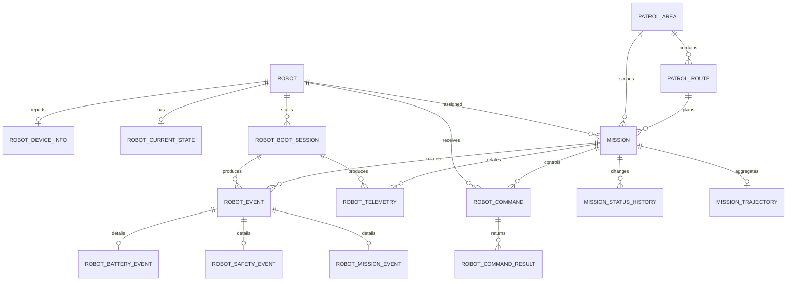

# 팀원 B DB 스키마 V1

> 문서 버전: V1  
> 작성 기준일: 2026-07-27  
> 담당: 팀원 B — 로봇 통신·임무·실시간 관제  
> 대상 DB: PostgreSQL 16 + PostGIS 3.5  
> MQTT 기준: `tbs/v2/robots/{robot_id}/...`, `schema_version = "2.0"`  
> Flyway 구현 예정 버전: `V5__create_robot_telemetry_schema.sql`

## 1. 문서 목적

이 문서는 팀원 B가 소유하는 로봇·텔레메트리·임무·명령 테이블의 V1 설계를
정의한다. 테이블 이름만 나열하지 않고 다음 구현 규칙까지 함께 고정한다.

- MQTT v2 Payload와 DB 칼럼의 원천 구분
- 로봇이 보고한 값과 서버가 관리·계산한 값의 분리
- 로봇 발급 `seq`와 서버 수신 시각의 처리
- 오래된 State·Telemetry가 최신 상태를 덮지 못하게 하는 규칙
- Flyway, DB Role, 최소 권한, Secret·감사 로그 정책
- 팀원 A·C 테이블과의 책임 경계

이 문서의 V1은 설계 문서 버전이다. 실제 Flyway의 V1과 혼동하지 않는다. 현재
프로젝트의 공통 Flyway V1~V4 다음에 팀원 B migration을 V5로 추가한다.

## 2. 적용 기준과 우선순위

충돌이 있을 때 다음 순서로 판단한다.

1. 현재 Java MQTT v2 DTO와 `final-mqtt-topic-schema-v2.md`
2. `database-migrations.md`와 기존 Flyway V1~V4
3. `authorization-matrix.md`, `audit-and-sensitive-data-policy.md`
4. `threat-model.md`, `environment-configuration-strategy.md`
5. `mqtt-device-db-mapping.md`와 `docs/길봄_DB_DDL.sql`

`mqtt-device-db-mapping.md`와 최종 DDL은 v1 Topic을 기준으로 작성된 부분이 있으므로
테이블 관계의 참고 자료로만 사용한다. Namespace, Payload 필드, enum, 명령 종류,
`schema_version`은 현재 구현된 MQTT v2 계약을 우선한다.

적용한 공통 규칙은 다음과 같다.

- DB 변경은 `backend/src/main/resources/db/migration`의 Flyway version migration만 사용한다.
- 적용된 `V*.sql`은 수정하지 않고 다음 version에서 `ALTER`한다.
- Hibernate `ddl-auto=none`, Spring Session 자동 DDL `never`,
  `flyway.clean-disabled=true`를 유지한다.
- 업무 시각은 `TIMESTAMPTZ`로 저장하고 DB·서버 표준 timezone은 UTC로 사용한다.
- Flyway owner와 Spring runtime 계정을 분리한다.
- Runtime 계정에는 테이블별 필요한 DML만 명시적으로 부여한다.
- MQTT 비밀번호, API Key, private key, 인증 헤더와 세션 값은 업무 테이블과
  `raw_payload`에 저장하지 않는다.
- 위치·이동 이력은 제한 데이터로 취급하고 로봇 객체 범위를 DB query 단계에서 적용한다.
- SQL, bind 값, constraint·table·column 이름은 외부 오류나 운영 로그에 노출하지 않는다.

## 3. 책임 경계

### 3.1 팀원 B가 생성·관리하는 Schema

```text
robot
telemetry
```

### 3.2 팀원 B 소유 테이블

| Schema | 테이블 | 역할 |
|---|---|---|
| `robot` | `robot` | 서버가 관리하는 로봇 등록 기준정보 |
| `robot` | `robot_device_info` | 로봇이 직접 보고한 장치정보의 최신값 |
| `robot` | `patrol_area` | 순찰 구역 Polygon |
| `robot` | `patrol_route` | 계획 경로 LineString |
| `robot` | `mission` | 임무 현재 상태와 진행 집계 |
| `robot` | `mission_status_history` | 임무 상태 전이 이력 |
| `robot` | `mission_trajectory` | 실제 순찰 궤적 read model |
| `robot` | `robot_command` | 서버가 생성한 명령과 발행·만료 상태 |
| `robot` | `robot_command_result` | 로봇 ACK와 최종 실행 결과 |
| `telemetry` | `robot_boot_session` | Presence와 부팅·연결 이력 |
| `telemetry` | `robot_telemetry` | Telemetry 측정 이력 |
| `telemetry` | `robot_current_state` | 실시간 관제용 최신 상태 |
| `telemetry` | `robot_event` | Event 공통 Envelope |
| `telemetry` | `robot_battery_event` | Battery Event 상세 |
| `telemetry` | `robot_safety_event` | Safety Event 상세 |
| `telemetry` | `robot_mission_event` | Mission Event 상세 |

### 3.3 다른 팀 소유 테이블

| 대상 | 소유자 | 팀원 B의 사용 방식 |
|---|---|---|
| `auth.admin_user` | A | 등록자·임무 생성자·명령 요청자 FK 참조 |
| `auth.user_robot_assignment` | A | 로봇별 조회·명령·임무 객체 범위 검사 |
| `request_control.idempotency_request` | A | 명령 REST 요청의 중복 생성 방지 |
| `audit.audit_log` | A | 명령·임무·로봇 변경 감사 행 INSERT |
| `defect.*` | C | Incident Event 공통 Envelope 이후 결함 처리 |
| `storage.*` | C/A | 이미지 object와 Incident 연결 |
| `report.*` | A | 임무 통계·보고서 근거 조회 |

팀원 B migration은 위 다른 팀 Schema에 새 테이블이나 칼럼을 만들지 않는다. 이미
생성된 PK를 FK로 참조하거나 서비스 트랜잭션에서 정해진 API·repository를 사용하는
것만 허용한다.

## 4. 핵심 설계 결정

### 4.1 로봇 등록과 로봇 보고정보를 분리한다

`robot.robot`은 서버가 신뢰하는 등록 기준정보다. MQTT 메시지를 처음 받았다는
이유만으로 미등록 로봇을 자동 생성하지 않는다. MVP에서는 별도 등록 화면 없이
운영 Seed 또는 제한된 프로비저닝 절차로 사전 등록한다.

`robot.robot_device_info`는 로봇이 직접 보고한 정보다. 로봇의 자기 보고값은 등록
권한을 부여하지 않으며 등록된 `robot_code`와 연결할 때만 저장한다.

### 4.2 펌웨어 버전은 저장하지 않는다

현재 `embedded`는 Jetson에서 실행되는 Python 애플리케이션이고 별도 MCU 펌웨어
프로젝트가 없다. 따라서 다음 칼럼은 만들지 않는다.

```text
firmware_version
```

MQTT `schema_version`과 AI `model.version`은 각각 Payload 계약과 AI 모델의
버전이므로 그대로 유지한다. 추후 실제 배포 버전 정책이 생기면
`software_version`을 새 계약과 새 Flyway version으로 추가한다.

### 4.3 MQTT username과 Client ID를 로봇 기준정보에 중복 저장하지 않는다

- 계약상 MQTT username은 `robot_code`와 동일하다.
- 현재 Backend 수신 객체에는 발행 로봇의 MQTT username과 Client ID가 없다.
- Mosquitto가 인증과 Topic ACL을 수행하며 Backend는 Topic의 `robot_id`와
  Payload의 `robot_id`를 교차 검증한다.
- 비밀번호와 private key 원문은 DB에 저장하지 않는다.

Credential Registry와 Mosquitto `passwd`·ACL의 동기화 프로비저닝은 별도 보안
작업이다. DB 행 하나를 추가하는 것만으로 Broker 계정이 생성된다고 가정하지 않는다.

### 4.4 `seq`는 로봇이 발급한다

`seq`는 서버 DB sequence가 아니다. 로봇이 새로운 `boot_id`를 만들 때 초기화하고
State·Telemetry·Event 전체에서 공유하는 증가 순번이다.

서버는 다음 원칙을 적용한다.

- 수신 순서대로 `seq + 1`을 새로 부여하지 않는다.
- `robot_boot_session.last_seen_seq`에는 수신한 최댓값만 기록한다.
- 업데이트는 `GREATEST(last_seen_seq, incoming_seq)`와 같은 원자적 연산을 사용한다.
- `message_id`, `event_id` 같은 자연 멱등 키를 중복 처리의 주 기준으로 사용한다.
- `seq` 역전과 누락은 진단 대상으로 기록하되 도착 순서만으로 실제 발생 순서를 바꾸지 않는다.

V1에서는 별도 전역 seq ledger를 만들지 않는다. Topic 전체의 모든 순번을 영구
감사해야 할 요구가 생기면 append-only ledger를 후속 version으로 추가한다.

### 4.5 로봇 시각과 서버 시각을 분리한다

| 의미 | 예시 |
|---|---|
| 로봇 발생 시각 | `sampled_at`, `updated_at`, `occurred_at`, `sent_at` |
| 서버 수신 시각 | `received_at`, `state_received_at`, `server_received_at` |

서로 다른 장치의 clock skew가 있으므로 DB CHECK로
`server_received_at >= robot_timestamp`를 강제하지 않는다. NTP 동기화와 허용 가능한
clock skew 검증은 애플리케이션 정책으로 처리한다.

### 4.6 원본과 서버 계산값을 구분한다

- `raw_payload`는 검증을 통과한 업무 JSON 원본이며 서버 보정값을 섞지 않는다.
- `overall_health_status`, 명령 Timeout, 임무 진행률은 서버 계산값이다.
- 배터리 추정값은 Payload의 `source=ESTIMATED`로 출처를 명시한다.
- 생성할 수 없는 센서 값은 임의 숫자 대신 `null` 또는 `valid=false`로 저장한다.

## 5. 관계 구조



Incident Event는 `telemetry.robot_event`까지만 B가 소유한다. Incident 상세,
결함 생성·병합, AI 관측과 이미지 연결은 C 테이블로 이어진다.

## 6. 식별자 규칙

| 외부 값 | DB 조회·저장 | 규칙 |
|---|---|---|
| Topic·Payload `robot_id` | `robot.robot.robot_code` 조회 후 내부 `robot_id` UUID | Topic과 Payload 값 일치 |
| Payload `mission_id` | `robot.mission.mission_code` 조회 후 내부 `mission_id` UUID | 대상 로봇에 배정된 임무만 허용 |
| `requested_by.actor_id` | `auth.admin_user.user_code` 조회 후 `user_id` UUID | 인증 세션의 행위자와 일치 |
| `boot_id` | Payload UUID 그대로 | 로봇 프로세스 시작마다 새 값 |
| `message_id` | Payload UUID 그대로 PK | Telemetry 멱등 키 |
| `event_id` | Payload UUID 그대로 PK | QoS 1 Event 멱등 키 |
| `command_id` | 서버 생성 UUID | REST 멱등 처리 후 MQTT와 결과 연결 |
| `result_id` | Payload UUID 그대로 PK | Command Result 멱등 키 |

코드형 Wire ID와 내부 UUID를 같은 값으로 취급하지 않는다.
