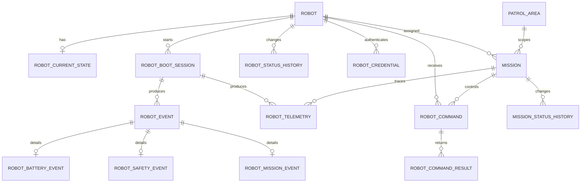

# 팀원 B DB 스키마 V2

> 문서 버전: V2  
> 작성 기준일: 2026-07-27  
> 담당: 팀원 B — 로봇 통신·임무·실시간 관제  
> 대상 DB: PostgreSQL 16 + PostGIS 3.5  
> MQTT 계약: `tbs/v2/robots/{robot_id}/...`, `schema_version = "2.0"`  
> Flyway 구현: 설계 확정 후 `V5__create_robot_telemetry_schema.sql`

## 1. 버전 구분

세 가지 버전은 서로 다른 의미다.

| 구분 | 현재 값 | 의미 |
|---|---|---|
| 설계 문서 | `V2` | 팀원 B DB 설계의 두 번째 검토안 |
| MQTT Schema | `2.0` | Topic과 Payload 계약 버전 |
| Flyway Migration | 다음 번호 `V5` | V1~V4 다음에 실제 DB를 생성할 migration |

이 문서가 검수되기 전에는 Flyway V5 SQL을 만들거나 DB에 적용하지 않는다.

## 2. V2에서 확정한 업무 흐름

### 2.1 로봇 등록

관리자 화면에서 로봇을 등록한다. Backend는 인증된 관리자 정보를 사용하여
`registered_by`를 기록하며, Frontend가 임의의 관리자 ID를 넘겨 결정하지 않는다.

등록정보는 다음과 같다.

- 로봇 코드
- 로봇 표시명
- Serial Number
- 운영 상태
- 등록 관리자와 등록 시각

`hardware_model`과 `firmware_version`은 저장하지 않는다.

### 2.2 순찰 방식

임무는 시작점과 도착점 또는 미리 정한 Waypoint를 따라가는 구조가 아니다.

1. 관리자가 지도에 중심점을 찍고 반경을 정하여 원형 순찰 구역을 만든다.
2. 관리자가 순찰 구역과 시간을 정하여 임무를 생성한다.
3. 서버가 `mission_id`, `zone_id`, 원형 Geofence 정보를 `START_MISSION` 명령으로 전달한다.
4. 임베디드는 원형 구역 안에서 인도를 따라 자율 주행한다.
5. 주행 중 점자블록을 탐지한다.
6. B는 위치·상태·명령·임무를 처리하고, 탐지 내용과 결함 처리는 C가 담당한다.

따라서 다음 구조를 만들지 않는다.

- 시작점과 도착점 컬럼
- Waypoint 테이블
- 계획 경로 `patrol_route`
- 계획 거리
- 임무 진행률
- 예상 완료시각

실제 이동 경로는 `robot_telemetry`의 유효한 GPS 위치를 시간순으로 조회한다.
구역 중심점은 주행 시작점이 아니라 Geofence 계산 기준점이다.

현재 MQTT v2의 `START_MISSION.parameters`에는 `mission_id`, `zone_id`만 있다.
임베디드가 원형 구역을 직접 제한하려면 계약과 Java DTO에 다음 구조를 추가해야 한다.

```json
{
  "mission_id": "MIS-20260727-001",
  "zone_id": "ZONE-001",
  "geofence": {
    "center_lat": 37.501,
    "center_lon": 127.039,
    "radius_m": 150.0
  }
}
```

이 변경은 DB 컬럼만 추가해서 해결되지 않으며 임베디드팀과 MQTT 계약을 함께
확정해야 한다.

## 3. 책임 경계와 테이블 목록

### 3.1 팀원 B Schema

```text
robot
telemetry
```

### 3.2 생성 대상 테이블

| Schema | 테이블 | 역할 |
|---|---|---|
| `robot` | `robot` | 관리자 화면에서 등록한 로봇 기준정보 |
| `robot` | `robot_credential` | MQTT Credential Hash와 발급·회전·폐기 상태 |
| `robot` | `patrol_area` | 로봇이 순찰할 운영 구역 |
| `robot` | `mission` | 순찰 임무의 현재 상태 |
| `robot` | `mission_status_history` | 임무 상태 전이 이력 |
| `robot` | `robot_status_history` | 연결 상태·운행 모드 변경 이력 |
| `robot` | `robot_command` | 서버가 생성하고 발행한 로봇 명령 |
| `robot` | `robot_command_result` | 로봇 ACK와 최종 명령 결과 |
| `telemetry` | `robot_boot_session` | 부팅 단위 연결 세션 |
| `telemetry` | `robot_telemetry` | GPS·배터리·온도 측정 이력 |
| `telemetry` | `robot_current_state` | 관제 화면용 최신 상태 |
| `telemetry` | `robot_event` | Battery·Safety·Mission Event 공통 정보 |
| `telemetry` | `robot_battery_event` | Battery Event 상세 |
| `telemetry` | `robot_safety_event` | Safety Event 상세 |
| `telemetry` | `robot_mission_event` | Mission Event 상세 |

### 3.3 생성하지 않는 테이블

| 테이블 | 제외 이유 |
|---|---|
| `robot_device_info` | Serial Number는 등록정보에 저장하며 별도 장치정보 Topic이 없음 |
| `patrol_route` | 임베디드가 고정 경로가 아니라 인도를 따라 주행 |
| `mission_trajectory` | GPS Telemetry와 중복 |
| `waypoint` | 시작점·도착점·Waypoint 방식이 아님 |

### 3.4 다른 팀 소유 데이터

| 대상 | 소유자 | 팀원 B의 사용 방식 |
|---|---|---|
| `auth.admin_user` | A | 등록자·임무 생성자·명령 요청자 FK |
| `auth.user_robot_assignment` | A | 로봇별 조회·명령 객체 범위 확인 |
| `request_control.idempotency_request` | A | 명령 REST 요청 중복 방지 |
| `audit.audit_log` | A | 로봇 등록·수정, 임무, 명령 감사 행 INSERT |
| Mosquitto `passwd`·운영 Secret 저장소 | A+B | B가 발급 흐름을 구현하고 A의 운영 보안 정책 적용 |
| Incident Event·`defect.*` | C | B가 MQTT 전달 경로를 제공하고 C가 저장·처리 |
| 이미지·`storage.*` | C/A | 점자블록 탐지 증거 이미지 관리 |

## 4. 공통 컬럼 설계 원칙

- 내부 PK·FK는 `UUID`를 사용한다.
- Wire의 `robot_id`는 `robot.robot.robot_code`이고 내부 UUID와 구분한다.
- Wire의 `mission_id`는 `robot.mission.mission_code`이고 내부 UUID와 구분한다.
- 모든 시각은 `TIMESTAMPTZ`로 저장하고 서버와 DB timezone은 UTC를 사용한다.
- 로봇 시각과 서버 수신 시각은 분리한다.
- Clock skew가 있으므로 로봇 시각과 서버 시각의 대소관계를 DB CHECK로 강제하지 않는다.
- Secret, MQTT 비밀번호, API Key, private key, 세션 값은 업무 테이블과 `raw_payload`에 저장하지 않는다.
- MQTT username은 `robot_code`와 같으므로 중복 컬럼으로 저장하지 않는다.
- 현재 Backend가 publisher Client ID를 받지 않으므로 `mqtt_client_id`를 저장하지 않는다.
- 상태값은 `VARCHAR`와 CHECK 제약조건으로 제한한다.
- 이력 테이블은 원칙적으로 append-only다.

## 5. `robot` Schema 컬럼

### 5.1 `robot.robot`

관리자 화면에서 등록하고 서버가 신뢰하는 로봇 기준정보다. 미등록 로봇이 MQTT
메시지를 보냈다는 이유만으로 자동 등록하지 않는다.

| 컬럼 | 타입 | 필수 | 출처 | 제약·용도 |
|---|---|---|---|---|
| `robot_id` | `UUID` | O | 서버 생성 | PK, 내부 FK 전용 |
| `robot_code` | `VARCHAR(128)` | O | 관리자 입력 | UNIQUE, Topic·Payload의 `robot_id` |
| `robot_name` | `VARCHAR(100)` | O | 관리자 입력 | 화면 표시명, 공백 문자열 금지 |
| `serial_number` | `VARCHAR(100)` | O | 관리자 입력 | UNIQUE, 물리 로봇 식별 |
| `operational_status` | `VARCHAR(20)` | O | 관리자·서버 | `ACTIVE`, `INACTIVE`, `MAINTENANCE`, `DISABLED` |
| `registered_by` | `UUID` | O | 인증 세션 | `auth.admin_user.user_id` FK |
| `registered_at` | `TIMESTAMPTZ` | O | 서버 | 등록 완료 시각 |
| `updated_at` | `TIMESTAMPTZ` | O | 서버 | 기준정보 최종 수정 시각 |

제외 컬럼:

```text
hardware_model
firmware_version
mqtt_username
mqtt_client_id
mqtt_password
```

로봇 삭제 API는 물리 삭제보다 `operational_status=DISABLED` 전환을 기본으로 한다.
등록·수정·비활성화는 같은 트랜잭션에서 `audit.audit_log`에 기록한다.

### 5.2 `robot.robot_credential`

MQTT 비밀번호 원문이 아니라 Credential의 식별자, Mosquitto 호환 Password Hash,
발급·활성·폐기 상태만 저장한다. `mqtt_username`은 `robot.robot_code`에서 가져온다.

| 컬럼 | 타입 | 필수 | 출처 | 제약·용도 |
|---|---|---|---|---|
| `credential_id` | `UUID` | O | 서버 생성 | PK, 감사 로그에 사용하는 Credential 식별자 |
| `robot_id` | `UUID` | O | 등록 로봇 | `robot.robot` FK |
| `credential_type` | `VARCHAR(30)` | O | 서버 | V2는 `MQTT_PASSWORD`만 허용 |
| `credential_version` | `INTEGER` | O | 서버 | 로봇·종류별 1부터 증가 |
| `secret_hash` | `TEXT` | O | Credential Provisioner | Mosquitto password-file 호환 Verifier, API 반환 금지 |
| `secret_fingerprint` | `CHAR(64)` | O | 서버 | 고엔트로피 원문의 SHA-256 식별값, 감사·중복 확인용 |
| `credential_status` | `VARCHAR(20)` | O | 상태머신 | `PENDING`, `ACTIVE`, `REVOKED`, `EXPIRED`, `FAILED` |
| `issued_by` | `UUID` | O | 인증 세션 | `auth.admin_user.user_id` FK |
| `issued_at` | `TIMESTAMPTZ` | O | 서버 | 발급 요청 시각 |
| `expires_at` | `TIMESTAMPTZ` | O | 서버 | 최대 180일 정책 |
| `activated_at` | `TIMESTAMPTZ` | X | Provisioner | Broker 반영 성공 시각 |
| `revoked_by` | `UUID` | X | 인증 세션 | 폐기 작업자 FK |
| `revoked_at` | `TIMESTAMPTZ` | X | 서버 | 폐기 시각 |
| `revocation_reason` | `VARCHAR(100)` | X | 관리자·서버 | 제한된 사유 코드 |
| `last_provision_error_code` | `VARCHAR(100)` | X | Provisioner | Secret·예외 원문이 아닌 제한 코드 |
| `created_at` | `TIMESTAMPTZ` | O | 서버 | 행 생성 시각 |
| `updated_at` | `TIMESTAMPTZ` | O | 서버 | 상태 변경 시각 |

제약조건:

- UNIQUE `(robot_id, credential_type, credential_version)`
- 로봇별 `ACTIVE` MQTT Password는 하나만 허용하는 Partial UNIQUE Index
- `expires_at > issued_at`
- `ACTIVE`이면 `activated_at` 필수
- `REVOKED`이면 `revoked_at`, `revoked_by` 필수
- `secret_hash`와 `secret_fingerprint`는 API·감사 로그·일반 애플리케이션 로그에 노출 금지

Password Hash도 인증에 악용될 수 있는 민감정보다. API 응답 DTO에는 해당 필드를
정의하지 않고, 일반 목록·상세 조회 쿼리에서도 선택하지 않는다.

### 5.3 `robot.patrol_area`

고정 경로가 아니라 로봇이 작업할 원형 운영 구역을 나타낸다. 중심점은
Geofence 계산용이며 시작점·도착점은 저장하지 않는다.

| 컬럼 | 타입 | 필수 | 출처 | 제약·용도 |
|---|---|---|---|---|
| `patrol_area_id` | `UUID` | O | 서버 생성 | PK |
| `zone_id` | `VARCHAR(50)` | O | 서버·관리자 | UNIQUE, MQTT `zone_id` |
| `area_name` | `VARCHAR(100)` | O | 관리자 | 화면 표시명 |
| `center_position` | `GEOGRAPHY(POINT,4326)` | O | 관리자 지도 입력 | 원형 Geofence 중심, GIST 인덱스 |
| `radius_m` | `NUMERIC(10,2)` | O | 관리자 입력 | 미터 단위, 0보다 커야 함 |
| `description` | `TEXT` | X | 관리자 | 구역 설명 |
| `is_active` | `BOOLEAN` | O | 관리자 | 과거 임무 보존을 위한 논리 비활성화 |
| `created_by` | `UUID` | O | 인증 세션 | `auth.admin_user.user_id` FK |
| `created_at` | `TIMESTAMPTZ` | O | 서버 | 생성 시각 |
| `updated_at` | `TIMESTAMPTZ` | O | 서버 | 수정 시각 |

현재 위치가 구역 안인지 다음 방식으로 판정한다.

```sql
ST_DWithin(
    telemetry_position::geography,
    center_position,
    radius_m
)
```

허용 가능한 최소·최대 반경은 실제 시연 장소와 안전 요구를 확인한 뒤 확정한다.

### 5.4 `robot.mission`

순찰 임무의 현재 상태를 보관한다. 경로 대비 진행률과 ETA는 저장하지 않는다.

| 컬럼 | 타입 | 필수 | 출처 | 제약·용도 |
|---|---|---|---|---|
| `mission_id` | `UUID` | O | 서버 생성 | PK |
| `mission_code` | `VARCHAR(50)` | O | 서버 생성 | UNIQUE, MQTT `mission_id` |
| `mission_name` | `VARCHAR(100)` | O | 관리자 | 화면 표시명 |
| `description` | `TEXT` | X | 관리자 | 임무 설명 |
| `robot_id` | `UUID` | O | 관리자 | 배정된 `robot.robot` FK |
| `patrol_area_id` | `UUID` | O | 관리자 | `robot.patrol_area` FK |
| `geofence_center` | `GEOGRAPHY(POINT,4326)` | O | Area 복사 | 임무 생성 시점의 중심점 Snapshot |
| `geofence_radius_m` | `NUMERIC(10,2)` | O | Area 복사 | 임무 생성 시점의 반경 Snapshot |
| `mission_status` | `VARCHAR(20)` | O | 상태머신 | `READY`, `RUNNING`, `PAUSED`, `COMPLETED`, `CANCELLED`, `FAILED` |
| `scheduled_start_at` | `TIMESTAMPTZ` | X | 관리자 | 예약 시작 시각 |
| `scheduled_end_at` | `TIMESTAMPTZ` | X | 관리자 | 예약 종료 시각 |
| `started_at` | `TIMESTAMPTZ` | X | Mission Event·서버 | 실제 시작 시각 |
| `ended_at` | `TIMESTAMPTZ` | X | Mission Event·서버 | 완료·취소·실패 시각 |
| `incident_count` | `INTEGER` | O | Mission Event | 로봇 보고 집계, 0 이상 |
| `normal_detection_count` | `INTEGER` | O | Mission Event | 로봇 보고 집계, 0 이상 |
| `completion_reason` | `VARCHAR(100)` | X | Mission Event·서버 | 종료 이유 |
| `created_by` | `UUID` | O | 인증 세션 | `auth.admin_user.user_id` FK |
| `created_at` | `TIMESTAMPTZ` | O | 서버 | 생성 시각 |
| `updated_at` | `TIMESTAMPTZ` | O | 서버 | 최종 수정 시각 |

`geofence_center`와 `geofence_radius_m`은 Area가 나중에 수정되더라도 이미 생성한
임무의 안전 경계가 바뀌지 않게 하는 Snapshot이다. `scheduled_end_at`이 존재하면
`scheduled_start_at`보다 빠를 수 없다. 로봇 시각과 서버 시각은 Clock skew가
있으므로 `ended_at`의 서버 수신 시각 비교는 애플리케이션에서 한다.

### 5.5 `robot.mission_status_history`

| 컬럼 | 타입 | 필수 | 출처 | 제약·용도 |
|---|---|---|---|---|
| `mission_status_history_id` | `UUID` | O | 서버 생성 | PK |
| `mission_id` | `UUID` | O | 서버 | `robot.mission` FK |
| `from_status` | `VARCHAR(20)` | X | 서버 | 최초 생성 이력은 `NULL` |
| `to_status` | `VARCHAR(20)` | O | 서버·Mission Event | 변경된 상태 |
| `transition_source` | `VARCHAR(20)` | O | 서버 | `ADMIN`, `ROBOT`, `SYSTEM` |
| `reason_code` | `VARCHAR(100)` | X | 명령·Event·서버 | 변경 이유 |
| `related_command_id` | `UUID` | X | 서버 | 원인이 된 명령 FK |
| `related_event_id` | `UUID` | X | MQTT | 원인이 된 Mission Event FK |
| `changed_by` | `UUID` | X | 인증 세션 | 관리자 변경일 때 Admin FK |
| `occurred_at` | `TIMESTAMPTZ` | X | Mission Event | 로봇 발생 시각 |
| `recorded_at` | `TIMESTAMPTZ` | O | 서버 | 서버 기록 시각 |

Runtime 계정에는 `SELECT`, `INSERT`만 부여하고 `UPDATE`, `DELETE`는 부여하지 않는다.

### 5.6 `robot.robot_status_history`

Presence와 State에서 연결 상태·운행 모드가 실제로 바뀔 때만 추가한다.

| 컬럼 | 타입 | 필수 | 출처 | 제약·용도 |
|---|---|---|---|---|
| `robot_status_history_id` | `UUID` | O | 서버 생성 | PK |
| `robot_id` | `UUID` | O | Topic 조회 | `robot.robot` FK |
| `boot_id` | `UUID` | X | Presence·State | Boot Session FK |
| `connectivity_status` | `VARCHAR(10)` | X | Presence·Timeout | `ONLINE`, `OFFLINE` |
| `robot_mode` | `VARCHAR(20)` | X | State | RobotMode |
| `reason_code` | `VARCHAR(50)` | X | Presence·State·서버 | 상태 변경 이유 |
| `mission_id` | `UUID` | X | State | 활성 Mission FK |
| `mission_status` | `VARCHAR(20)` | X | State | 현재 MissionState |
| `change_source` | `VARCHAR(20)` | O | 서버 | `PRESENCE`, `STATE`, `TIMEOUT`, `SYSTEM` |
| `observed_at` | `TIMESTAMPTZ` | X | 로봇 Payload | 로봇 상태 기준시각 |
| `received_at` | `TIMESTAMPTZ` | O | 서버 | 서버 상태 변경 확정 시각 |

`connectivity_status`, `robot_mode`, `mission_status` 중 적어도 하나가 있어야 한다.
이 테이블도 append-only다.

### 5.7 `robot.robot_command`

명령은 DB 저장과 감사 로그 기록 후 MQTT로 발행한다.

| 컬럼 | 타입 | 필수 | 출처 | 제약·용도 |
|---|---|---|---|---|
| `command_id` | `UUID` | O | 서버 생성 | PK, MQTT 명령 멱등 키 |
| `schema_version` | `VARCHAR(10)` | O | 서버 | 현재 `2.0` |
| `robot_id` | `UUID` | O | API 대상 | `robot.robot` FK |
| `mission_id` | `UUID` | X | START 명령 | `robot.mission` FK |
| `patrol_area_id` | `UUID` | X | START 명령 | `zone_id`를 결정하는 Area FK |
| `command_type` | `VARCHAR(30)` | O | 관리자·서버 | MQTT v2 CommandType |
| `command_status` | `VARCHAR(20)` | O | 상태머신 | `CREATED`, `SENT`, `ACCEPTED`, `COMPLETED`, `FAILED`, `REJECTED`, `EXPIRED`, `PUBLISH_FAILED` |
| `parameters` | `JSONB` | O | 서버 | 실제 발행한 Parameters, Secret 금지 |
| `requested_by_type` | `VARCHAR(10)` | O | 인증·서버 | `ADMIN`, `SYSTEM` |
| `requested_by_user_id` | `UUID` | X | 인증 세션 | ADMIN이면 Admin FK |
| `issued_at` | `TIMESTAMPTZ` | O | 서버 | 명령 생성 시각 |
| `expires_at` | `TIMESTAMPTZ` | O | 서버 | `issued_at`보다 늦어야 함 |
| `sent_at` | `TIMESTAMPTZ` | X | Publisher | 최초 발행 성공 시각 |
| `accepted_at` | `TIMESTAMPTZ` | X | 서버 | ACCEPTED 결과 수신 시각 |
| `completed_at` | `TIMESTAMPTZ` | X | 서버 | 최종 상태 확정 시각 |
| `publish_attempt_count` | `INTEGER` | O | 서버 | 0 이상 |
| `last_error_code` | `VARCHAR(100)` | X | 서버 | 제한된 오류 코드, 예외·SQL 원문 금지 |
| `created_at` | `TIMESTAMPTZ` | O | 서버 | 행 생성 시각 |
| `updated_at` | `TIMESTAMPTZ` | O | 서버 | 최종 상태 변경 시각 |

`Idempotency-Key` 원문은 `request_control.idempotency_request`가 담당하므로 중복 저장하지 않는다.

### 5.8 `robot.robot_command_result`

한 명령에 ACCEPTED와 최종 결과가 별도 메시지로 올 수 있다.

| 컬럼 | 타입 | 필수 | 출처 | 제약·용도 |
|---|---|---|---|---|
| `result_id` | `UUID` | O | MQTT Payload | PK, 결과 멱등 키 |
| `command_id` | `UUID` | O | MQTT Payload | `robot.robot_command` FK |
| `robot_id` | `UUID` | O | Topic·Payload | 명령 대상과 일치 |
| `schema_version` | `VARCHAR(10)` | O | MQTT Payload | 현재 `2.0` |
| `result_status` | `VARCHAR(20)` | O | MQTT Payload | `ACCEPTED`, `COMPLETED`, `FAILED`, `REJECTED`, `EXPIRED` |
| `robot_received_at` | `TIMESTAMPTZ` | O | Payload | 로봇의 명령 수신 시각 |
| `robot_completed_at` | `TIMESTAMPTZ` | X | Payload | ACCEPTED는 `NULL`, 최종 결과는 필수 |
| `reason_code` | `VARCHAR(100)` | O | Payload | 결과 이유 코드 |
| `resulting_mode` | `VARCHAR(20)` | O | Payload | 결과 시점 RobotMode |
| `resulting_reason_code` | `VARCHAR(50)` | O | Payload | 결과 시점 RobotStateReason |
| `server_received_at` | `TIMESTAMPTZ` | O | 서버 | 서버 수신 시각 |
| `raw_payload` | `JSONB` | O | 검증된 Payload | Secret 없는 업무 JSON |

## 6. `telemetry` Schema 컬럼

### 6.1 `telemetry.robot_boot_session`

| 컬럼 | 타입 | 필수 | 출처 | 제약·용도 |
|---|---|---|---|---|
| `boot_id` | `UUID` | O | Presence | PK |
| `robot_id` | `UUID` | O | Topic 조회 | `robot.robot` FK |
| `schema_version` | `VARCHAR(10)` | O | Presence | 현재 `2.0` |
| `session_status` | `VARCHAR(10)` | O | Presence·서버 | `ONLINE`, `OFFLINE` |
| `robot_connected_at` | `TIMESTAMPTZ` | X | ONLINE Presence | 로봇 연결 보고 시각 |
| `first_received_at` | `TIMESTAMPTZ` | O | 서버 | 해당 boot의 최초 수신 시각 |
| `last_received_at` | `TIMESTAMPTZ` | O | 서버 | 해당 boot의 최종 수신 시각 |
| `offline_received_at` | `TIMESTAMPTZ` | X | 서버 | OFFLINE 확정 시각 |
| `offline_reason` | `VARCHAR(50)` | X | Presence·Timeout | OfflineReason |
| `last_seen_seq` | `BIGINT` | X | State·Telemetry·Event | 수신한 최댓값, 0 이상 |
| `created_at` | `TIMESTAMPTZ` | O | 서버 | 생성 시각 |
| `updated_at` | `TIMESTAMPTZ` | O | 서버 | 수정 시각 |

`last_seen_seq`는 서버가 새 번호를 부여하는 컬럼이 아니다. 로봇이 생성한 `seq`의
최댓값만 `GREATEST` 방식으로 저장한다.

### 6.2 `telemetry.robot_telemetry`

주행 이력과 실제 궤적의 원본이다.

| 컬럼 | 타입 | 필수 | 출처 | 제약·용도 |
|---|---|---|---|---|
| `message_id` | `UUID` | O | MQTT Payload | PK, 멱등 키 |
| `schema_version` | `VARCHAR(10)` | O | Payload | 현재 `2.0` |
| `robot_id` | `UUID` | O | Topic 조회 | `robot.robot` FK |
| `boot_id` | `UUID` | O | Payload | Boot Session FK |
| `seq` | `BIGINT` | O | Payload | 0 이상, `(robot_id, boot_id, seq)` UNIQUE |
| `mission_id` | `UUID` | X | Payload 코드 조회 | 관련 Mission FK |
| `sampled_at` | `TIMESTAMPTZ` | O | Payload | 로봇 측정 시각 |
| `received_at` | `TIMESTAMPTZ` | O | 서버 | 서버 수신 시각 |
| `position_valid` | `BOOLEAN` | O | `position.valid` | 위치 유효 여부 |
| `position` | `GEOMETRY(POINT,4326)` | X | 위도·경도 | valid일 때 필수, GIST 인덱스 |
| `heading_deg` | `DOUBLE PRECISION` | X | Payload | 0 이상 360 미만 |
| `moving` | `BOOLEAN` | O | Payload | 이동 여부 |
| `speed_mps` | `DOUBLE PRECISION` | X | Payload | 0 이상 |
| `battery_valid` | `BOOLEAN` | O | Payload | 배터리 유효 여부 |
| `battery_percent` | `NUMERIC(5,2)` | X | Payload | valid일 때 0~100 |
| `battery_state` | `VARCHAR(20)` | O | Payload | BatteryState |
| `battery_source` | `VARCHAR(20)` | X | Payload | `MEASURED`, `ESTIMATED` |
| `battery_voltage_v` | `DOUBLE PRECISION` | X | Payload | 제공될 때 저장 |
| `battery_current_a` | `DOUBLE PRECISION` | X | Payload | 제공될 때 저장 |
| `charging` | `BOOLEAN` | X | Payload | 제공될 때 저장 |
| `battery_temperature_c` | `DOUBLE PRECISION` | X | Payload | 제공될 때 저장 |
| `estimated_runtime_sec` | `INTEGER` | X | Payload | 0 이상 |
| `jetson_temp_c` | `DOUBLE PRECISION` | X | Payload | 현재 v2의 시스템 온도 |
| `mission_state` | `VARCHAR(20)` | X | Payload | Mission 객체가 있을 때 |
| `mission_elapsed_sec` | `INTEGER` | X | Payload | 0 이상 |
| `mission_incident_count` | `INTEGER` | X | Payload | 0 이상 |
| `raw_payload` | `JSONB` | O | 검증된 Payload | Secret 없는 업무 JSON |

실제 순찰 궤적은 다음 조건으로 조회한다.

```text
mission_id 일치
AND position_valid = true
ORDER BY sampled_at, seq
```

### 6.3 `telemetry.robot_current_state`

로봇별 1행만 유지하는 실시간 관제 read model이다.

| 컬럼 | 타입 | 필수 | 출처 | 제약·용도 |
|---|---|---|---|---|
| `robot_id` | `UUID` | O | 등록 로봇 | PK이자 `robot.robot` FK |
| `current_boot_id` | `UUID` | X | MQTT | 현재 Boot Session FK |
| `connectivity_status` | `VARCHAR(10)` | O | Presence·Timeout | `ONLINE`, `OFFLINE` |
| `connection_changed_at` | `TIMESTAMPTZ` | X | 서버 | 연결 상태 변경 시각 |
| `last_received_at` | `TIMESTAMPTZ` | X | 서버 | 모든 로봇 메시지 중 마지막 수신 시각 |
| `last_seen_seq` | `BIGINT` | X | MQTT | 현재 boot의 수신 최댓값 |
| `state_schema_version` | `VARCHAR(10)` | X | State | 현재 `2.0` |
| `state_seq` | `BIGINT` | X | State | 오래된 State 덮어쓰기 방지 |
| `state_observed_at` | `TIMESTAMPTZ` | X | State | Payload `updated_at` |
| `state_received_at` | `TIMESTAMPTZ` | X | 서버 | State 수신 시각 |
| `robot_mode` | `VARCHAR(20)` | X | State | RobotMode |
| `state_reason_code` | `VARCHAR(50)` | X | State | RobotStateReason |
| `active_mission_id` | `UUID` | X | State·Telemetry | Mission FK |
| `mission_status` | `VARCHAR(20)` | X | State·Telemetry | 현재 MissionState |
| `battery_valid` | `BOOLEAN` | X | State·Telemetry | 배터리 유효 여부 |
| `battery_percent` | `NUMERIC(5,2)` | X | State·Telemetry | 0~100 |
| `battery_state` | `VARCHAR(20)` | X | State·Telemetry | BatteryState |
| `battery_source` | `VARCHAR(20)` | X | Telemetry | `MEASURED`, `ESTIMATED` |
| `battery_voltage_v` | `DOUBLE PRECISION` | X | Telemetry | 최신 값 |
| `battery_current_a` | `DOUBLE PRECISION` | X | Telemetry | 최신 값 |
| `charging` | `BOOLEAN` | X | Telemetry | 최신 값 |
| `battery_temperature_c` | `DOUBLE PRECISION` | X | Telemetry | 최신 값 |
| `estimated_runtime_sec` | `INTEGER` | X | Telemetry | 최신 값 |
| `battery_observed_at` | `TIMESTAMPTZ` | X | State·Telemetry | 최신 배터리 판정 시각 |
| `camera_health` | `VARCHAR(20)` | X | State | HealthStatus |
| `lidar_health` | `VARCHAR(20)` | X | State | HealthStatus |
| `gps_health` | `VARCHAR(20)` | X | State | HealthStatus |
| `battery_health` | `VARCHAR(20)` | X | State | HealthStatus |
| `motor_health` | `VARCHAR(20)` | X | State | HealthStatus |
| `storage_health` | `VARCHAR(20)` | X | State | HealthStatus |
| `telemetry_seq` | `BIGINT` | X | Telemetry | 오래된 Telemetry 덮어쓰기 방지 |
| `telemetry_sampled_at` | `TIMESTAMPTZ` | X | Telemetry | 최신 측정 시각 |
| `telemetry_received_at` | `TIMESTAMPTZ` | X | 서버 | 최신 Telemetry 수신 시각 |
| `position_valid` | `BOOLEAN` | X | Telemetry | 위치 유효 여부 |
| `position` | `GEOMETRY(POINT,4326)` | X | Telemetry | 최신 위치, GIST 인덱스 |
| `heading_deg` | `DOUBLE PRECISION` | X | Telemetry | 이동 방향 |
| `moving` | `BOOLEAN` | X | Telemetry | 이동 여부 |
| `speed_mps` | `DOUBLE PRECISION` | X | Telemetry | 현재 속도 |
| `jetson_temp_c` | `DOUBLE PRECISION` | X | Telemetry | Jetson 온도 |
| `overall_health_status` | `VARCHAR(20)` | O | 서버 계산 | `OK`, `WARNING`, `CRITICAL`, `UNKNOWN` |
| `updated_at` | `TIMESTAMPTZ` | O | 서버 | read model 최종 수정 시각 |

State와 Telemetry는 각자의 `seq`와 로봇 기준시각이 기존값보다 최신일 때만 관련
컬럼을 갱신한다. 이전 boot의 지연 메시지가 현재 상태를 덮어쓰지 못하게 한다.

### 6.4 `telemetry.robot_event`

B가 저장하는 Battery·Safety·Mission Event의 공통 Envelope다. Incident Event는
저장하지 않고 C의 처리 흐름으로 전달한다.

| 컬럼 | 타입 | 필수 | 출처 | 제약·용도 |
|---|---|---|---|---|
| `event_id` | `UUID` | O | MQTT Payload | PK, QoS 1 멱등 키 |
| `schema_version` | `VARCHAR(10)` | O | Payload | 현재 `2.0` |
| `event_category` | `VARCHAR(20)` | O | Topic | `BATTERY`, `SAFETY`, `MISSION` |
| `event_type` | `VARCHAR(50)` | O | Payload | 카테고리별 EventType |
| `robot_id` | `UUID` | O | Topic 조회 | `robot.robot` FK |
| `boot_id` | `UUID` | O | Payload | Boot Session FK |
| `seq` | `BIGINT` | O | Payload | 0 이상, `(robot_id, boot_id, seq)` UNIQUE |
| `mission_id` | `UUID` | X | Payload 코드 조회 | 관련 Mission FK |
| `source_component` | `VARCHAR(20)` | O | Payload | `power`, `safety`, `mission` |
| `occurred_at` | `TIMESTAMPTZ` | O | Payload | 로봇 발생 시각 |
| `sent_at` | `TIMESTAMPTZ` | O | Payload | 로봇 발행 시각 |
| `first_received_at` | `TIMESTAMPTZ` | O | 서버 | 최초 수신 시각 |
| `last_received_at` | `TIMESTAMPTZ` | O | 서버 | 재전송 포함 최종 수신 시각 |
| `receive_count` | `INTEGER` | O | 서버 | 최초 1, 중복 수신 때 증가 |
| `raw_payload` | `JSONB` | O | 검증된 Payload | Secret 없는 업무 JSON |

### 6.5 `telemetry.robot_battery_event`

| 컬럼 | 타입 | 필수 | 출처 | 제약·용도 |
|---|---|---|---|---|
| `event_id` | `UUID` | O | 공통 Event | PK이자 `robot_event` FK |
| `previous_state` | `VARCHAR(20)` | O | Payload | 이전 BatteryState |
| `battery_valid` | `BOOLEAN` | O | Payload | 배터리 유효 여부 |
| `battery_percent` | `NUMERIC(5,2)` | X | Payload | valid일 때 0~100 |
| `battery_state` | `VARCHAR(20)` | O | Payload | 현재 BatteryState |
| `threshold_percent` | `NUMERIC(5,2)` | X | Payload | 적용 임계치, 0~100 |
| `action_mission_state` | `VARCHAR(20)` | X | Payload | 조치 후 MissionState |
| `action_robot_mode` | `VARCHAR(20)` | O | Payload | 조치 후 RobotMode |

### 6.6 `telemetry.robot_safety_event`

| 컬럼 | 타입 | 필수 | 출처 | 제약·용도 |
|---|---|---|---|---|
| `event_id` | `UUID` | O | 공통 Event | PK이자 `robot_event` FK |
| `reason_code` | `VARCHAR(50)` | O | Payload | Safety ReasonCode |
| `distance_m` | `DOUBLE PRECISION` | X | Payload | 장애물 거리 등, 0 이상 |
| `mode_before` | `VARCHAR(20)` | O | Payload | 변경 전 RobotMode |
| `mode_after` | `VARCHAR(20)` | O | Payload | 변경 후 RobotMode |
| `auto_resume_allowed` | `BOOLEAN` | O | Payload | 자동 재개 허용 여부 |

### 6.7 `telemetry.robot_mission_event`

| 컬럼 | 타입 | 필수 | 출처 | 제약·용도 |
|---|---|---|---|---|
| `event_id` | `UUID` | O | 공통 Event | PK이자 `robot_event` FK |
| `duration_sec` | `INTEGER` | X | 최종 Event | 완료·취소·실패일 때 필수, 0 이상 |
| `incident_count` | `INTEGER` | X | 최종 Event | 0 이상 |
| `normal_detection_count` | `INTEGER` | X | 최종 Event | 0 이상 |
| `completion_reason` | `VARCHAR(100)` | X | 최종 Event | 종료 이유 |

Mission Event에서는 공통 `robot_event.mission_id`가 반드시 존재해야 한다.

## 7. 관계 구조



## 8. 주요 인덱스와 무결성

| 대상 | 인덱스·제약조건 | 목적 |
|---|---|---|
| `robot.robot` | UNIQUE `robot_code` | MQTT 로봇 식별 |
| `robot.robot` | UNIQUE `serial_number` | 물리 로봇 중복 등록 방지 |
| `robot_credential` | UNIQUE `(robot_id, credential_type, credential_version)` | 회전 이력 식별 |
| `robot_credential` | 로봇별 ACTIVE Credential Partial UNIQUE | 활성 비밀번호 중복 방지 |
| `robot_credential` | `(credential_status, expires_at)` | 만료·폐기 처리 |
| `patrol_area` | GIST `center_position` | 중심점 기반 주변 구역 조회 |
| `mission` | `(robot_id, mission_status, created_at DESC)` | 로봇별 임무 조회 |
| `mission` | `(patrol_area_id, scheduled_start_at)` | 구역별 일정 조회 |
| `mission_status_history` | `(mission_id, recorded_at)` | 상태 타임라인 |
| `robot_status_history` | `(robot_id, received_at DESC)` | 상태 타임라인 |
| `robot_command` | `(robot_id, command_status, issued_at DESC)` | 명령 조회·Timeout |
| `robot_command_result` | `(command_id, server_received_at)` | ACK·최종 결과 |
| `robot_boot_session` | `(robot_id, first_received_at DESC)` | 부팅 이력 |
| `robot_telemetry` | UNIQUE `(robot_id, boot_id, seq)` | Telemetry 중복 방지 |
| `robot_telemetry` | `(robot_id, sampled_at DESC)` | 시계열 조회 |
| `robot_telemetry` | `(mission_id, sampled_at, seq)` WHERE 위치 유효 | 실제 이동 궤적 |
| `robot_telemetry` | GIST `position` WHERE 위치 유효 | 공간 조회 |
| `robot_current_state` | GIST `position` WHERE 위치 유효 | 현재 지도 위치 |
| `robot_event` | UNIQUE `(robot_id, boot_id, seq)` | B 소유 Event 중복 방지 |
| `robot_event` | `(robot_id, occurred_at DESC)` | 이벤트 조회 |

State·Telemetry·Event가 공유하는 `seq`의 전체 Topic 간 유일성은 개별 테이블
UNIQUE만으로 완전히 보장되지 않는다. V2에서는 `last_seen_seq`와 애플리케이션
검증으로 역전·누락을 진단하고, 전체 메시지 ledger는 만들지 않는다.

## 9. 트랜잭션과 권한

다음 작업은 같은 트랜잭션으로 처리한다.

- 로봇 등록·수정 + `audit.audit_log`
- Credential 상태 변경 + `audit.audit_log`
- 임무 상태 변경 + `mission_status_history` + 필요 시 감사 로그
- 명령 생성 + 감사 로그
- Command Result INSERT + `robot_command` 상태 갱신
- Telemetry INSERT + 최신일 때 `robot_current_state` UPSERT
- Event Envelope INSERT + Event 상세 INSERT

Runtime DB Role 권한:

- `robot`, `telemetry` Schema에 `USAGE`
- 현재 상태·임무·명령처럼 변경되는 테이블에 필요한 `SELECT`, `INSERT`, `UPDATE`
- 이력 테이블에는 원칙적으로 `SELECT`, `INSERT`
- 업무 테이블에 포괄적인 `DELETE` 권한을 부여하지 않음
- DDL과 Schema 변경 권한을 부여하지 않음

## 10. MQTT Password 처리 정책

### 10.1 현재 구현 상태

현재 Mosquitto는 DB가 아니라 password-file 플러그인으로 로그인 정보를 검증한다.

- 로컬: `mqtt-init`이 환경변수의 비밀번호를 `mosquitto_passwd`로 해시하여
  `runtime/passwd` 파일을 만든다.
- 운영 TLS Profile: `passwd` 파일을 Mosquitto 컨테이너에 읽기 전용으로 마운트한다.
- Backend 컨테이너에는 `passwd` 파일 수정 권한이나 Docker 제어 권한이 없다.

따라서 `robot`과 `robot_credential` 행을 INSERT하는 것만으로 실제 MQTT 계정이
생성되지는 않는다.

### 10.2 발급 흐름

목표 발급 순서는 다음과 같다.

1. `ROBOT_REGISTER` 권한, CSRF, 요청 멱등성, 중요 작업 재인증을 확인한다.
2. Backend 또는 격리된 Credential Provisioner가 암호학적으로 안전한 난수
   32바이트 이상으로 비밀번호를 생성한다.
3. 원문을 Mosquitto 호환 Password Hash로 변환하고 별도 SHA-256 Fingerprint를 만든다.
4. `robot_credential`을 `PENDING` 상태로 저장한다.
5. 전용 Provisioner가 기존 `passwd` 전체를 보존하면서 새 사용자 또는 변경된
   Verifier를 임시 파일에 작성한다.
6. 파일 소유권과 권한을 `root:1883`, `0640`으로 제한하고 원자적으로 교체한다.
7. Mosquitto에 설정 Reload를 요청하고 반영 여부를 검증한다.
8. 성공하면 Credential을 `ACTIVE`로 바꾸고 감사 로그
   `ROBOT_CREDENTIAL_ISSUED`를 기록한다.
9. **이 단계에서만** 비밀번호 원문을 HTTPS 응답으로 한 번 표시한다.

원문 응답에는 `Cache-Control: no-store`를 적용한다. 원문은 DB, `raw_payload`,
애플리케이션 로그, 감사 로그, 분산 추적, Shell History, 프로세스 명령행에 넣지 않는다.
관리자가 발급 화면을 닫은 뒤에는 같은 값을 다시 조회할 수 없다.

Provisioner 반영이 실패하면 비밀번호를 화면에 표시하지 않고 Credential을 `FAILED`로
표시한다. 외부 파일 반영 성공 후 DB 갱신이 실패하면 Provisioner가 해당 Broker
계정을 제거하는 보상 작업을 수행하고, 주기적인 정합성 점검으로 고아 계정을 찾는다.

### 10.3 현재 구조에서의 제한

현재 저장소에는 Backend가 호출할 수 있는 전용 Credential Provisioner가 없다.
기존 `mqtt-init`은 Compose 시작 시 정해진 Backend 계정과 테스트 로봇 계정만 만들며
동적 등록용이 아니다.

따라서 Provisioner가 구현되기 전에는 다음 중 하나만 허용한다.

- 운영자가 제한된 서버 환경에서 `mosquitto_passwd`로 수동 발급하고 로봇에 주입
- 등록 화면의 Credential 기능을 비활성화하고 `PENDING` 상태로 안내

DB 등록 성공만으로 MQTT Credential 발급 성공 응답을 반환하면 안 된다.

### 10.4 로봇 전달과 보관

- 비밀번호는 등록·재발급 직후 관리자에게 한 번만 제공한다.
- 관리자는 로봇의 읽기 제한된 환경변수 또는 설정 Secret에 주입한다.
- 소스코드, Git, Docker Image, 일반 YAML, 메신저에 저장하거나 전달하지 않는다.
- MQTT 연결은 TLS `8883`만 사용한다.
- username은 `robot_code`와 같으며 ACL `%u`로 자기 로봇 Topic만 허용한다.
- 로봇의 비밀번호를 Backend 서비스 계정과 공유하지 않는다.

### 10.5 회전·만료·폐기

- 정기 만료는 발급 후 최대 180일이다.
- 로봇 교체·분실 또는 유출 의심 시 해당 로봇 Credential만 즉시 폐기한다.
- 재발급은 새 `credential_version`을 만들고 Broker 반영 성공 후 원문을 한 번 표시한다.
- 현재 username 고정 방식은 새 비밀번호 적용 즉시 이전 비밀번호가 무효가 되므로
  로봇 설정 변경과 재연결 시간을 정한 Cutover 절차가 필요하다.
- 폐기 시 `passwd`에서 사용자를 제거하고 Reload한 뒤 DB를 `REVOKED`로 변경한다.
- 이미 연결된 Client를 즉시 차단해야 하면 Broker에서 해당 Client 연결을 끊는
  운영 기능이 추가로 필요하다. Reload만으로 기존 연결 종료를 보장한다고 가정하지 않는다.
- 모든 발급·실패·재발급·폐기는 Credential ID와 작업자·시각·결과만 감사하며
  비밀번호와 Hash는 감사 데이터에 넣지 않는다.

## 11. 현재 MQTT v2로 구현할 수 없는 값

| 요구 후보 | 현재 상태 |
|---|---|
| CPU·GPU·모터 개별 온도 | Payload에 없으므로 저장하지 않음 |
| GPS 정확도 | Payload에 없으므로 저장하지 않음 |
| 원형 구역의 로봇측 강제 | 현재 START_MISSION에 중심·반경이 없어 MQTT 계약 변경 필요 |
| 고정 경로 대비 임무 진행률 | 고정 경로가 없어 계산·저장하지 않음 |
| 예상 완료시각 | 완료 거리 기준이 없어 계산·저장하지 않음 |
| 하드웨어 모델 | 등록정보와 Payload에서 제거 |
| 펌웨어 버전 | 등록정보와 Payload에서 제거 |

### 11.1 센서 사양 확정 전 처리 원칙

현재 임베디드 로봇의 실제 센서 상태와 제공 가능한 측정값이 확정되지 않았다.
따라서 MQTT 문서에 후보로 존재한다는 이유만으로 DB의 필수 컬럼으로 만들지 않는다.

| 구분 | 처리 |
|---|---|
| 메시지 식별정보 | `message_id`, `robot_id`, `boot_id`, `seq`, 측정·수신 시각은 필수 |
| 센서 장착 여부가 확실한 값 | Payload 계약 확정 후 타입·단위·범위 CHECK와 함께 컬럼화 |
| 일시적으로 읽지 못한 센서 | 임의의 `0` 대신 `valid=false` 또는 `NULL` |
| 아직 계약하지 않은 센서 | CPU·GPU·모터 온도, GPS 정확도 등은 컬럼을 미리 만들지 않음 |
| 단위가 확정되지 않은 값 | 이름과 단위를 확정하기 전 저장·계산하지 않음 |
| 추가 센서 원본 | 검증된 Payload의 `raw_payload`로 보존할 수 있으나 업무 계산에는 사용하지 않음 |

센서별로 다음 항목이 합의되어야 정식 컬럼으로 확정한다.

- JSON 필드명
- 자료형과 단위
- 정상 범위
- 측정 불가 표현 방식
- 발행 주기
- 센서 원본값인지 임베디드 계산값인지
- State와 Telemetry 중 어느 Topic에서 보내는지

V5 적용 전에 확정되면 V2 문서와 V5 초안에 반영한다. V5가 한 번이라도 적용된
뒤에 확정되면 기존 V5를 수정하지 않고 V6 이상의 새 migration으로 추가한다.

관제 화면에서는 진행률 대신 다음 정보를 표시한다.

- 임무 상태
- 실제 시작 후 경과시간
- 현재 위치와 실제 이동 궤적
- 탐지 건수
- 배터리·온도·통신 상태

## 12. V5 작성 전 검수 항목

- [ ] 로봇 등록 화면 입력값을 `robot_code`, `robot_name`, `serial_number`로 확정
- [ ] `registered_by`는 로그인 사용자를 Backend가 자동 설정
- [ ] 로봇 비활성화 상태와 재활성화 정책 확정
- [ ] 원형 구역의 최소·최대 `radius_m` 확정
- [ ] START_MISSION에 `geofence.center_lat`, `center_lon`, `radius_m` 추가
- [ ] Backend Command DTO와 임베디드 명령 Handler의 Geofence 검증 방식 확정
- [ ] 임무 예약 종료시각이 필수인지 선택인지 확인
- [ ] Telemetry·Event `raw_payload` 보존기간 확정
- [ ] MQTT v2의 `mission.elapsed_sec`를 관제 경과시간으로 사용할지 확인
- [ ] 임베디드 실기 확인 후 제공 가능한 센서명·단위·유효성 규칙 확정
- [ ] C가 Incident Event를 인수하는 트랜잭션·실패 재처리 방식 확정
- [ ] Credential Provisioner의 실행 주체와 Backend 호출 방식 확정
- [ ] 운영 `passwd` 파일의 원자적 교체·Reload·실패 보상 절차 구현
- [ ] 발급 원문 1회 응답에 `Cache-Control: no-store`와 로그 마스킹 적용
- [ ] Credential 만료 알림과 최대 180일 회전 일정 확정

위 항목을 검수한 뒤에만 실제 Flyway V5 SQL을 작성한다.
