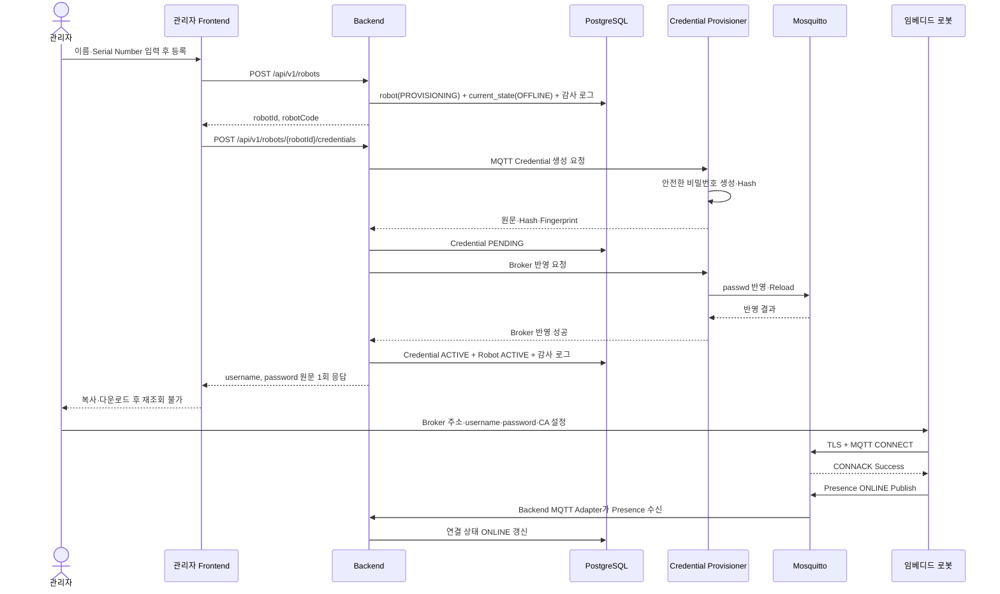

# 로봇 등록 및 MQTT Credential 발급

> 문서 버전: V2  
> 작성 기준일: 2026-07-27  
> 대상: 관리자 Frontend, Backend, Credential Provisioner, Mosquitto, 임베디드 로봇  
> MQTT 기준: TLS `8883`, username/password, 로봇별 Topic ACL  
> 관련 스키마: `robot.robot`, `robot.robot_credential`, `telemetry.robot_current_state`

로봇에 발급 결과를 설치하는 구체적인 절차는
[로봇 MQTT 환경변수 및 Credential 전달](<./로봇 MQTT 환경변수 및 Credential 전달.md>)을 따른다.

## 1. 목적

관리자가 로봇 등록 버튼을 누른 시점부터 실제 로봇이 MQTT Broker에 연결하여
Telemetry를 보내고 명령을 받기까지의 절차를 정의한다.

로봇 등록과 MQTT 연결은 같은 시점에 일어날 필요가 없다. 등록할 때 로봇이
켜져 있거나 외부 연결을 기다리고 있을 필요도 없다. 서버의 Mosquitto가 `8883`
포트에서 연결을 기다리고, Credential을 설정받은 로봇이 나중에 외부 방향으로
연결한다.

## 2. 대상별 책임

| 대상 | 책임 |
|---|---|
| 관리자 | 실제 로봇 확인, 등록정보 입력, 발급 Credential의 안전한 전달 |
| 관리자 Frontend | 등록·Credential API 호출, 비밀번호 원문 1회 표시 |
| Backend | 권한 확인, 로봇 코드 생성, DB 저장, 발급 흐름 조정, 감사 로그 |
| Credential Provisioner | 비밀번호 생성·Hash, Mosquitto `passwd` 반영·Reload |
| Mosquitto | CONNECT 인증, Topic ACL 적용, MQTT 메시지 중계 |
| 임베디드 로봇 | Credential 보관, Broker 연결, 자기 Topic 발행·구독 |
| Backend MQTT Adapter | 로봇 데이터 구독, 로봇 명령 발행 |

Backend와 로봇은 직접 TCP 연결하지 않는다. 두 대상은 각각 Mosquitto에 연결하고,
Broker가 메시지를 중계한다.

```text
로봇 ── Publish ──▶ Mosquitto ── Subscribe ──▶ Backend
로봇 ◀─ Subscribe ─ Mosquitto ◀── Publish ─── Backend
```

## 3. 등록 화면

### 3.1 관리자가 입력하는 값

| 입력값 | 필수 | 설명 |
|---|:---:|---|
| `robot_name` | O | 관제 화면에 표시할 로봇 이름 |
| `serial_number` | O | 실제 기체에 적힌 고유 Serial Number |

다음 값은 등록 화면에서 입력받지 않는다.

```text
registered_by
registered_at
operational_status
connectivity_status
mqtt_username
mqtt_password
mqtt_client_id
hardware_model
firmware_version
```

### 3.2 서버가 생성·결정하는 값

| 값 | 생성·결정 방식 |
|---|---|
| `robot_id` | 서버 UUID |
| `robot_code` | 서버가 `RBT-001`과 같은 공개 코드를 생성 |
| `mqtt_username` | 별도 DB 컬럼 없이 `robot_code` 사용 |
| `registered_by` | 로그인한 관리자 `user_id` |
| `registered_at` | 서버 현재시각 |
| `operational_status` | 최초 `PROVISIONING` |
| `connectivity_status` | 최초 `OFFLINE` |
| `mqtt_client_id` | 로봇 설정에서 `robot_code`와 동일하게 사용 |

`registered_by`를 Request Body로 받지 않는다. Frontend가 다른 관리자 ID를 보내
등록자를 위조하지 못하도록 Backend가 인증 세션에서 결정한다.

## 4. 상태 구분

로봇 운영 상태, Credential 상태, 연결 상태는 서로 다른 값이다.

| 구분 | 상태 예 | 의미 |
|---|---|---|
| 로봇 운영 상태 | `PROVISIONING`, `ACTIVE`, `MAINTENANCE`, `DISABLED` | 관리자가 로봇을 사용할 수 있게 승인한 상태 |
| Credential 상태 | `PENDING`, `ACTIVE`, `FAILED`, `EXPIRED`, `REVOKED` | MQTT 인증정보 수명주기 |
| 연결 상태 | `ONLINE`, `OFFLINE` | 현재 MQTT 연결 여부 |

예를 들어 정상적으로 등록되고 Credential도 발급됐지만 로봇 전원이 꺼져 있다면
다음 상태가 가능하다.

```text
operational_status = ACTIVE
credential_status = ACTIVE
connectivity_status = OFFLINE
```

## 5. 권장 등록 절차

### 5.1 전체 순서



### 5.2 로봇 등록 API

```http
POST /api/v1/robots
Content-Type: application/json
Idempotency-Key: <요청별 고유값>
```

Request 예:

```json
{
  "robotName": "점자블록 순찰 로봇 1호",
  "serialNumber": "SN-JETSON-0001"
}
```

Backend 처리:

1. 로그인, `ROBOT_REGISTER` 권한, CSRF, 요청 멱등성을 확인한다.
2. 이름과 Serial Number를 검증한다.
3. 중복 Serial Number 등록을 차단한다.
4. `robot_id`, `robot_code`를 생성한다.
5. `robot.robot`을 `PROVISIONING`으로 생성한다.
6. `robot_current_state`를 `OFFLINE`으로 생성한다.
7. 같은 DB 트랜잭션에 `ROBOT_REGISTERED` 감사 로그를 저장한다.

Response 예:

```json
{
  "robotId": "8750afcb-d682-4ef6-a90d-f63fcf5c214e",
  "robotCode": "RBT-001",
  "robotName": "점자블록 순찰 로봇 1호",
  "serialNumber": "SN-JETSON-0001",
  "operationalStatus": "PROVISIONING",
  "connectivityStatus": "OFFLINE"
}
```

이 응답에는 MQTT 비밀번호가 없다.

### 5.3 Credential 발급 API

```http
POST /api/v1/robots/{robotId}/credentials
Idempotency-Key: <요청별 고유값>
```

Backend와 Provisioner 처리:

1. `ROBOT_REGISTER` 권한, CSRF, 중요 작업 재인증, 요청 멱등성을 확인한다.
2. 대상 로봇이 등록되어 있고 `DISABLED`가 아닌지 확인한다.
3. 안전한 난수 32바이트 이상으로 비밀번호를 생성한다.
4. Mosquitto 호환 Password Hash와 Fingerprint를 만든다.
5. `robot_credential`을 `PENDING`으로 생성한다.
6. Provisioner가 기존 사용자 전체를 보존하면서 `passwd` 파일을 갱신한다.
7. 파일을 안전한 권한으로 원자적 교체하고 Mosquitto를 Reload한다.
8. 반영 성공 시 Credential을 `ACTIVE`로 변경한다.
9. 로봇 운영 상태를 `ACTIVE`로 변경한다.
10. 같은 DB 트랜잭션에 감사 로그 `ROBOT_CREDENTIAL_ISSUED`를 저장한다.
11. 마지막으로 원문 비밀번호를 한 번만 응답한다.

성공 Response 예:

```json
{
  "credentialId": "42ba8e8c-bb29-4f86-a53b-d17fa9321106",
  "credentialType": "MQTT_PASSWORD",
  "mqtt": {
    "brokerUri": "ssl://mqtt.example.com:8883",
    "username": "RBT-001",
    "password": "<이번 응답에서만 제공되는 원문>",
    "clientId": "RBT-001"
  },
  "expiresAt": "2027-01-23T04:00:00Z"
}
```

응답에는 다음 Header를 적용한다.

```http
Cache-Control: no-store
Pragma: no-cache
```

Frontend는 비밀번호를 `localStorage`, `sessionStorage`, Redux 영속 저장소, URL,
Analytics에 넣지 않는다. 화면을 닫으면 같은 원문을 다시 조회할 수 없다.

### 5.4 Credential 조회·폐기 API

```http
GET  /api/v1/robots/{robotId}/credentials
POST /api/v1/robots/{robotId}/credentials/{credentialId}/revoke
```

조회 API가 반환할 수 있는 값:

- Credential ID와 종류
- 상태
- 발급자와 발급시각
- 만료시각
- 폐기시각

조회 API가 반환하면 안 되는 값:

```text
password 원문
secret_hash
secret_fingerprint
Mosquitto passwd 행
```

## 6. 로봇에 Credential 등록

Credential 발급 후 임베디드팀이 다음 설정을 로봇에 입력한다.

```text
MQTT_BROKER=ssl://mqtt.example.com:8883
MQTT_USERNAME=RBT-001
MQTT_PASSWORD=<발급받은 비밀번호>
MQTT_CLIENT_ID=RBT-001
MQTT_CA_CERT=/secure/path/ca.pem
```

보관 규칙:

- Git, Docker Image, 일반 설정 예제에 실제 비밀번호를 넣지 않는다.
- Jetson의 전용 서비스 계정만 읽을 수 있는 Secret 파일을 사용한다.
- 파일 권한은 최소 `0600` 수준으로 제한한다.
- 애플리케이션 시작 로그에 username은 필요 시 마스킹하여 남길 수 있지만
  password는 절대 출력하지 않는다.
- 관리자와 임베디드팀 사이 전달은 승인된 보안 채널을 사용한다.

로봇에서 원문 비밀번호가 필요한 이유는 새 TCP 연결마다 MQTT CONNECT 인증을
수행해야 하기 때문이다. 사람이 매번 입력하는 것이 아니라 MQTT Client가 보호된
설정에서 읽어 자동으로 사용한다.

## 7. MQTT 연결

로봇이 먼저 Broker로 외부 연결을 만든다. 로봇은 외부에 MQTT 수신 포트를 열지 않는다.

```text
1. Robot → Broker: TCP 연결
2. Robot ↔ Broker: TLS Handshake 및 서버 인증서 검증
3. Robot → Broker: MQTT CONNECT(clientId, username, password)
4. Broker: passwd Hash 비교
5. Broker: username 기반 ACL 적용
6. Broker → Robot: CONNACK
7. Robot: 자기 commands/request Topic 구독
8. Robot: Presence ONLINE 발행
```

같은 TCP 연결이 유지되는 동안 PUBLISH·SUBSCRIBE·ACK·Keep Alive가 양방향으로
오간다. 비밀번호는 매 PUBLISH마다 보내지 않는다.

다음 상황에는 새 CONNECT와 인증이 필요하다.

- 로봇 재부팅
- LTE·Wi-Fi 단절
- TCP 오류
- Keep Alive Timeout
- Broker 재시작

## 8. Topic ACL

username은 `robot_code`와 같아야 한다. 로봇 `RBT-001`은 자기 Topic에만 접근한다.

허용:

```text
Publish   tbs/v2/robots/RBT-001/presence
Publish   tbs/v2/robots/RBT-001/state
Publish   tbs/v2/robots/RBT-001/telemetry
Publish   tbs/v2/robots/RBT-001/events/#
Publish   tbs/v2/robots/RBT-001/commands/result
Subscribe tbs/v2/robots/RBT-001/commands/request
Subscribe tbs/v2/robots/RBT-001/ingest/receipt
```

금지:

```text
tbs/v2/robots/다른로봇ID/#
자기 commands/request Publish
자기 ingest/receipt Publish
```

Backend MQTT Adapter는 로봇 비밀번호를 공유하지 않고 별도의 서비스 계정
`gilbom`과 별도 비밀번호를 사용한다.

## 9. 연결 성공 판정

Credential 발급 성공과 로봇 연결 성공은 다른 사건이다.

| 단계 | 판정 |
|---|---|
| Credential `ACTIVE` | Mosquitto 인증정보 반영 완료 |
| MQTT CONNACK 성공 | 로봇이 Broker 인증 성공 |
| Presence `ONLINE` 수신 | Backend가 해당 로봇의 온라인 상태 확인 |
| State·Telemetry 수신 | 실제 데이터 통신 확인 |

관리자 화면에서 최종 연결 완료는 Presence `ONLINE`을 받은 시점으로 표시한다.
Credential만 발급되고 Presence가 없으면 `연결 대기`로 표시한다.

## 10. 실패와 복구

| 상황 | 처리 |
|---|---|
| 중복 Serial Number | 등록 거부 |
| Mosquitto 반영 실패 | Credential `FAILED`, 원문 표시 금지 |
| 비밀번호 분실 | 기존 원문 조회 금지, 새 Credential 재발급 |
| 로봇 인증 실패 | 사용자에게 상세 Hash·Broker 정보를 숨기고 제한 오류 코드 반환 |
| Credential 발급 후 로봇 미연결 | `ACTIVE + OFFLINE`, 연결 대기 표시 |
| 로봇 분실·탈취 | Credential 폐기, 연결 강제 종료, 로봇 `DISABLED` |
| Credential 만료 | 최대 180일 이내 재발급·교체 |
| Broker 반영 후 DB 실패 | Broker 계정 제거 보상 작업과 정합성 점검 |

같은 username의 비밀번호를 교체하면 이전 비밀번호가 즉시 무효가 된다. 임베디드
설정 변경과 Broker 반영 순서를 정한 Cutover 절차가 필요하다.

## 11. 현재 프로젝트의 구현 상태

현재 Mosquitto는 password-file 방식이다.

- 로컬 `mqtt-init`은 환경변수의 Backend 계정과 테스트 로봇 계정만 생성한다.
- 운영 TLS Profile은 `passwd` 파일을 Broker에 읽기 전용으로 마운트한다.
- Backend가 호출할 수 있는 동적 Credential Provisioner는 아직 없다.

따라서 현재 단계에서 등록 화면이 할 수 있는 안전한 범위는 다음과 같다.

```text
로봇 DB 등록
→ operational_status=PROVISIONING
→ connectivity_status=OFFLINE
→ "MQTT Credential 발급 준비 중" 표시
```

Provisioner가 구현되기 전에는 Credential 발급 성공이나 비밀번호 원문을 임의로
표시하면 안 된다. 수동 `mosquitto_passwd` 작업을 사용한다면 제한된 운영자만
서버에서 대화형으로 수행하고, 비밀번호를 명령행 인자로 넣거나 Shell History에
남기지 않는다.

## 12. 구현 체크리스트

- [ ] `robot_code` 서버 생성 규칙과 동시성 제어
- [ ] 등록 화면 입력값을 이름·Serial Number로 제한
- [ ] `registered_by`를 인증 세션에서 자동 설정
- [ ] 로봇·현재 상태·감사 로그의 동일 트랜잭션 저장
- [ ] Credential Provisioner 실행 주체와 권한
- [ ] Mosquitto `passwd` 원자적 교체와 Reload
- [ ] Broker 반영 실패 보상 작업
- [ ] 비밀번호 원문 1회 응답과 `Cache-Control: no-store`
- [ ] Frontend Secret 비영속 처리
- [ ] 로봇 Secret 파일 권한과 로그 마스킹
- [ ] 로봇별 Topic ACL 검증
- [ ] Presence ONLINE까지 연결 대기 UI
- [ ] 최대 180일 회전과 즉시 폐기 절차
- [ ] 발급·실패·재발급·폐기 감사 로그
